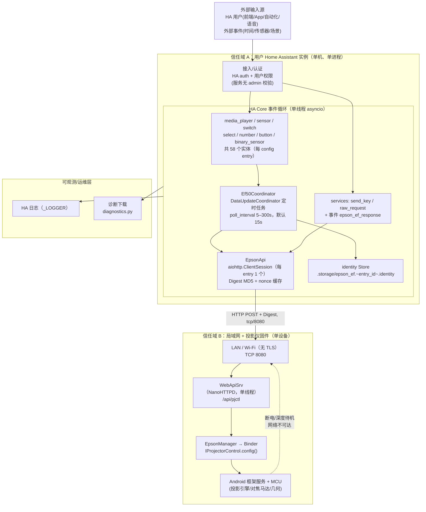
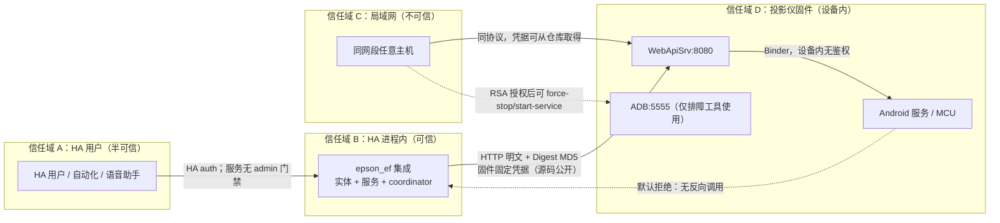

# 部署视图（物理部署与拓扑）

> 本项目的"部署"不是集群编排，而是**把一组 Python 文件放进用户 HA 配置目录**。运行时单元只有两个真正的物理实体：用户的 Home Assistant 进程，和局域网里的那台投影仪。下文所有资源约束、故障域、RTO/RPO 均按这两个实体展开，不套用云原生概念。

## 1. 全局部署拓扑

关键事实：

- 集成是**进程内模块**，不存在独立服务进程；HA 重启即集成重启（`custom_components/epson_ef/__init__.py:166-206`）。
- 通信端点是硬编码拼接的**明文 HTTP**：`self._url = f"http://{host}:{port}{API_PATH}"`（`custom_components/epson_ef/api.py:79`），`API_PATH = "/api/pjctl"`（`custom_components/epson_ef/const.py:14`）。
- 集成与设备是 **1 config entry : 1 设备 : 1 个 aiohttp session : 1 个 coordinator**，多台投影仪 = 多个 entry（`custom_components/epson_ef/__init__.py:195-201`，`custom_components/epson_ef/services.py:32-35`）。

## 2. 运行时单元与资源配置

### 2.1 单元划分与调度

| 单元名称 | 职责 | 实例数(min/max) | 资源约束 | 调度/扩缩策略 |
|-|-|-|-|-|
| HA Core 进程（含本集成） | 承载事件循环、实体状态机、配置条目 | 1 / 1（用户单实例） | 整机资源；本集成常驻内存仅为若干 dict + 1 个 session | 无水平扩展概念；HA 自带 restart/reload 即"重启策略" |
| `Ef50Coordinator` 定时任务 | 周期轮询电源态 + 每 12 轮刷慢速诊断 | 每 config entry 1 个 | 单轮最坏 ≈30+ 次串行 HTTP，每次默认 10s 超时；两次请求间 `asyncio.sleep(0.2)` 节流 | 由 `update_interval` 驱动（`poll_interval`，5–300s，默认 15s），无并发/无自适应退避（`custom_components/epson_ef/coordinator.py:28-33`、`:84-115`） |
| aiohttp `ClientSession` | Digest 认证 + JSON POST 传输 | 每 entry 1 个（懒创建） | 复用连接池；session 由 `_owns_session` 判定归属 | 不扩缩；entry 卸载时 `api.close()`（`custom_components/epson_ef/api.py:87-97`、`custom_components/epson_ef/__init__.py:213-221`） |
| 实体平台（7 个 platform） | 暴露 58 个实体 | 每 entry 58（固定，不动态增减） | 状态存于 coordinator 缓存，非独立进程 | 无（`custom_components/epson_ef/__init__.py:24-27`） |
| 投影仪 `WebApiSrv` | 解析 pjctl、转 Binder 调用 | 1 / 1（NanoHTTPD **单线程**） | 固件内线程，无排队深度控制；一次卡死即全端口不可用 | 无。仅能靠设备重启/ADB 重启服务恢复（`docs/architecture/architecture_views/process_view.md` §2） |
| Android `EpsonService` / MCU | 实际执行写入（灯、马达、几何） | 1 / 1 | 固件私有不透明；`control_mcu_transmitCommand` 内部超时 250–1500ms | 无（固件内部实现，无源码可查） |

实体数口径：media_player 1 + sensor 2 + binary_sensor 1 + button 30 + switch 11（6 可写 + 3 氛围灯 + 测试图案 + 自动对比度）+ select 6（1 启动模式 + 4 可写 + 1 氛围灯模式）+ number 7（亮度/刷新/对焦/氛围亮度 + RGB×3）= 58，与真机验收记录的实体总数一致（`button.py:17-84`、`switch.py:34-53`、`select.py:33-46`、`number.py:53-63`）。

### 2.2 部署制品与关键资源位置

| 制品/资源类型 | 位置 | 说明 |
|-|-|-|
| HACS 清单 | `hacs.json:1-5` | `homeassistant: 2024.4.0` 最低版本；`render_readme: true`；无 `zip_release`/`filename`（走仓库直装） |
| 集成清单 | `custom_components/epson_ef/manifest.json:1-19` | `domain=epson_ef`、`config_flow=true`、`iot_class=local_polling`、`version=0.0.2`、`requirements: []`（依赖 HA 自带 aiohttp） |
| 集成代码 | `custom_components/epson_ef/*.py`（14 个模块 / 3 055 行，`ls custom_components/epson_ef/*.py \| wc -l` 实测） | 全部逻辑；无第三方包、无二进制依赖 |
| 前端资源 | `custom_components/epson_ef/icon.png`、`logo*.png` | 仅 HACS/UI 展示 |
| 翻译 | `custom_components/epson_ef/strings.json`、`translations/{en,zh-Hans}.json` | 配置流与实体名称 |
| 服务定义 | `custom_components/epson_ef/services.yaml:1-31` | `send_key`、`raw_request` 字段描述 |
| **凭据（明文）** | `custom_components/epson_ef/const.py:15-19` | `DIGEST_USER`/`DIGEST_PASSWORD` 为源码常量，**不在任何密管系统** |
| 设备身份持久化 | HA `.storage/epson_ef.<entry_id>.identity`（运行时生成，不入库） | `Store(hass, 1, f"{DOMAIN}.{entry.entry_id}.identity")`，存 `serial` 或 `identity`（`custom_components/epson_ef/__init__.py:53-55`） |
| 配置条目 | HA `.storage/core.config_entries`（运行时生成） | `host`/`port`/`name`/`poll_interval`；**不含** Digest 凭据（`custom_components/epson_ef/__init__.py:168-187`） |
| CI 工作流 | `.github/workflows/{tests,hassfest,hacs}.yml` | lint(`ruff F,E9`) + `unittest` + hassfest 清单校验 + HACS 仓库结构校验；无 HA 版本矩阵、无真机 job |
| 运维脚本 | `tools/diagnose_state.py`、`tools/verify_full.py`、`tools/enum_map.json` | 不随 HACS 安装分发，只在仓库内；设备地址从命令行参数或 `EPSON_HOST` 读取，无默认值 |
| 网络策略 | 仓库内**不存在**（无 NetworkPolicy/防火墙即代码） | 仅有文字建议：不要暴露 8080 到公网、做 DHCP 静态绑定（见 `README.md` 安全节与已知限制节） |
| 日志/运行产物 | HA 侧日志；仓库 `logs/` 已被忽略 | `.gitignore:14-16` 忽略 `logs/` 与 `*.log` |

### 2.3 配置条目版本迁移（v1 ADB → v2 native）

| 维度 | 事实 | 证据 |
|-|-|-|
| 当前版本 | config flow `VERSION = 2` | `custom_components/epson_ef/config_flow.py:26` |
| 迁移入口 | HA 在 setup 前调用 `async_migrate_entry`；函数对 v1 直接原地改写 entry | `custom_components/epson_ef/__init__.py:31-39` |
| v1→v2 动作 | 强制写入 `port=8080`（忽略 v1 的任何端口），删除 `enable_camera` 键，`async_update_entry(version=2)` | `custom_components/epson_ef/__init__.py:33-37` |
| 迁移幂等性 | 只在 `entry.version == 1` 时执行，返回 `True`；重复调用不重复改写 | `custom_components/epson_ef/__init__.py:33-39` |
| 迁移不做的事 | 不迁移 ADB 时代遗留的实体 unique_id（由 identity 迁移另行处理）、不校验新端口可达性 | `__init__.py:31-39` 对比 `:42-120` |
| 回滚 | 无向下迁移；v1 语义（ADB:5555）在新版本代码中已无任何调用路径 | 生产代码无任何 ADB 调用 |

## 3. 隔离边界与访问控制

| 来源 | 目标 | 端口/接口 | 协议/机制 | 规则 |
|-|-|-|-|-|
| HA 用户（任意已登录用户） | 集成服务 `send_key` / `raw_request` | HA 服务总线 | HA auth + 用户策略 | **未使用 `require_admin`**，任何能调服务的用户都可发任意 pjctl 写命令（`custom_components/epson_ef/services.py:72-94`） |
| HA 自动化/语音 | 实体（turn_on/off、select、number） | 实体服务 | HA 实体权限 | 与上同属"调用即执行"，无二次确认 |
| HA 集成 | 投影仪 | TCP 8080 `/api/pjctl` | HTTP 明文 + Digest MD5(qop=auth) | 唯一鉴权是**固件内置、全平台共用、不可轮换**的常量凭据（`custom_components/epson_ef/api.py:119-145`、`const.py:15-19`） |
| 同网段任意主机 | 投影仪 | TCP 8080 | 同上 | 凭据在公开仓库中，等价于**无鉴权可达**；无 IP 白名单、无 TLS（`api.py:79`） |
| 同网段任意主机 | 投影仪 | TCP 5555 (ADB) | ADB RSA 授权 | 若设备开启了网络调试，该通道可执行任意命令，风险高于 8080；建议用后关闭 |
| 投影仪 | HA | 无 | 无推送/回调 | 只能由 HA 主动轮询；设备不反向连接（`manifest.json:15` `local_polling`） |
| HA 事件总线监听者 | `epson_ef_response` 事件 | HA 事件 | 订阅即得 | `raw_request` 把命令结果（含设备返回值）广播到事件总线，无权限过滤（`custom_components/epson_ef/services.py:67-70`） |

## 4. 入口路径与流量/事件调度

### 4.1 入口路由规则

| 入口标识 | 目标单元 | 中间处理（认证/限流/熔断/转换） | 说明 |
|-|-|-|-|
| `media_player.turn_on` / `turn_off` | `Ef50MediaPlayer` → `send_keyevent(26)` | `asyncio.Lock` 串行化 + 先探测再发（避免"盲 toggle"翻转两次） | 无幂等键；靠"先 probe 再决定"实现幂等（`custom_components/epson_ef/media_player.py:73`、`:178-199`） |
| 音量/静音/播放控制 | `Ef50MediaPlayer` → keyevent | 静音为乐观状态机（固件无读通路） | 物理遥控器操作后 UI 会漂移（`media_player.py:207-216`） |
| `epson_ef.send_key` 服务 | 对应 entry 的 `EpsonApi` | 按键名→keycode 映射；未知键抛 `HomeAssistantError` | 无 admin 门禁；`entity_id` 缺省取"第一个 entry"（`services.py:15-35`、`:43-54`） |
| `epson_ef.raw_request` 服务 | `EpsonApi.request(id, params)` | **无白名单、无参数校验、无 admin 门禁**；异常被吞成 `{"error": ...}` | 可发送任意 `CONFIG_SET_*`，包括"立即刷新并关机"等危险命令（`services.py:56-70`；`api.py:481-488` 警示 `SET_REFRESH "1"`） |
| coordinator 定时器 | `probe_state()` → 逐条 `get_raw` | 仅"每 12 轮一次"降频；无并发、无熔断、无跨轮退避 | 投影仪唤醒时慢速轮每轮 35 次串行 HTTP（probe_state 2 + 17 条诊断 + 6 开关 + 4 select + 亮度/刷新/对焦范围/对焦位置/产品名各 1 + 待机模式 1），多数间隔 0.2s；待机时降为 3 次（`coordinator.py:43-133`） |
| config flow（user/reconfigure/options） | 新建/改地址/改间隔 | 连接性校验：能取到 product name 才允许创建；IPv4 地址格式未做正则，仅要求 `str` | `port`/`host` 可配，`poll_interval` 限 5–300 且**不可配置**通信超时（`custom_components/epson_ef/config_flow.py:56-66`、`:92-105`、`:111-131`） |
| 诊断下载 | `diagnostics.py` | HA 侧限制为管理员可下载 | 导出 `entry.data/options`、`base_id`、coordinator 数据、host/port、`digest_nonce_cached` 布尔；**不含密码**（`custom_components/epson_ef/diagnostics.py:19-39`） |

### 4.2 边缘缓存/缓冲策略

系统**没有队列、没有离线缓冲、没有重放**。存在的"缓存"只有三处内存态，且都不具备回压能力：

| 资源/事件类型 | 缓存/缓冲策略 | 失效/回压策略 | 说明 |
|-|-|-|-|
| 轮询结果（电源态/诊断/设置值） | coordinator `self.data` 内存字典 | 无失效 TTL；慢速值"沿用上一轮"直到下次诊断轮 | 投影仪关机后灯时等值仍显示，用 `stale` 属性提示（`custom_components/epson_ef/coordinator.py:134-153`、`sensor.py:70-83`） |
| 不可读设备状态（氛围灯/自动对比度/测试图案/静音） | 乐观状态 + `RestoreEntity` 跨重启恢复 | 无校验，第三方（遥控器/机身菜单）修改即漂移 | 实体显式 `assumed_state = True` 告知用户（`switch.py:167-169`、`:228-230`、`:288-290`、`select.py:204-206`、`number.py:445-447`） |
| Digest 认证参数 | `_auth = (nonce, realm, qop)` + 递增 `nc` | 401 或网络异常时 `_clear_auth()` 重取一次 | 避免每条命令多一次 401 往返（`api.py:84-85`、`:99-117`、`:180-204`） |
| 写操作并发 | 仅电源类有 `asyncio.Lock` | 其它写操作（亮度/对焦/几何）无锁 | 并发连点可能产生交错的马达/几何命令（`media_player.py:73`；`number.py:282-301` 无锁） |

## 5. 环境矩阵

| 环境 | 用途 | 运行平台 | 存储 | 外部依赖 | 访问控制 |
|-|-|-|-|-|-|
| dev（本仓库开发机） | 改代码、跑静态检查与单测 | macOS/开发者主机；**不需要 HA**（测试用 stub 包 + `FakeResponse` 假 aiohttp） | 无（进程内） | Python 3.13、`aiohttp`、`ruff`、`pyflakes` | 开发者本机账号；`tests/test_api.py:15-40` 显式屏蔽 HA 导入 |
| dev（真机联调） | 验证命令与写通路 | 开发者主机 + **真实投影仪**（EF-50/HB71，`192.168.61.7:8080`）+ 可选 ADB:5555 | 无（终端输出由人工判读） | 同网段可达投影仪 | `EPSON_HOST` 环境变量或首参传入；工具无内建鉴权（`tools/README.md`） |
| CI（GitHub Actions） | 每次 push/PR 的 lint + 单测 | `ubuntu-latest` / Python 3.13 | 无 | `pip install aiohttp ruff pyflakes` | 仓库权限；**不接触任何真实设备**（`.github/workflows/tests.yml:9-24`） |
| 验收/prod（用户真机） | 实际使用 | NanoPi-R76S / HA 2026.9.3 / Docker / Python 3.14；部署方式＝整目录替换 + 重启 HA | HA `.storage`（config entry + identity）+ HA 历史库（不属于本集成） | 局域网内的投影仪；HA 自带 aiohttp | HA 用户体系；投影仪侧仅固件 Digest（凭据公开） |
| staging | — | **不存在** | — | — | — |

补充事实：`hacs.json:3` 声明最低 HA `2024.4.0`，而真机运行环境为较新的 HA 版本。仓库**没有**任何固件仿真器或协议 mock 服务端；唯一"仿真"是单测里的 `FakeResponse`/`AsyncMock`（`tests/test_api.py:41-60`），因此"未在真机验证过的行为"在 CI 中不可见。

## 6. 容灾与高可用设计

真实故障域按"HA 侧 / 网络侧 / 设备侧"三层列出；本项目**没有任何冗余实例**，所有 RTO 都等同于人工干预时间。

| 故障场景 | 影响范围 | 恢复机制 | RTO | RPO |
|-|-|-|-|-|
| HA 重启 / 集成 reload / 升级覆盖目录 | 全部 58 实体短暂 unavailable | HA 重新 `async_setup_entry`；身份从 `.storage` 的 identity 与实体注册表恢复；乐观状态由 `RestoreEntity` 恢复 | ≈ HA 启动耗时 + 首次 `async_config_entry_first_refresh`（单次探测 10s 内） | 乐观状态（静音/氛围灯/测试图案/自动对比度）可能回退到最后一次写入值；灯时等真实读数不丢 |
| 投影仪市电断电 / 深度待机断网 | 该 entry 全部实体 unavailable | coordinator 探测抛 `UpdateFailed` → 实体不可用；来电后下一轮自动恢复（`coordinator.py:42-45`） | 取决于人工开机（**无远程唤醒能力**，WOL 实测无效） | 不适用（设备侧状态由固件保存） |
| 投影仪 `WebApiSrv` 单线程挂起（NanoHTTPD） | 8080 全部请求超时；HA 侧表现为不可达 | **代码内无自愈**：只有 aiohttp 10s 超时把请求判死，服务端线程仍然卡住；恢复需物理重启设备或用 ADB `am force-stop` + `am start-service` 重启服务 | 人工重启设备（分钟级）或 ADB 解卡（需预先开启 5555） | 不适用；期间所有命令与新状态变更丢失 |
| 局域网 Wi-Fi 断连 / DHCP 续租失败 | 该 entry 全部实体 unavailable | 设备侧自行断网（`reason=3 DEAUTH_LEAVING`）；HA 只能持续轮询等待恢复 | 人工开机或等网络恢复 | 不适用 |
| DHCP 地址漂移（投影仪换 IP） | 连接失败，实体 unavailable（**身份不丢**） | 用"重新配置"改写 entry 的 host/port → 触发 reload；实体 unique_id 基于序列号，历史保留 | 用户操作时间（≈1 分钟） | 不适用 |
| HA `.storage` identity 文件丢失/损坏 | 可能退回 `host:port` 身份 | 下次启动重新读序列号并**自动迁移** unique_id（`__init__.py:58-76`、`:79-120`） | 一次 HA 重启 | 若序列号读不到（待机）则退化为 `host:port` 钉住 |
| 固件升级 / 换机型（非 HB7x） | 部分命令 FAIL，实体变 assumed/unavailable | 无版本探测、无兼容性降级；仅 `product name` 取回值做展示 | 不适用（需改代码） | 不适用 |
| 多台投影仪（多 entry） | 互不影响（各自 session/coordinator） | 独立 entry 生命周期；服务未指定 `entity_id` 时取"第一个 entry" | 同单台 | 同单台 |

**身份稳定性（DHCP 漂移时的核心保障）**：

1. 身份优先取**序列号**：`await api.get_serial_number()`（`CONFIG_GET_PJ_SNO` params=`"1"`）成功后写入 `Store` 并直接作为 `base_id`（`__init__.py:58-66`、`api.py:302-315`）。
2. 序列号取不到时，把**首次的 `host:port` 钉住**为 identity，之后的地址变更不再改变身份（`__init__.py:68-76`）。
3. 身份变更时批量迁移实体与设备注册表 unique_id（`__init__.py:79-120`），并清理旧身份下的历史孤儿实体（`__init__.py:123-163`）。
4. 反例/缺陷：**config entry 的 unique_id 仍是 `host:port`**（`config_flow.py:47-49`），与实体身份（序列号）不同源；因此"改 IP 后重新添加而不是用重新配置"会产生第二个 config entry，导致同序列号实体唯一 ID 冲突。

**投影仪挂起场景的防护现状（逐条核对代码）**：

- 已知风险在代码注释中被明确记录：`get_raw` 的 docstring 直接写"some [commands] hang the HTTP thread when the projector cannot answer — callers must apply a timeout"（`api.py:340-346`）；`GET_AUTO_FOCUS` 注释写"无参数查询会挂,带参不挂"（`coordinator.py:78-81`、`api.py:634-641`）。
- 现有防护只有**客户端侧超时**：默认 10s（`api.py:160`、`:186-189`），`CONFIG_GET_LIGHT_TIME` 用 5s（`api.py:255-257`）；`goto_focus` 用 `finally` 保证发 `OFF`（`api.py:573-582`）防止马达失控——这是唯一"主动收尾"式防护。
- **没有**：熔断器、连续失败计数、指数退避、健康探测 endpoint、跨轮降级、以及对"服务端已卡死"的识别（超时与"设备太慢"不可区分）。
- 集成代码**没有任何**针对该场景的自愈逻辑：既无熔断也无重试退避，只能靠用户重启投影仪恢复。`tools/diagnose_state.py` 可帮助定位是哪条命令触发了挂起。

---

## 7. 部署与运维风险候选（）

> 本节不属于模板标准节，仅作为"探索副产物"列出，便于维护者 去重合并。

| 候选 ID | 分类 | 风险 | 证据 | 建议缓解 |
|-|-|-|-|-|
| DEP-R1 | 安全 | 固件 Digest 凭据以明文常量入库，且无 TLS，任何拿到仓库的人可在同网段控制设备 | `const.py:15-19`、`api.py:79` | 已属"固件固定、不可轮换"的既成事实，只能靠网络隔离（VLAN/防火墙）+ 文档明示；不要把 8080 映射到公网 |
| DEP-R2 | 安全 | `raw_request` 服务无命令白名单、无 `require_admin`，任何 HA 用户/自动化可发任意 `CONFIG_SET_*`（含"立即刷新并关机"） | `services.py:56-94`、`api.py:481-488`、`README.md:111` | 加 `@require_admin`；对 `CONFIG_SET_REFRESH "1"` 等高危命令做参数级拒绝 |
| DEP-R3 | 可用性 | 投影仪 NanoHTTPD 单线程挂起后**无自愈**，超时只是客户端放弃，服务端仍卡死 | `api.py:340-346`、`coordinator.py:63-101`（无熔断/退避） | 连续 N 次超时后进入熔断降级（只保留低频存活探测），并在文档/UI 明示"需重启设备"；避免无参数引擎查询（已部分做到） |
| DEP-R4 | 稳定性 | 唤醒时单轮慢速诊断 35 次串行请求、无整车超时预算，10s×N 的最坏情况可远超 poll_interval，导致轮询积压/状态陈旧 | `coordinator.py:43-133`、`api.py:160` | 给整轮更新加 `asyncio.timeout` 总预算；失败即跳过本轮并退避 |
| DEP-R5 | 可用性 | 深度待机 + DHCP 续租失败会让设备**自愿断网**，HA 无法远程唤醒（硬件限制），表现为长期 unavailable | `README.md` 已知限制节 | 运维前置条件：DHCP 静态绑定 + 延长租约；文档已写但无代码可校验 |
| DEP-R6 | 运维 | 无 staging、CI 不跑 hassfest/HACS 校验、无真机 job；多个发布阻断缺陷只在真机验收暴露 | `.github/workflows/tests.yml:9-24` | 接入 `hassfest`/`hacs/action`，并把"开机态诊断轮询"纳入最小冒烟测试（当前 BLOCKER 正是待机时不执行该分支） |
| DEP-R7 | 技术债 | `_TIMEOUT` 常量定义但从未使用，超时时长散落在字面量 10.0/5.0 中；`switch.py`/`select.py`/`services.py` 用 `except Exception` 掩盖编程错误 | `api.py:37`（仅定义）、`api.py:160`、`api.py:256`、`switch.py:107`、`select.py:108`、`services.py:65` | 统一超时配置项；捕获范围收窄到 `EpsonApiError` 家族 |
| DEP-R8 | 技术债/身份 | config entry unique_id 用 `host:port`，与实体序列号身份不同源；改 IP 后"重新添加"会造出重复 entry 并使实体唯一 ID 冲突 | `config_flow.py:47-49` 对比 `__init__.py:58-76` | 创建时也用序列号做 unique_id，或对同一序列号做去重提示 |
