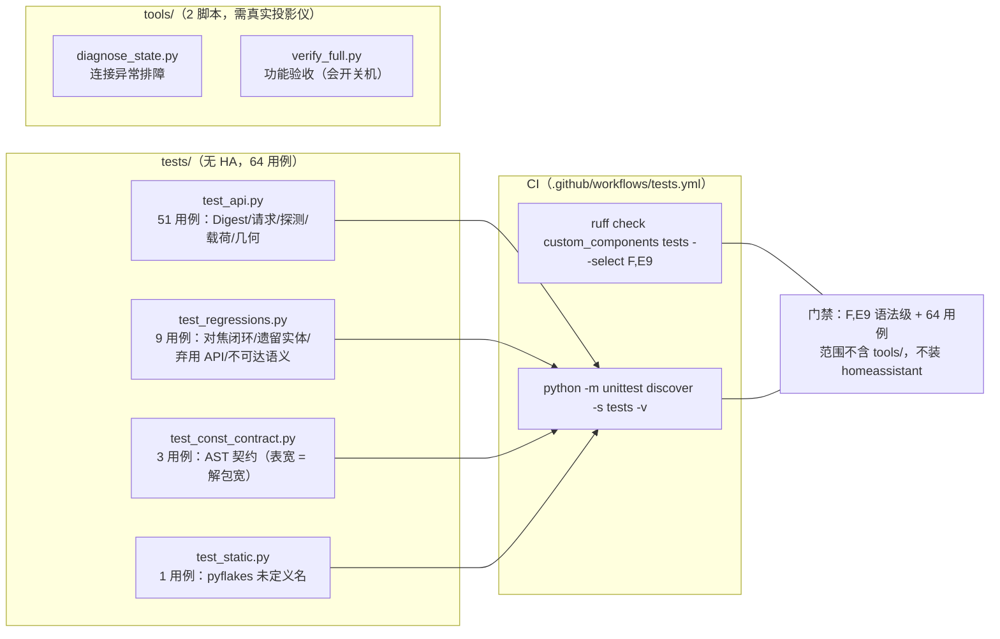

# 开发视图（源码结构与开发者视角）

> 适用范围：`custom_components/epson_ef/`（14 个 .py，共 3 055 行）为唯一运行物；`tools/`（2 个脚本 + 1 个枚举清单）为真机排障与验收脚本；`tests/`（4 个 .py，共 1 020 行）为离线单测；`docs/architecture/` 为代码知识库。
> 本视图与 logical_view §1 互补：本节只回答「谁构建出什么、源在哪、产物去哪、怎么验证」。

## 1. 源码仓库工程结构

```text
ha-epson-ef-projector/                 # 仓库根 = HA 自定义集成仓库（HACS 布局）
├── custom_components/epson_ef/        # ★ 唯一运行物（开发单元），整目录即"发布产物"
│   ├── __init__.py                    # 装配点：config entry 生命周期 / 迁移 / 遗留实体清理 (221 行)
│   ├── api.py                         # 传输层：pjctl HTTP + Digest，纯 aiohttp，不 import HA (656 行)
│   ├── coordinator.py                 # 状态聚合：快探测 + 慢诊断，DataUpdateCoordinator (154 行)
│   ├── const.py                       # 契约表：命令 ID / 可写设置表 / 对焦常量 / 键值 (222 行)
│   ├── <platform>.py × 7              # media_player/sensor/select/binary_sensor/button/switch/number
│   ├── config_flow.py                 # 用户/重配置/选项流程 (VERSION=2)
│   ├── services.py + services.yaml    # 自定义服务 send_key / raw_request
│   ├── diagnostics.py                 # 诊断下载（不泄密）
│   ├── manifest.json                  # ★ 发布契约：version/requirements/iot_class
│   ├── strings.json + translations/   # en / zh-Hans（三方 145 键完全对齐）
│   └── icon*.png / logo*.png          # HACS/HA 展示资产
├── tests/                             # 离线单测，不 import homeassistant（4 文件 / 64 用例）
├── tools/                             # 真机验证脚本，通过 importlib 直载 api.py
├── docs/                              # PROTOCOL / REVERSE_METHODOLOGY / AUDIT_COVERAGE / RELEASE_TEST_REPORT / FIRMWARE_AUDIT
├── .github/workflows/tests.yml        # 唯一 CI（ruff + unittest）
├── hacs.json                          # ★ HACS 安装契约：homeassistant 最低版本
├── README.md / LICENSE                # Apache-2.0
└── （无 pyproject.toml / setup.py / requirements*.txt / Makefile / tox.ini / .editorconfig / CONTRIBUTING）
```

| 构建产物 | 源码根 | 构建目标 | 对应运行时单元（deployment §2） |
|-|-|-|-|
| `epson_ef` 集成目录（无编译，源码即产物） | `custom_components/epson_ef/` | HACS 下载后落到 HA 的 `<config>/custom_components/epson_ef/`；手动方式为 `rsync` 整目录 | HA 进程内加载的自定义集成（`manifest.json:2` domain=`epson_ef`） |
| 验证脚本（非交付物） | `tools/` | 仓库内原地执行，无打包 | 开发者工作站侧临时进程 |
| 单测套件（非交付物） | `tests/` | 无 | 无（CI 内进程） |

**发布契约事实（manifest.json:13 行全文）**：`"version": "3.10.0"`；`"requirements": []`（`manifest.json:12`）；`"dependencies": []`（`manifest.json:8`）；`"iot_class": "local_polling"`（`manifest.json:10`）；`"config_flow": true`（`manifest.json:7`）。
**HACS 契约事实**：`"homeassistant": "2024.4.0"`（`hacs.json:3`）、`"render_readme": true`（`hacs.json:4`）。
**HACS 安装机制**：仓库根即 HACS 自定义存储库，用户在 HACS「自定义存储库」填仓库 URL、类别选 Integration，HACS 把 `custom_components/epson_ef/` 落到 HA 配置目录后重启（`README.md:121-125`）；备选为 `rsync` 手动覆盖并重启容器（`README.md:131-135`）。**仓库内不存在任何构建脚本参与该过程**。

> 事实补充（版本/发布形态）：`git for-each-ref` 仅返回 `refs/heads/main`，`git tag --list` 为空，`git remote -v` 为空，历史仅 3 个提交（`e4e4f25` → `dcafba5` → `52928ed`）。因此版本号唯一载体是 `custom_components/epson_ef/manifest.json:13`，代码内无第二处版本常量（全仓 `3.10.0` 仅出现在 manifest 与测试注释中）。

## 2. 构建与依赖工具链

### 2.1 构建命令

| 动作 | 命令 | 说明 |
|-|-|-|
| 构建 | **不存在**（无 setup.py/pyproject.toml/Makefile，`ls` 全部 No such file） | Python 源码直接分发；"构建"等价于把目录拷进 HA |
| 部署（开发） | `rsync -av custom_components/epson_ef/ <user>@<ha主机>:<配置目录>/custom_components/epson_ef/` 后重启 HA（`README.md:131-135`） | 冒烟验证必须在真机/HA 实例 |
| 部署（用户） | HACS 自定义存储库安装（`README.md:121-125`） | 最低 HA 2024.4.0（`hacs.json:3`、`README.md:129`） |
| 测试 | `python3 -m pytest tests/ -q` → **64 passed，rc=0**（实测）；或 `python3 -m unittest discover -s tests -v` → **Ran 64 tests，OK，rc=0**（实测，与 CI 同款） | 二者等价，见 §3 |
| 测试（单文件直跑） | `python3 tests/test_api.py` → **Ran 42 tests**；`python3 tests/test_regressions.py` → **Ran 7 tests**（实测） | 两个文件的 `unittest.main()` 都不在文件末尾（`tests/test_api.py:507`、`tests/test_regressions.py:183`），其后定义的 4 个类（11 个用例）不会执行；**必须用 discover/pytest** |
| 静态检查（CI 同款） | `ruff check custom_components tests --select F,E9` → **All checks passed!，rc=0**（实测） | 范围不含 `tools/`，规则仅 pyflakes 类 |
| 静态检查（仓库全量，默认规则） | `ruff check .` → **All checks passed!**（实测） | 与 CI 同款命令结果一致 |
| 名字级静态检查（测试内嵌） | `python3 -m unittest tests.test_static -v`（依赖 `pyflakes`） | 只扫 `custom_components/epson_ef/*.py`，仅判 `undefined name` / `redefinition`（`tests/test_static.py:33-37`） |
| 产物校验 | 不适用 —— 无产物可校验 | 等价物是 HA 内 reload 后实体可用性，属人工/真机验证 |

### 2.2 依赖与版本管理

| 依赖层面 | 管理机制 | 版本锁定 | 备注 |
|-|-|-|-|
| Python 运行时依赖 | **无清单**：`manifest.json:12` `requirements: []`、`:8` `dependencies: []`；仓库根无 requirements/pyproject/setup.py | 无锁 | 含义：集成不自带第三方包，全部依赖 HA 运行时已装的库 |
| 第三方 import 实测面 | 生产代码仅两处：`import aiohttp`（`api.py:14`）、`import voluptuous as vol`（`config_flow.py:6`、`services.py:6`） | 跟随 HA | aiohttp 与 voluptuous 都是 HA core 自带依赖，故 `requirements: []` 自洽 |
| 其余 import | 全为 stdlib：`asyncio/hashlib/logging/random/re`（`api.py:7-11`）、`datetime`（`coordinator.py:6`）、`typing`（各平台） | — | 证明"只依赖 HA 提供的包"成立 |
| HA 侧 API 依赖 | `homeassistant.*` 仅在非 api 模块出现（`coordinator.py:9-11`、`__init__.py:6-11`），`api.py` 显式保持零 HA import（`api.py:1-3` 文档字符串声明 "no Home Assistant imports so it can be tested standalone"） | 由 `hacs.json:3` 的 2024.4.0 约束 | 注：2024.4.0 为声明值，CI 与本地测试均未覆盖该下界 |
| Python 版本 | 无 `python_requires`；CI 固定 `python-version: "3.13"`（`.github/workflows/tests.yml:15`）；本地实测 `Python 3.13.13`；真机 HA 运行 `Python 3.14`（真机运行 Python 3.14） | CI 锁 3.13 | 三处版本不一致，无单一权威声明 |
| 测试期依赖 | CI `pip install aiohttp ruff pyflakes`（`.github/workflows/tests.yml:18`）；**不装 homeassistant** | 不锁版本 | 故 CI 只覆盖"不 import HA 的代码" |
| 工具链版本痕迹 | `.ruff_cache/0.15.15/` 目录存在（含 5 个缓存条目）→ 本地用 ruff 0.15.15 跑过；本机 `ruff --version` = 0.15.15 | 无配置锁定 | 仓库无 ruff 配置文件，规则全靠命令行 `--select` |

### 2.3 规范与静态检查（本仓库实况）

| 规范项 | 事实 | 证据 |
|-|-|-|
| ruff 配置文件 | **不存在**。全仓 `find` 无 `ruff.toml`/`.ruff.toml`/`pyproject.toml`/`setup.cfg`/`tox.ini`/`.flake8`/`mypy.ini`/`.pre-commit-config.yaml` | `ls setup.py pyproject.toml ...` 全部 No such file；`find -name "*.toml"` 无结果 |
| ruff 是否跑过 | 跑过：`.ruff_cache/0.15.15/` 有 5 个缓存文件（`.ruff_cache/0.15.15/2938140942634140503` 等） | `.ruff_cache/0.15.15/`（git 已忽略，`.gitignore:10`） |
| CI 是否装/跑 ruff | 是，且**只用命令行 `--select F,E9`**，不读配置文件 | `.github/workflows/tests.yml:18,21` |
| 检查范围 | CI 只查 `custom_components tests`；**`tools/` 被排除** | `.github/workflows/tests.yml:21` |
| pyflakes | CI 装上并再由 `tests/test_static.py` 二次调用；不可用时 skip | `.github/workflows/tests.yml:18`、`tests/test_static.py:14-17` |
| `.editorconfig` | **不存在** | `ls .editorconfig` → No such file |
| `CONTRIBUTING.md` | **不存在**（协作规范仅隐含在 `README.md`；） | `ls CONTRIBUTING.md` → No such file |
| 类型注解覆盖 | 生产代码 **165/166 个函数有返回注解 = 99.4%**（AST 统计，`AnnAssign`/`FunctionDef.returns`）；唯一缺项是 `services.py:15` 的 `_resolve_api` | 本次 `ast` 实测：files 14 / funcs 166 / annotated 165 |
| 类型检查器 | **无**（无 mypy/pyright 配置与 CI 步骤），注解不参与门禁 | `.github/workflows/tests.yml:17-24` 仅 4 个 step |
| 风格约定（代码内观察到的事实） | 统一 `from __future__ import annotations`（14/14 文件首部）、模块/类级中文 docstring、`_LOGGER` 每模块一个、常量集中在 `const.py`、实体类统一 `Ef50*` 前缀 | `api.py:2`、`number.py:2-38`、`switch.py:25`、`const.py` 整体 |
| 门禁宽严 | 门禁只拦「语法级/未定义名」错误（F,E9），不拦风格、不拦未使用导入、不拦复杂度 | `.github/workflows/tests.yml:21`；`ruff check .` 与 CI 同款命令结果一致 |

## 3. 测试策略与布局



| 测试层 | 位置 | 跑法（命令/触发） | 覆盖目标 |
|-|-|-|-|
| 单元（传输/协议编解码） | `tests/test_api.py`（613 行，51 用例） | `python3 -m pytest tests/ -q` 或 unittest discover；CI 每次 push/PR | Digest 头构造（`tests/test_api.py:100-118`）、401 challenge/缓存（`:120-163`）、`probe_state` 电源态判定（`:165-216`）、命令载荷 size/token 语义（`:218-280`）、待机模式映射（`:282-297`）、第四~六轮命令载荷（`:299-505`）、FocusAbsolute（`:511-567`）、读辅助（`:569-593`）、`wait_for_state`（`:595-613`） |
| 回归（真机缺陷固化） | `tests/test_regressions.py`（219 行，9 用例） | 同上 | 对焦闭环三性质（`tests/test_regressions.py:38`）、遗留实体清理表（`:96`）、`async_get_entity_id` 实参顺序（`:141`）、coordinator 确实遍历两张可写表（`:173`）、不可达必须有 `EpsonApiUnavailable` 语义（`:186`） |
| 契约（AST 而非 import） | `tests/test_const_contract.py`（146 行，3 用例） | 同上；`TABLE_SOURCES` 定义在 `tests/test_const_contract.py:27` | 表非空/等宽（`tests/test_const_contract.py:92`）、每个解包点宽度 == 表宽（`:111`）、已知消费者位置不得漂移（`:127`） |
| 静态（名字级） | `tests/test_static.py`（42 行，1 用例） | 同上；**无 pyflakes 时 `skipTest`**（`tests/test_static.py:14-17`） | 只查 `undefined name`/`redefinition`，范围仅 `custom_components/epson_ef`（`tests/test_static.py:19-38`） |
| 真机验证（非单测） | `tools/`（2 脚本） | `python tools/<name>.py <投影仪IP>` 或 `export EPSON_HOST=...`（`tools/README.md`） | 连接异常排障（`diagnose_state.py`）、功能与深待机唤醒验收（`verify_full.py`）；脚本通过 `importlib` 直载 `custom_components/epson_ef/api.py`（如 `tools/diagnose_state.py:11-21`） |
| E2E / 集成（含 HA 运行时） | **不存在** | 无 | 无 HA 测试夹具、无 `pytest-homeassistant-custom-component`、无 `conftest.py`；实体装配、coordinator 与 HA 生命周期从未被自动化执行 |

**实测记录（本次在 base_commit 上真实执行）**：

| 命令 | 真实输出 | 退出码 | 影响判定 |
|-|-|-|-|
| `python3 -m pytest tests/ -q` | `64 passed in 0.20s` | 0 | 可通过；但 `pytest` 未声明为依赖（无 requirements/CI 未装），本地能跑属环境自带 |
| `python3 -m unittest discover -s tests -v` | `Ran 64 tests in 0.171s / OK` | 0 | 与 CI 一致，-green |
| `python3 -m unittest tests.test_static -v` | `Ran 1 test / OK`（本机已装 pyflakes 4.1.0） | 0 | 若 CI/本地未装 pyflakes，此用例静默 skip 而非失败 |
| `python3 tests/test_api.py` | `Ran 42 tests / OK` | 0 | 少跑 22 个用例：`main()` 位于 `tests/test_api.py:507`，其后 3 个类不执行 |
| `python3 tests/test_regressions.py` | `Ran 7 tests / OK` | 0 | 少跑 2 个用例：`main()` 位于 `tests/test_regressions.py:183`，其后 `UnreachableProjectorTests` 不执行 |
| `ruff check custom_components tests --select F,E9` | `All checks passed!` | 0 | CI 门禁范围不含 `tools/` |

**测试与生产代码的隔离手法（可复用模式）**：4 个测试文件都不 import `homeassistant`——`tests/test_api.py:23-26` 手工注入 `types.ModuleType("epson_ef")` 伪包并把 `__path__` 指向源码目录，从而绕过会拉入 HA 的 `__init__.py`；`tests/test_const_contract.py:21-24` 与 `tests/test_regressions.py:24-27` 复用同一手法；契约类测试改用 `ast.parse` 读源码（`tests/test_const_contract.py:36`）。

## 4. 开发者入手路径

**最短路径原则**：仓库无构建步骤，改完文件同步到 HA 目录并重启即可见效；验证靠 `pytest` + 真机 `tools/` 脚本。

| 步骤 | 做什么 | 关键文件/命令 |
|-|-|-|
| 1. 定位装配入口 | 看 config entry 如何组装平台与共享对象 | `custom_components/epson_ef/__init__.py:166` `async_setup_entry`；平台清单 `__init__.py:24-27`；转发 `__init__.py:203` |
| 2. 找到实体清单 | 每个平台在 `async_setup_entry` 里显式枚举实体类 | `number.py:47-63`、`switch.py:28-53`、`select.py:27-45`、`button.py:86-98` |
| 3. 理解数据从哪来 | coordinator 每轮产出 `state/light_hours/diag/settings` 四类键 | `coordinator.py:37-59`（快探测 + 每 12 轮慢诊断，`const.py:222`） |
| 4. 追到协议层 | 具体命令 ID、params 语义、size=token 数 | `api.py:147` `request`、`api.py:340` `get_raw`、`api.py:221` `probe_state` |
| 5. 本地改代码 | 直接编辑 `.py`，无编译/无生成步骤 | 无 Makefile，无热重载；改完 `rsync` 到 HA（`README.md:131-135`） |
| 6. 跑测试 | 离线套件（秒级） | `python3 -m pytest tests/ -q` 或 `python3 -m unittest discover -s tests -v` |
| 7. 静态检查 | CI 同款两行 | `ruff check custom_components tests --select F,E9` |
| 8. 真机验证 | 用 tools 脚本对照设备行为（`verify_full.py` 会开关机） | `tools/README.md`；如 `python tools/verify_full.py <IP>` |
| 9. 提交规范 | **无 CONTRIBUTING、无 pre-commit、无 commit 规范文件**；CI 在 push/PR 自动跑 | `.github/workflows/tests.yml:3-5` |

**真实示例：改「对焦」逻辑（number 实体）——从仓库根到一行代码的完整链路**

| 顺序 | 落点 | 事实 |
|-|-|-|
| ① 语义先看常量注释 | `custom_components/epson_ef/const.py:104-133` | 文件里写死了实测语义：换向后首步 ±10、同向后续 ±1；行程 0–264；连续移动 ≈65 单位/秒；容差 3；最多 14 次尝试；停稳轮询 0.45s |
| ② 实体声明与翻译键 | `number.py:223-241` | `Ef50FocusNumber`，`_attr_translation_key = "focus_position"`，`_attr_native_min_value = FOCUS_MIN`（`:237`）、max = `FOCUS_MAX`（`:238`） |
| ③ 读通路（状态从哪来） | `coordinator.py:110-115` | 慢诊断轮询里 `get_focus_range()` 写入 `diag["focus_range"]`，`get_focus_position()` 写入 `settings["focus_position"]` |
| ④ 写通路（改这里） | `number.py:282-301` | `async_set_native_value` → `api.goto_focus(target)`（`:290`），成功后回写 `settings["focus_position"]`（`:297`）并 `async_request_refresh()`（`:301`） |
| ⑤ 算法本体 | `api.py:544-584` | 闭环：读 POS → 算剩余 → 定时 `focus_move_start` → `finally` 里必定 `focus_move_stop`（`api.py:575-582`）→ 轮询到容差内 |
| ⑥ 已有测试护栏 | `tests/test_regressions.py:38-94`（闭环、取消时必发 OFF、常量 `FOCUS_STEP_UNIT==1`）、`tests/test_api.py:511-568`（`MAX/MIN/OFF` 载荷、收敛、POS 不可读返回 None） | 改算法前先读这两处，改完必须仍绿 |
| ⑦ 验证 | `python3 -m pytest tests/ -q`（64 passed）；真机 `python tools/diagnose_state.py <IP>` 确认通路可用 | — |

> 同一路径可套用到任何实体：`const.py` 表/常量 → 平台 `async_setup_entry` 枚举 → coordinator 读 → 实体 setter 写 → `api.py` 命令 → `tests/` 护栏。

## 5. 开发环境与产物一致性

| 构建服务 | 环境 | 产物差异 | 一致性保障 |
|-|-|-|-|
| 本地开发 | macOS + Python 3.13.13（实测）+ 手工 `pytest`/`ruff` | 无产物差异（源码即产物）；本地可能缺 `pyflakes`，导致 `tests/test_static.py` **静默 skip** | 仅靠开发者自觉跑 CI 同款两条命令；仓库无 pre-commit / 无 Makefile |
| CI/CD | GitHub Actions `ubuntu-latest` + Python 3.13（`.github/workflows/tests.yml:9,15`）；`pip install aiohttp ruff pyflakes`（`:18`） | **不安装 homeassistant**（`:18`），故 CI 与本地"能跑通"都只证明非 HA 代码正确 | 门禁 = `ruff check custom_components tests --select F,E9`（`:21`）+ `unittest discover`（`:24`）；push 与 PR 均触发（`:3-5`） |
| 产线构建 | **不适用** —— 无编译产物、无镜像、无签名；分发物就是 `custom_components/epson_ef/` 目录源码 | 无 | 版本号手工写在 `manifest.json:13`，无 tag/无 release workflow 兜底（仓库 0 tag、0 remote，`.github/workflows/` 仅 `tests.yml`） |
| 用户部署 | HACS 自定义存储库 / 手动 rsync（`README.md:121-135`） | 与开发目录内容一致（同目录整包） | 版本一致性无自动化保障：HACS 依 `hacs.json:3` 判最低 HA 版本，HA 依 `manifest.json:13` 显示版本 |

**关键一致性缺口（事实）**：CI 从不安装 `homeassistant`，而全部 7 个平台模块、`config_flow`、`services`、`diagnostics`、`__init__` 都 import HA（如 `__init__.py:6-11`、`number.py:8-16`）。因此 `manifest.json` 声明的 HA API 兼容性、实体装配、迁移逻辑在 CI 中**零覆盖**，只能靠真机回归（唯一验证方式是"整目录替换 + 重启 HA"）。

---

## 编写自检

| 模板节 | 状态 | 证据/结论 |
|-|-|-|
| §1 工程结构 + 产物表 | 已填 | 目录树 + 实测 `ls`/`git ls-files`(86 文件)；产物表 3 行 |
| §2.1 构建命令表 | 已填（含"不适用"明确化） | 构建命令不存在已用 `ls` 失败证据记录；测试/静态检查/产物校验四行全填 |
| §2.2 依赖与版本管理 | 已填 | `manifest.json:12` + import 实测 + CI `:18` |
| §3 测试拓扑 + 分层表 | 已填 | mermaid + 6 行表（含"E2E 不存在"）+ 5 条实测命令记录 |
| §4 入手路径表 | 已填 | 9 步 + 对焦真实示例 7 步全链证据 |
| §5 环境一致性表 | 已填 | 本地/CI/产线（明确不适用 + 原因）/用户部署 4 行 |
| 缺失项 | 无留空 | 唯一未能在代码中确证者已记为 `[待确认]`：`§2.2` HA 最低版本 2024.4.0 是否真为下界（`[待确认: 最低可运行 HA 版本?]`） |

---

## 附录：工程侧风险清单

| # | 风险 | 证据 | 影响 |
|-|-|-|-|
| D1 | `tools/` 不在 CI lint 范围内 | CI 范围 `--select F,E9` 只查 `custom_components tests`（`.github/workflows/tests.yml:21`） | 脚本改动不会让 CI 变红 |
| D2 | 测试存在结构缺陷：`unittest.main()` 被放在文件中部的类之间，其后定义的类在直跑时被跳过 | `tests/test_api.py:507-508` 后紧跟 `FocusAbsoluteTests`（`:511`）、`ReadHelperTests`（`:569`）、`PowerStateTests`（`:595`）；`tests/test_regressions.py:183-184` 后紧跟 `UnreachableProjectorTests`（`:186`） | 实测 `python3 tests/test_api.py` 只跑 42/64、`python3 tests/test_regressions.py` 只跑 7/9；两个文件共 4 个类、11 个用例（9+2）仅在 `discover`/`pytest` 下才会执行，开发者直跑会误以为全绿 |
| D3 | HA 运行时零自动化覆盖：CI 从不安装 `homeassistant`，却存在 7 个平台模块 + config_flow + services + diagnostics 全量 import HA | `.github/workflows/tests.yml:18`；`__init__.py:6-11`、`number.py:8-16`、`config_flow.py:7-10` | 装配错误（如 3.10.0 的 `WRITABLE_SELECTS` 解包宽度）只能在真机暴露，历史已发生过一次全实体不可用（见 `tests/test_const_contract.py:1-9`） |
| D4 | `pytest` 未被声明为依赖，但 `tests/` 被写成 pytest 可发现形态；本地可用纯属环境自带 | 无 requirements/pyproject；`.github/workflows/tests.yml:18` 只装 `aiohttp ruff pyflakes`；实测本机 `pytest` 9.1.1 可跑 | 换机/换 CI 镜像即"命令不存在"，文档中 `pytest tests/` 的跑法不可移植 |
| D5 | 版本/发布完全手工：0 tag、0 remote、无 release workflow，版本号仅 `manifest.json:13` 一处 | `git tag --list` 空、`git for-each-ref` 仅 `refs/heads/main`、`git remote -v` 空、`.github/workflows/` 仅 `tests.yml` | HACS 依 manifest version 判定更新，漏改即"装了新版但 HA 显示旧版" |
| D6 | `ruff` 无配置锁定、无版本约束：CI `pip install ruff` 浮动，规则靠命令行 | `.github/workflows/tests.yml:18,21`；无 ruff 配置文件 | 上游默认规则集变化不会影响 CI（因 `--select` 固定），但本地 `ruff check .` 与 CI 语义不同，易产生"本地红 CI 绿"的认知错位（实测：本地 `ruff check .` rc=1，CI 同款 rc=0） |
