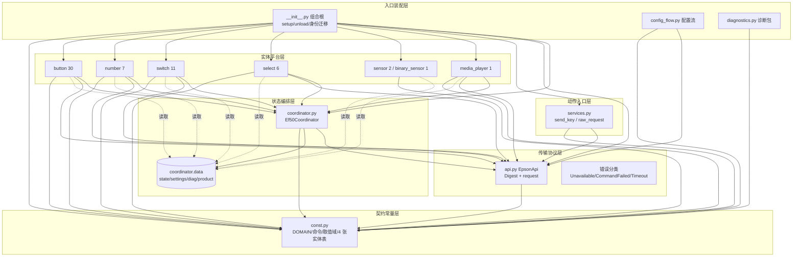
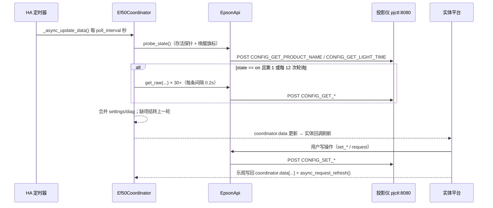

# 逻辑视图

## 代码结构与模块划分

本仓库是单个 HACS 自定义集成，生产代码只有一个 Python 包 `custom_components/epson_ef/`（14 模块 / 3055 行，`wc -l custom_components/epson_ef/*.py` 实测）。`tools/`（20 个 .py 探测脚本 + 1 个 .sh + 2 个 .json 存档，`ls tools/*` 实测；受版本控制 24 个文件）与 `tests/`（4 文件 / 1020 行）属于证据与验证设施，不是运行时域。

```text
project-root/
├── custom_components/epson_ef/          # 唯一生产包（3055 行 / 14 模块）
│   ├── __init__.py                      # 入口装配层：setup/unload、身份解析与迁移、平台转发
│   ├── config_flow.py                    # 入口装配层：配置/重配置/选项流（VERSION=2）
│   ├── diagnostics.py                    # 入口装配层（可观测）：诊断包导出
│   ├── services.py                       # 动作入口层：send_key / raw_request 服务
│   ├── coordinator.py                    # 状态编排层：单一定时轮询 + 快/慢双速数据装配
│   ├── api.py                            # 传输协议层：pjctl over HTTP + Digest + 高层命令封装
│   ├── const.py                          # 契约常量层：DOMAIN/端口/命令名/取值域/声明式实体表
│   ├── media_player.py                   # 实体平台层：电源/音量/媒体键（1 实体）
│   ├── sensor.py                         # 实体平台层：光源时长、投射距离（2 实体）
│   ├── select.py                         # 实体平台层：启动模式 + 4 个固件档位项 + 氛围灯模式（6 实体）
│   ├── binary_sensor.py                  # 实体平台层：连通性（1 实体）
│   ├── button.py                         # 实体平台层：30 个动作按钮（表驱动）
│   ├── switch.py                         # 实体平台层：6 配置开关 + 3 氛围灯 + 2 乐观开关（11 实体）
│   ├── number.py                         # 实体平台层：亮度/定时器/对焦/增益×3/氛围亮度（7 实体）
│   ├── manifest.json / hacs.json         # 集成元数据（iot_class=local_polling，requirements=[]）
│   ├── services.yaml / strings.json      # 服务与文案（strings.json 与 translations/en|zh-Hans 同构）
│   └── translations/{en,zh-Hans}.json    # 222 行 ×2，键集合与 strings.json 完全一致
├── tests/                                # 证据设施：unittest + AST 契约测试（4 文件）
├── tools/                                # 证据设施：probe_*/verify_* 探测脚本
└── docs/                                 # 参考文档（非事实来源）
```

### 模块清单（行数与职责）

| 模块 | 行数 | 层次 | 核心职责 | 关键证据 |
|-|-|-|-|-|
| `__init__.py` | 221 | 入口装配 | `PLATFORMS` 声明、首次可达性探测、身份（serial→host:port 兜底）解析与注册表迁移、`hass.data` 组装、卸载释放 | `custom_components/epson_ef/__init__.py:24`, `:166`, `:195`, `:213` |
| `config_flow.py` | 132 | 入口装配 | user/reconfigure/options 三流；用 `get_product_name()` 作为可达性探针；`VERSION = 2` | `custom_components/epson_ef/config_flow.py:26`, `:35`, `:68`, `:108` |
| `diagnostics.py` | 39 | 入口装配（可观测） | 导出 entry/identity/coordinator/api 四段诊断，用 `getattr` 读私有字段 | `custom_components/epson_ef/diagnostics.py:12`, `:35` |
| `services.py` | 102 | 动作入口 | 两个服务：按键（键名或数字 keycode）与任意 pjctl 透传；结果经 `epson_ef_response` 事件返回 | `custom_components/epson_ef/services.py:15`, `:39`, `:56`, `:67` |
| `coordinator.py` | 154 | 状态编排 | 每次轮询一次 `probe_state`（快），每 12 次轮询一轮 30+ 条诊断读（慢），并把 `settings`/`diag` 合并与结转 | `custom_components/epson_ef/coordinator.py:19`, `:37`, `:59`, `:134` |
| `api.py` | 656 | 传输协议 | Digest 挑战缓存与单次重试、`size=token 数` 协议约定、34 个公开命令方法、对焦闭环 | `custom_components/epson_ef/api.py:68`, `:99`, `:147`, `:171`, `:544` |
| `const.py` | 222 | 契约常量 | DOMAIN/端口/命令名/固件取值域；4 张声明式实体表驱动平台装配；零内部 import | `custom_components/epson_ef/const.py:4`, `:53`, `:75`, `:138`, `:222` |
| `media_player.py` | 228 | 实体平台 | 电源盲切换（先探测再发键 + 锁）、音量/静音乐观状态、播放键 | `custom_components/epson_ef/media_player.py:73`, `:178`, `:207` |
| `sensor.py` | 120 | 实体平台 | 光源时长（含 `stale` 标记）、投射距离（mm→m） | `custom_components/epson_ef/sensor.py:36`, `:57`, `:88` |
| `select.py` | 219 | 实体平台 | 档位项：原始值 ↔ 标签双向映射；启动模式专用表；氛围灯模式乐观态 | `custom_components/epson_ef/select.py:48`, `:116`, `:167` |
| `binary_sensor.py` | 56 | 实体平台 | 连通性：跟随 `coordinator.last_update_success`，但永不 unavailable | `custom_components/epson_ef/binary_sensor.py:49` |
| `button.py` | 142 | 实体平台 | 30 条 `BUTTON_DEFS` 表驱动（NOTIFY_* 触发 + CONFIG_SET_QC 几何步进） | `custom_components/epson_ef/button.py:17`, `:86`, `:136` |
| `switch.py` | 306 | 实体平台 | 6 个 0/1 回写开关 + 3 个氛围灯写-only + 测试图案 + 自动对比度 | `custom_components/epson_ef/switch.py:28`, `:56`, `:120`, `:188`, `:249` |
| `number.py` | 458 | 实体平台 | 光源亮度、刷新定时器、对焦（闭环）、RGB 增益三通道共享一条 GET、氛围亮度 | `custom_components/epson_ef/number.py:47`, `:66`, `:143`, `:223`, `:304`, `:399` |

### 模块依赖矩阵

依赖取自 AST（`ImportFrom.level>0` 全部枚举），箭头方向即 `import` 方向，无遗漏。

| 模块 | 依赖模块 | 禁止依赖（现状是否遵守） | 说明 |
|-|-|-|-|
| `const` | 无 | 所有其他模块（遵守：仅 `from __future__`） | 叶子契约层，可被任意层安全引用 |
| `api` | `const` | HA 库（遵守：仅 `aiohttp`，`api.py:3` 明示可独立测试） | 传输层故意不 import HA，为单测解耦 |
| `coordinator` | `api`, `const` | 任何实体平台（遵守） | 只认识 API 与契约表，不认识实体 |
| `services` | `const` | `coordinator`/实体平台（遵守） | 通过 `hass.data` 取 api，不入协调器 |
| `diagnostics` | `const` | — | 只从 `hass.data` 读，不 import 平台 |
| `config_flow` | `api`, `const` | `coordinator`（遵守） | 配置期只做一次探测，不建协调器 |
| `__init__` | `api`, `const`, `coordinator`, `services` | 实体平台模块（遵守：只用字符串 `PLATFORMS` 转发） | 组合根，唯一允许同时认识四层 |
| `binary_sensor`/`sensor` | `const`, `coordinator` | `api`（遵守） | 纯读实体，不直接发命令 |
| `button`/`select`/`switch`/`number`/`media_player` | `api`, `const`, `coordinator` | — | **接口例外**：写动作直接调 `api`（见风险 R2） |

### 循环依赖核查

对全部 14 模块做 DFS 环检测（含 `from . import x` 形式），结果：**无环**。可达证据链：`const` 无出边（`const.py:2` 仅 `from __future__`）→ `api → const`（`api.py:16`）→ `coordinator → api, const`（`coordinator.py:13-14`）→ 平台 → `coordinator`（如 `switch.py:23`）→ `__init__` 汇总（`__init__.py:13-22`）。`services.py` 在函数体内延迟 import 实体注册表（`services.py:21`），避免与 HA helper 的模块级耦合，也避免与 `__init__` 构成环。

约束未被工具强制：仓库无 `pyproject.toml`/`setup.cfg`/`ruff.toml`，CI 只跑 `ruff check --select F,E9` 与 unittest（`.github/workflows/tests.yml:22-26`），因此"平台层不得直接发命令"这类规则仅靠评审维持。

## 架构分层（Home Assistant 集成分层）

> **DDD 适配说明（模板改写）**：本项目**不适用 DDD 四层**。代码中没有 domain/application/infrastructure 目录，没有聚合根/值对象/仓储端口/领域事件，也**不存在限界上下文**——整个集成就是一个有界上下文（Epson EF 投影控制），实体是 HA 平台对象而非领域对象。所以本节改写为代码里真实存在的六层，划分依据是 `import` 方向与职责，不是套模板。



### 层职责与约束

| 层 | 真实模块 | 核心职责 | 允许依赖 | 实际越界情况 |
|-|-|-|-|-|
| 入口装配层 | `__init__.py`, `config_flow.py`, `diagnostics.py` | 配置项→运行时对象装配；身份（serial/host:port）与注册表迁移；平台转发；卸载释放 | 全部下层 | 无越界，但 `__init__.py` 承载了 3 类迁移逻辑（`__init__.py:31`, `:79`, `:123`），职责偏重 |
| 动作入口层 | `services.py` | 面向用户的非实体动作（按键注入、任意命令透传） | 契约层 + `hass.data` | 直接调用 `api.request` 透传（`services.py:64`），属设计意图 |
| 状态编排层 | `coordinator.py` | 唯一轮询源；快探针（电源/灯时）+ 慢诊断（每 12 次）合并、结转 | `api`, `const` | 写入共享字典作为跨层契约，无类型约束 |
| 传输协议层 | `api.py` | Digest 认证、协议细节（`size`=token 数）、错误分类、命令语义、对焦闭环 | `const` | 34 个公开命令方法中 12 个在包内无任何调用者（风险 R1） |
| 实体平台层 | 7 个平台文件 | 把 `coordinator.data` 投影为实体；写动作 + 乐观更新 + 触发刷新 | `coordinator`, `api`, `const` | **系统性越界**：平台直接 `coordinator.api.request(...)` 绕过高层封装（风险 R2） |
| 契约常量层 | `const.py` | 固件命令名、取值域、标签映射、4 张声明式实体表 | 无 | 表宽度与消费者解包宽度靠测试守护（`tests/test_const_contract.py:1`） |

### 运行时数据流（读 / 写）



## 模块边界与功能域映射（替代限界上下文）

真实边界不是"业务子域"，而是**按固件命令族 + 读写能力**切分的 7 个功能域。它们不是独立目录，而是同一包内跨模块共享 `coordinator.data` 与 `const.py` 表（共享内核模式），因此模板中的 ACL/OHS/Partnership 需改写为"共享内核 + 单一上游适配器"。

| 功能域 | 承载模块（真实路径） | 固件命令族 | 读/写能力 | 上下游与集成方式 |
|-|-|-|-|-|
| 电源与按键 | `media_player.py`, `button.py`(前 4 项), `const.KEYCODES` | `NOTIFY_KEYEVENT` | 写 + 探针状态 | 下游消费协调器 `state`；上游唯一适配器 `api.py` |
| 画面设置 | `select.py`(4 项), `switch.py`(6 项), `number.py`(light_output) | `CONFIG_GET/SET_*` | 读写回环（同值回写法） | 共享 `coordinator.data["settings"]` |
| 几何/校正 | `button.py`(CONFIG_SET_QC 8 项) | `CONFIG_SET_QC` "1..5" 子命令 | 写 + 读诊断 `diag.qc` | 同一表驱动按钮，无独立实体类型 |
| 光学（对焦/测距/灯时） | `number.py`(focus), `sensor.py`, `switch.py`(test_pattern) | `CONFIG_GET/SET_FOCUS`, `MEASURE_DISTANCE`, `LIGHT_TIME`, `GET_ESCVP` | 对焦读+写、距离只读、图案只写 | 闭环算法位于传输层（`api.py:544`） |
| 环境光 | `switch.py`(3 项), `select.py`(ambient_mode), `number.py`(ambient_brightness) | `CONFIG_SET_AMBIENT_LIGHT` "1/3/4/5/9" | **只写**（GET 全 FAIL） | 乐观状态 + `RestoreEntity`，与读路径完全解耦 |
| 身份与生命周期 | `__init__.py`, `config_flow.py` | `CONFIG_GET_PJ_SNO`, `CONFIG_GET_PRODUCT_NAME` | 读 | HA 配置条目/注册表为上游 |
| 诊断/遥测 | `coordinator.py`(diag 段), `diagnostics.py`, `sensor.py` | 17 条 `CONFIG_GET_*`（`coordinator.py:63-83`） | 只读 | 供排障，无控制语义 |

| 上游 | 下游 | 集成模式 | 集成方式 | 防腐层位置 |
|-|-|-|-|-|
| 固件 pjctl API | 全部功能域 | ACL（下游隔离协议细节） | HTTP POST JSON + Digest | `custom_components/epson_ef/api.py` 整体即防腐层：`request()` 归一化 401/超时/FAIL 为 4 类异常（`api.py:40-61`, `:147`） |
| 协调器 | 7 个平台 | 共享内核（Shared Kernel） | 同一个 `dict[str, Any]` 数据契约 | `custom_components/epson_ef/coordinator.py:37`（写）对各平台（读） |
| `const.py` 实体表 | `switch`/`select`/`button` | 发布-订阅式表驱动 | 元组表 + 解包 | `const.py:53`, `:75`, `:138`；`button.py:17` |

### `coordinator.data` 契约（事实上的层间接口）

键集合由 `coordinator.py` 写入、由各平台读取（`coordinator.py:51-153` 为唯一写入方）：

| 键 | 类型 | 生产位置 | 消费者 | 语义 |
|-|-|-|-|-|
| `state` | `"on"\|"off"` | `coordinator.py:51`（及实体乐观写 `media_player.py:162`） | 全部平台 | 电源状态，唯一快变量 |
| `light_hours` / `light_extra` / `light_measured_at` | int/ISO 串 | `coordinator.py:53-56` | `sensor.py:68`, `media_player.py:114` | 灯时，关机时结转并标记 `stale`（`sensor.py:76`） |
| `settings` | `dict[str, str]` | `coordinator.py:119`（+实体乐观写） | switch/select/number | 可写设置的固件原始串 |
| `diag` | `dict[str, str]` | `coordinator.py:127` | sensor/media_player/number | 只读诊断原始串 |
| `product` / `standby_mode` | `str` | `coordinator.py:123`, `:132` | `media_player.py:87`, `select.py:144` | 设备型号与启动模式 |

## 领域映射（真实模块边界）

| 单元 | 模块路径 | 核心对象 | 上下游 | 关系类型 |
|-|-|-|-|-|
| 集成装配 | `custom_components/epson_ef/__init__.py` | `async_setup_entry`, `_async_get_base_id` | 下游：协调器/平台 | 组合根 |
| 固件协议适配 | `custom_components/epson_ef/api.py` | `EpsonApi`, 4 个异常类 | 上游：固件；下游：协调器/平台 | ACL |
| 轮询编排 | `custom_components/epson_ef/coordinator.py` | `Ef50Coordinator` | 上游：api；下游：7 平台 | 共享内核 |
| 契约 | `custom_components/epson_ef/const.py` | 4 张实体表 + 取值域 | 被所有层引用 | 叶子 |
| 实体平台 | `media_player.py`/`sensor.py`/`select.py`/`binary_sensor.py`/`button.py`/`switch.py`/`number.py` | 17 个具体实体类（+1 个 `_Ef50Sensor` 抽象基类） | 上游：协调器 + api | 适配器 |
| 动作入口 | `custom_components/epson_ef/services.py` | `send_key`, `raw_request` | 上游：HA 服务；下游：api | 命令入口 |
| 配置入口 | `custom_components/epson_ef/config_flow.py` | `Ef50ConfigFlow`(VERSION=2), `Ef50OptionsFlow` | 上游：用户；下游：api | 边界入口 |
| 可观测 | `custom_components/epson_ef/diagnostics.py` | `async_get_config_entry_diagnostics` | 只读 | 旁路 |

## PLATFORMS、平台文件与实体清单

`PLATFORMS` 以**字符串列表**声明（未使用 `homeassistant.const.Platform` 枚举），顺序与 `async_forward_entry_setups` 完全一致：

`custom_components/epson_ef/__init__.py:24-27`
```python
PLATFORMS = [
    "media_player", "sensor", "select", "binary_sensor", "button", "switch",
    "number",
]
```

对应关系与实体数量（实体类逐个数出，非估算）：

| 平台 | 文件 | 实体类 | 实体数 | 装配方式 |
|-|-|-|-|-|
| `media_player` | `media_player.py` | `Ef50MediaPlayer`（+`RestoreEntity`） | 1 | 直接实例化（`media_player.py:36`） |
| `sensor` | `sensor.py` | `Ef50LightHoursSensor`, `Ef50DistanceSensor`（共用 `_Ef50Sensor` 基类） | 2 | 列表（`sensor.py:28-33`） |
| `select` | `select.py` | `Ef50StandbyModeSelect`, `Ef50ConfigSelect` ×4, `Ef50AmbientModeSelect` | 6 | 3 次 `async_add_entities`（`select.py:33`, `:36`, `:43`） |
| `binary_sensor` | `binary_sensor.py` | `Ef50ConnectivitySensor` | 1 | 列表（`binary_sensor.py:24`） |
| `button` | `button.py` | `Ef50Button` ×30（`BUTTON_DEFS`） | 30 | 表驱动推导（`button.py:92-98`） |
| `switch` | `switch.py` | `Ef50ConfigSwitch` ×6, `Ef50AmbientLightSwitch` ×3, `Ef50TestPatternSwitch`, `Ef50AutoContrastSwitch` | 11 | 4 次 `async_add_entities`（`switch.py:34`, `:41`, `:48`, `:51`） |
| `number` | `number.py` | `Ef50LightOutputNumber`, `Ef50RefreshTimerNumber`, `Ef50FocusNumber`, `Ef50AmbientBrightnessNumber`, `Ef50ColorGainNumber` ×3 | 7 | 列表 + `extend`（`number.py:53-63`） |
| **合计** | 7 文件 / 1529 行 | 17 个具体实体类 | **58** | — |

数量交叉校验：`strings.json` 的 `entity` 段键数 = button 30 / switch 11 / select 6 / number 7 / sensor 2 / binary_sensor 1（media_player 无 translation_key，用配置条目名），与代码实体数逐一吻合；`tests/test_const_contract.py` 亦锁定 4 张表的宽度与解包点（`tests/test_const_contract.py:118-145`）。

### 实体命名规律

- **身份基座**：`base_id` 由 `__init__.py` 解析——优先固件序列号，无序列号则把首个 `host:port` 持久化钉住（`__init__.py:42-76`），并存入 `hass.data[DOMAIN][entry_id]["base_id"]`（`__init__.py:199`）。设备侧统一用 `identifiers={(DOMAIN, base_id)}` 聚成一个设备（`media_player.py:89`）。
- **unique_id 四套后缀约定并存**：
  - 平台前缀式：`{base_id}-button-{suffix}`（`button.py:122`）、`{base_id}-number-{key}`（`number.py:338`）、`{base_id}-number-light_output`（`number.py:90`）、`{base_id}-select-ambient_mode`（`select.py:189`）；
  - 设置式：`{base_id}-setting-{suffix}` 同时被 switch 与 select 使用（`switch.py:78`, `select.py:75`）；
  - 裸后缀式：`{base_id}-connectivity`（`binary_sensor.py:41`）、`{base_id}-standby_mode`（`select.py:130`）、`{base_id}-{suffix}`（`sensor.py:44`）；
  - 媒体播放器直接用 `base_id`（`media_player.py:68`）。
- **展示名**：除 media_player 用 `entry.data["name"]` 作 `_attr_name`（`media_player.py:69`）外，其余均 `_attr_has_entity_name = True` + `_attr_translation_key`，由 `translations/*.json` 提供本地化名称。
- **历史命名残留**：类名一律 `Ef50*`（共 20 个类：`coordinator.py:19`、`media_player.py:41`、`config_flow.py:23`, `:108` 等），而 integration/domain 是 `epson_ef`、覆盖 HB7x 全系；`Ef50` 是早期型号名，已与语义脱节。

## 关键接口契约

1. **错误分类是跨层契约**：4 个异常类把"网络不可达 / 命令 FAIL / 超时 / 通用"分开（`api.py:40-61`），协调器据此区分"断电"与"待机"（`coordinator.py:44-49`），`probe_state` 还把 liveness 超时归一化为 `EpsonApiUnavailable`（`api.py:236-246`），避免"关机被当成卡死"。
2. **协议不变量 `size = params.split(" ")` 的长度**，而非字节数（`api.py:160-171`），注释记录了这是写通路曾被 MCU 拒绝的根因。
3. **实体表宽度契约**：`WRITABLE_SWITCHES`(6×4)、`WRITABLE_SELECTS`(4×6)、`AMBIENT_LIGHT_SWITCHES`(3×4)、`BUTTON_DEFS`(30×5) 必须与消费者解包宽度一致，否则整集成 unavailable；该事故已固化为 AST 测试（`tests/test_const_contract.py:1-15`）。
4. **单轮询源**：所有实体读状态都取自 `coordinator.data`，不再各自发 GET（除写后确认），这是 58 个实体只产生一条轮询链的原因。
5. **写后乐观 + 触发刷新**的统一模式：写成功即改 `coordinator.data` 并 `async_request_refresh()`（`number.py:129-133`, `select.py:110-113`, `media_player.py:159-163`）。

## 结构性风险线索（逻辑视图视角，详见 risk.md）

| 编号 | 现象 | 证据 | 逻辑层影响 |
|-|-|-|-|
| R1 | 传输层解析型辅助方法被绕过：`api.py` 有 12 个公开方法在包内零调用者，协调器改用 `get_raw` + 手工解析 | `api.py:340`（get_raw）；`coordinator.py:63-83` 全部走 `get_raw`；零调用者含 `get_distance_mm`(`api.py:353`)、`get_light_output`(`:366`)、`get_color_gain`(`:432`)、`get_auto_focus_state`(`:634`) | 同一命令的解析逻辑存在两份（api 方法与协调器字符串键），改协议要点改两处 |
| R2 | 实体平台绕过传输层封装直接发原始命令 | `switch.py:106`、`select.py:107`、`button.py:138` 均为 `api.request(cmd, params=...)`，而 `api.py` 同时提供 `set_*` 语义方法（如 `set_auto_contrast` `api.py:623`） | 语义校验与错误文案分裂；`geometry_*` 三个方法无人调用，命令改由 `button.py:69-82` 拼字符串 |
| R3 | `hass.data` 字典为隐式契约，无类型 | 写入 `__init__.py:195-201`；读取 `binary_sensor.py:23`、`services.py:27`、`diagnostics.py:16` 共 9 处 | 键名/形状变更无编译期或静态检查保护 |
| R4 | 身份双轨：配置流 unique_id 用 `host:port`，实体/设备身份用 serial | `config_flow.py:47-49` vs `__init__.py:60-76` | reconfigure 到新 IP 后两套标识可能分叉，仅靠 `_async_migrate_identity` 被动修复 |
| R5 | 类名 `Ef50*` 与 domain `epson_ef`、覆盖面 HB7x 不一致（20 个类） | `coordinator.py:19`、`media_player.py:41`、`sensor.py:36` 等 | 命名不承载语义，新平台扩展时易误判适用范围 |
| R6 | 慢诊断轮询串行 30+ 次 HTTP，每次间隔 0.2s | `coordinator.py:85-101`（`await asyncio.sleep(0.2)` 位于循环内） | 单轮诊断耗时叠加在协调器更新内，最坏情况拖长刷新周期；无并发/超时预算 |
| R7 | 未使用常量与遗留物 | `api.py:37` `_TIMEOUT` 定义后从未引用（实际超时在 `api.py:160` 另算）；`api.py:330` `get_light_time` 零调用者 | 死代码误导读者以为存在全局超时 |

## 观察与缺项

- `const.py` 之外，`hass.data` 的字典形状是隐式契约（7 个平台 + 服务 + 诊断各自解包，`binary_sensor.py:23`, `services.py:27`, `diagnostics.py:16`），无 `TypedDict`/dataclass，键名错误只能在运行时暴露。
- 模板的"限界上下文上下游/ACL 位置"在本项目退化为"单一上游（固件）+ 共享内核（coordinator.data）"，已按真实结构改写于上文，未虚构不存在的目录。
- `[待确认: 是否存在未纳入版本库的部署侧约束（如 HACS 最低 HA 版本 2024.4.0 与代码中 2026.x 弃用规避的兼容窗口）]` —— `hacs.json` 声明 `homeassistant: 2024.4.0`，而 `__init__.py:106-109` 注释针对 HA 2026.x/2027.8.0 的 API 弃用，两者跨度需维护者确认。
- `[待确认: 多投影仪实例下的身份冲突边界]` —— 配置流 unique_id 用 `host:port`（`config_flow.py:47-49`），实体身份用 serial（`__init__.py:60-76`），两套标识在 reconfigure 后是否会产生重复条目，代码内无断言或测试覆盖。
