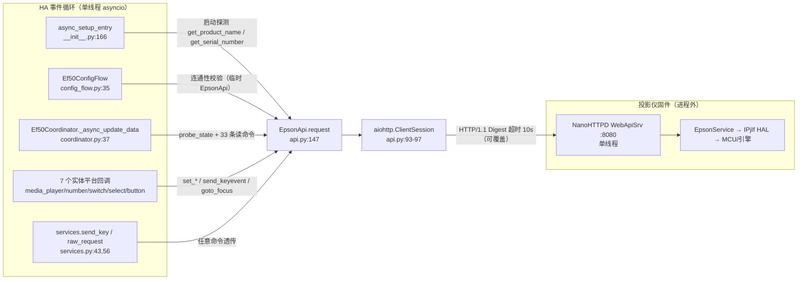
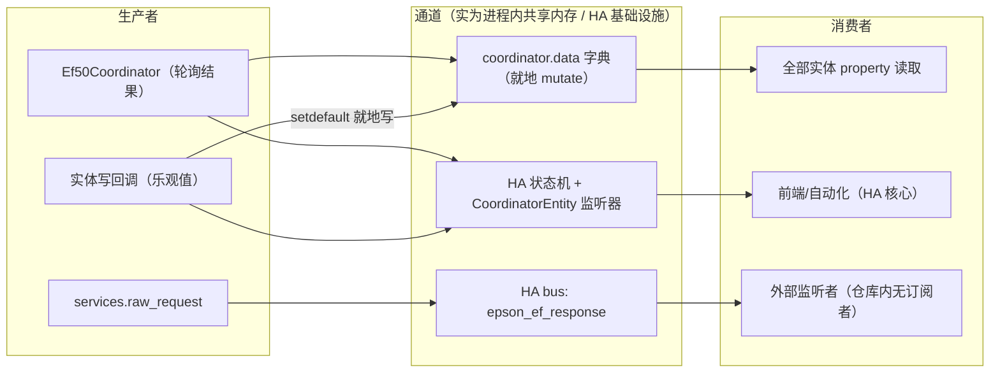
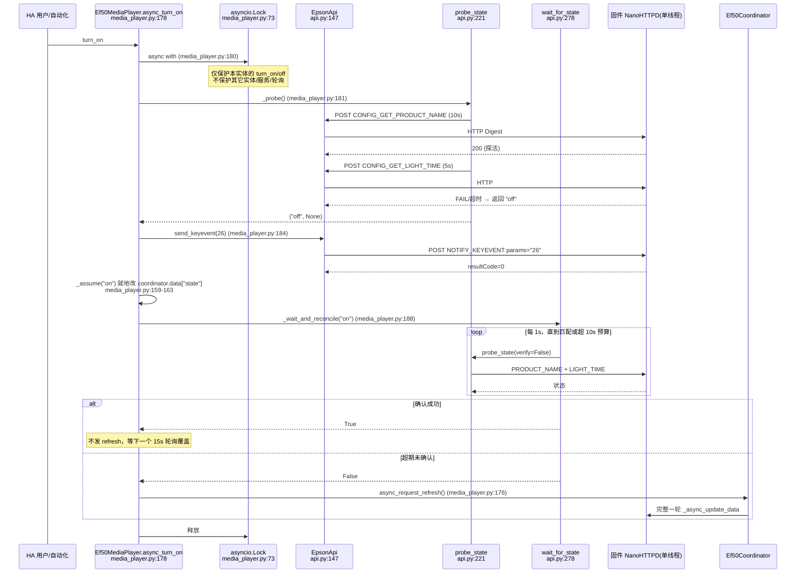
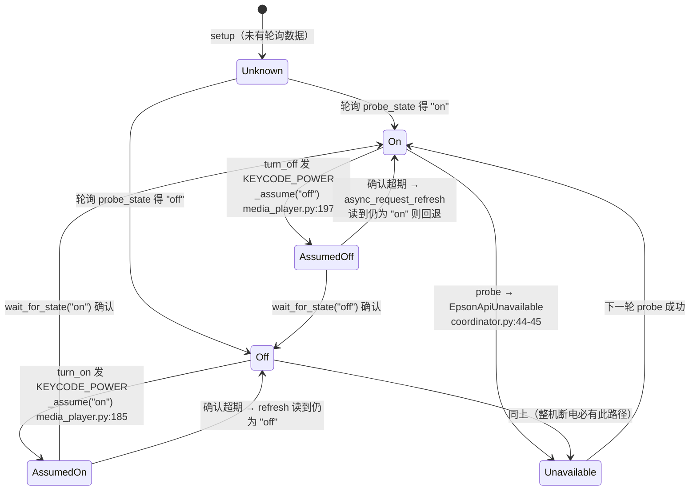
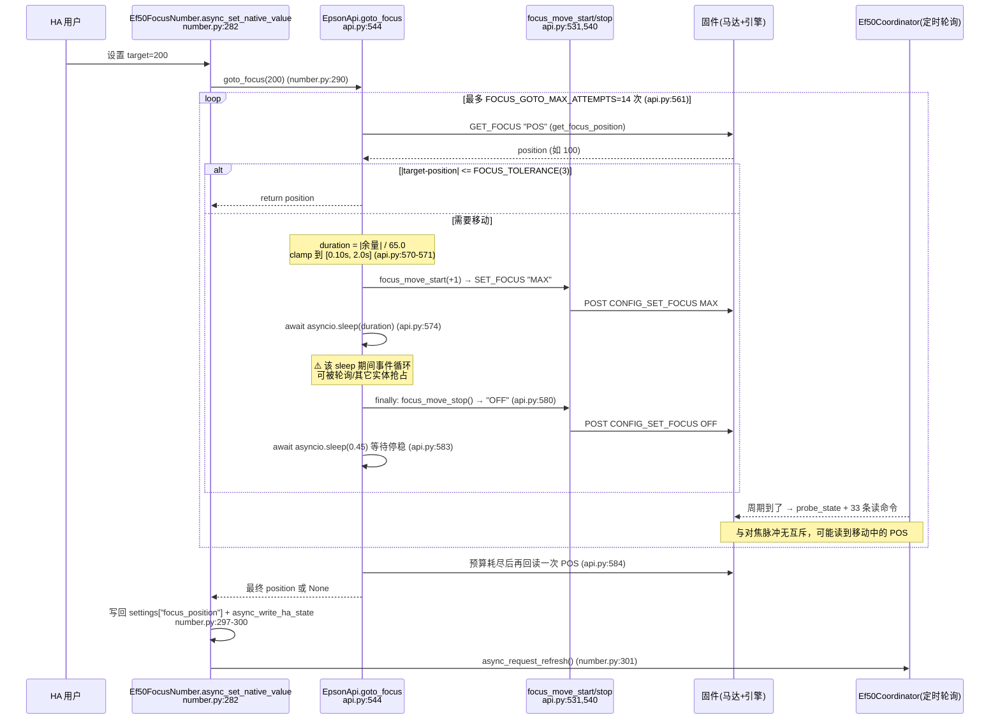
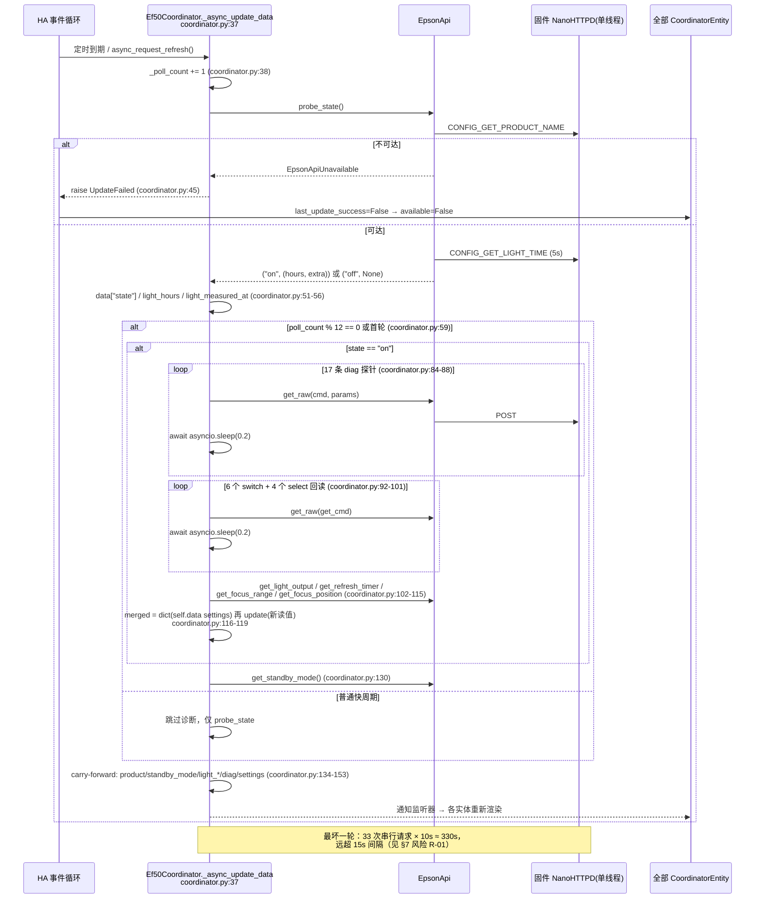
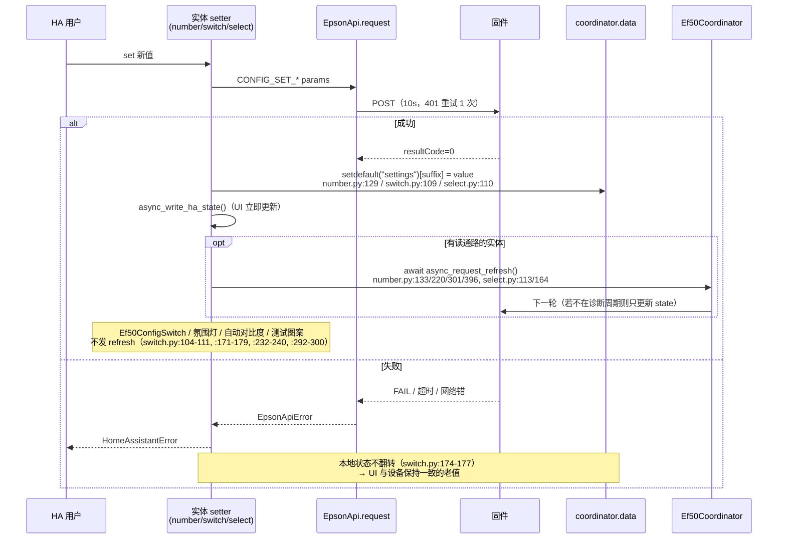

# 进程视图（跨单元运行时协作）

> 运行时单元的定义：本集成没有独立进程/线程，只有 **HA 事件循环中的若干协程族**（coordinator 定时任务、实体回调、服务回调、配置流）以及**事件循环之外的固件 HTTP 服务**。因此"跨单元协作"在本项目里等价于"协程之间通过共享 `coordinator.data` 字典与同一个 `EpsonApi` HTTP 客户端协作"。
>
> 约定：所有 `path/to/file:line` 相对仓库根；行号取自 `base_commit`。

## 1. 跨单元协作流程总览

| 流程 ID | 流程名称 | 涉及单元 | 协作模式 | 一致性级别 | 详情章节 |
|-|-|-|-|-|-|
| GP-001 | 定时轮询刷新（快探针 + 慢诊断） | `Ef50Coordinator` ↔ `EpsonApi` ↔ 固件 NanoHTTPD | 单协程串行 await（请求-响应） | 最终一致（≤12 个轮询周期收敛） | §5.3 |
| GP-002 | 开关机状态感知 | `Ef50MediaPlayer` ↔ `EpsonApi` ↔ 固件 | 锁串行化（`asyncio.Lock`）+ 主动确认轮询 | 强一致（动作前 probe、动作后 `wait_for_state` 确认） | §5.1 |
| GP-003 | 对焦闭环定位 | `Ef50FocusNumber` ↔ `EpsonApi.goto_focus` ↔ 固件马达 | 开环脉冲 + 闭环回读（连续移动/定时/OFF/POS 回读） | 强一致（每次循环回读 POS，误差 ≤3） | §5.2 |
| GP-004 | 可读设置写入与收敛 | `Ef50ConfigSwitch`/`Ef50ConfigSelect`/`Ef50LightOutputNumber` ↔ `EpsonApi` ↔ 固件 | 乐观写内存 + 可选立即 refresh | 最终一致（下一轮诊断轮询覆盖） | §5.4 |
| GP-005 | 无读通路设置写入（氛围灯/自动对比度/测试图案/静音） | 对应实体 ↔ `EpsonApi` ↔ 固件 | 纯单向写 + 本地记忆 | 无收敛（assumed_state，仅本地记忆） | §5.4 |
| GP-006 | 任意命令透传（调试服务） | `services.raw_request` ↔ `EpsonApi` ↔ 固件 | 请求-响应 + 事件回传 | 最弱（失败仅写事件，不重试） | §3.1 |
| GP-007 | 启动装配与不可达降级 | `async_setup_entry` ↔ `EpsonApi` ↔ HA 配置项 | 同步 await + 异常上抛 `ConfigEntryNotReady` | 强一致（setup 失败即整体回滚） | §2 |

**判据说明**：GP-001 的"最终一致"证据是诊断段只在 `_poll_count == 1 or _poll_count % 12 == 0` 时执行（`custom_components/epson_ef/coordinator.py:59`，`DIAGNOSTIC_EVERY_N_POLLS = 12` 见 `custom_components/epson_ef/const.py:222`），而 `settings`/`diag` 在非诊断周期靠 carry-forward 保留旧值（`custom_components/epson_ef/coordinator.py:145`, `:150`）。

---

## 2. 同步调用拓扑

全部调用都是 **HTTP POST `/api/pjctl` + JSON + Digest 认证**（`custom_components/epson_ef/const.py:14`, `custom_components/epson_ef/api.py:79`）。没有 WebSocket、没有 MQTT、没有 gRPC。



| 调用方 | 被调用方 | 协议/机制 | 超时 | 重试策略 | 熔断/降级 | 关键文件 |
|-|-|-|-|-|-|-|
| `Ef50Coordinator._async_update_data` | `EpsonApi.probe_state`（含 2 次 HTTP） | HTTP POST pjctl | 第 1 条 `CONFIG_GET_PRODUCT_NAME` 默认 10s；第 2 条 `CONFIG_GET_LIGHT_TIME` 5s | 引擎查询 FAIL 时 1.5s 后重试 1 次（`verify=True`→2 次） | `EpsonApiUnavailable` → `UpdateFailed` → 实体不可用；`EpsonApiTimeout` 归一化为 `Unavailable`；`CommandFailed` → 记为 `state="off"`（假设待机） | `custom_components/epson_ef/coordinator.py:43`, `:44-49`; `custom_components/epson_ef/api.py:236-276` |
| `Ef50Coordinator._async_update_data` | `EpsonApi.get_raw` × 33（诊断 + 设置） | 同上 | 每条默认 10s，**无聚合超时** | 无重试；失败一律 `None` | `None` → 键缺失 → carry-forward 旧值 | `custom_components/epson_ef/coordinator.py:84-115`; `custom_components/epson_ef/api.py:340-351` |
| `Ef50MediaPlayer._key` | `EpsonApi.send_keyevent` | 同上 | 10s | 401 时重取 Digest challenge 重试 1 次 | 三类异常分别转 `HomeAssistantError`（不可达/未执行/未知） | `custom_components/epson_ef/media_player.py:139-149`; `custom_components/epson_ef/api.py:180-214` |
| `Ef50MediaPlayer._probe` / `_wait_and_reconcile` | `EpsonApi.probe_state` / `wait_for_state` | 同上（1s 间隔轮询） | 单次 probe ≈ 最长 15s；`timeout_s=10` 预算 | 不重试，超期返回 `False` | 确认失败 → `async_request_refresh()` 回落到协调器真值 | `custom_components/epson_ef/media_player.py:151-176`; `custom_components/epson_ef/api.py:278-293` |
| `Ef50LightOutputNumber` / `Ef50RefreshTimerNumber` / `Ef50ColorGainNumber` / `Ef50FocusNumber` setters | `EpsonApi.set_*` / `goto_focus` | 同上 | 10s（对焦为多次 10s） | 仅 Digest 重试 | `EpsonApiError` → `HomeAssistantError`，本地值保持不变 | `custom_components/epson_ef/number.py:123-133`, `:210-220`, `:282-301`, `:379-396` |
| `Ef50ConfigSwitch._write` / `Ef50ConfigSelect.async_select_option` | `EpsonApi.request`（`CONFIG_SET_*`） | 同上 | 10s | 仅 Digest 重试 | 捕获 `Exception` 转 `HomeAssistantError` | `custom_components/epson_ef/switch.py:104-111`; `custom_components/epson_ef/select.py:104-113` |
| 乐观写实体（氛围灯 ×3、自动对比度、测试图案、氛围亮度、氛围模式、静音） | `EpsonApi.set_ambient_light` / `set_auto_contrast` / `set_test_pattern` / `send_keyevent` | 同上 | 10s | 仅 Digest 重试 | 失败抛错且**不翻转**本地状态（状态只在写成功后改） | `custom_components/epson_ef/switch.py:171-179`, `:232-240`, `:292-300`; `custom_components/epson_ef/number.py:449-458`; `custom_components/epson_ef/select.py:208-219` |
| `Ef50Button.async_press` | `EpsonApi.request` | 同上 | 10s | 仅 Digest 重试 | `EpsonApiError` → `HomeAssistantError`；实体 `available` 恒为 `True` | `custom_components/epson_ef/button.py:131-142` |
| `services.send_key` / `raw_request` | `EpsonApi.send_keyevent` / `request` | 同上 | 10s | 仅 Digest 重试 | `raw_request` 吞掉所有异常写进事件（`services.py:63-70`）；`send_key` 直接上抛 | `custom_components/epson_ef/services.py:43-70` |
| `async_setup_entry` | `EpsonApi.get_product_name` / `get_serial_number` / `coordinator.async_config_entry_first_refresh` | 同上 | 10s 每条 | 无 | 见下方"降级实测" | `custom_components/epson_ef/__init__.py:170-193` |
| `Ef50ConfigFlow.async_step_user` | 临时 `EpsonApi.get_product_name` | 同上 | 10s | 无 | `finally: await api.close()`，`product is None` → `errors["base"]="cannot_connect"` | `custom_components/epson_ef/config_flow.py:38-54` |

**超时事实（易误读，逐个核对）**

- 模块级 `_TIMEOUT = aiohttp.ClientTimeout(total=10)`（`custom_components/epson_ef/api.py:37`）**是死常量**，全仓无引用；真正生效的是 `request()` 内联构造的 `total`（`custom_components/epson_ef/api.py:160`, `:188`）。修改 `_TIMEOUT` 不会改变任何行为。
- 默认值 `10.0`、可被 `timeout` 参数覆盖（`custom_components/epson_ef/api.py:160`）；`probe_state` 的引擎探针显式传 `5.0`（`custom_components/epson_ef/api.py:255-257`）。
- `wait_for_state(timeout_s=10.0)` 的 10s **不是硬上限**：循环先 `await probe_state(verify=False)` 再判 `loop.time() >= deadline`（`custom_components/epson_ef/api.py:284-292`），单次 probe 自身最长 15s（10s + 5s），故实际可超期到 ~25s。

**失败降级事实（`ConfigEntryNotReady` 的真实触发点与代码意图不一致）**

- 代码意图是"探活失败即 `ConfigEntryNotReady`"（`custom_components/epson_ef/__init__.py:172-176`）。但 `EpsonApi.get_product_name` 内部 `except EpsonApiError: return None`（`custom_components/epson_ef/api.py:295-300`），**永远不抛** —— 该 `except` 分支实际不可达。
- 真正抛 `ConfigEntryNotReady` 的是协调器首刷：`UpdateFailed` 由 `probe_state` 的 `EpsonApiUnavailable` 触发（`custom_components/epson_ef/coordinator.py:44-45`），经 `async_config_entry_first_refresh` 转成 `ConfigEntryNotReady`，在 `custom_components/epson_ef/__init__.py:189-193` 被捕获并 `await api.close()` 后重抛。
- 重试由 HA 自身完成（`ConfigEntryNotReady` 触发平台重试），集成内**没有** setup 级重试循环。

---

## 3. 异步消息/事件拓扑

### 3.1 拓扑与清单

**结论先行：本项目没有独立消息通道、没有事件总线订阅、没有 `async_track_*`、没有 `async_dispatcher_send`。** 依据：`grep -rn "async_track\|dispatcher\|async_listen\|EVENT_" custom_components/epson_ef/*.py` 零命中；`grep -rn "async with"` 仅 3 处（1 处 HTTP、2 处电源锁）；全仓唯一的事件发布是 `services.py:67` 的 `hass.bus.async_fire`。



| 通道 | 分区/并发 | 保留/缓冲 | 生产者 | 消费者 | 消费保障 | 备注 |
|-|-|-|-|-|-|-|
| `Ef50Coordinator.data`（dict） | 单协程写入（轮询）+ 多协程就地 mutate（实体） | 保留至下次轮询覆盖；`diag`/`settings` 靠 carry-forward 跨周期存活 | `coordinator.py:37-154`；`number.py:129`, `switch.py:109`, `select.py:110`, `media_player.py:162` | 所有 `CoordinatorEntity` 的 property | 无锁、无版本号、无 CAS；后写覆盖先写 | 事实上的进程内"共享寄存器"，详见 §4 风险 |
| HA 状态机/实体监听器（`CoordinatorEntity`） | HA 事件循环串行派发 | HA 自身维护 | coordinator 刷新完成、`async_write_ha_state()` | HA 前端、自动化、recorder | 由 HA 核心保证（框架行为，本仓库内不可验证：环境无 `homeassistant` 包，`python3 -c "import homeassistant"` 失败） | 集成只调用 `async_write_ha_state()`（如 `media_player.py:163`, `number.py:132`） |
| `epson_ef_response`（HA bus 事件） | 全局广播 | 无缓冲、即发即弃 | `services.py:67-70` | 仓库内**无订阅者** | 最多一次 | 调试用；payload 见 §3.2 |

### 3.2 事件契约（Schema）

仓库内唯一定义的事件（`custom_components/epson_ef/services.py:67-70`）：

```
// Event: epson_ef_response -> HA event bus
{
  "entity_id": <str | [str] | null>,   // 调用方传入的 media_player.entity_id，原样回传
  "id":        "<pjctl command id>",   // 例如 CONFIG_GET_PRODUCT_NAME
  "response":  { <固件返回的 JSON> }   // 成功=固件 data；失败={"error": "<异常字符串>"}
}
```

证据：`custom_components/epson_ef/services.py:64-70`（成功走 `api.request` 的 dict；`except Exception` 时 `result = {"error": str(err)}`）。事件名在 `services.yaml:19` 与 `README.md:83` 中同步声明（文档仅作导航，契约以代码为准）。

### 3.3 投递语义与保障

| 保证维度 | 策略 | 实现方式 | 说明 |
|-|-|-|-|
| 投递保证 | 最多一次 | `hass.bus.async_fire`（`services.py:67`）即发即弃 | 无持久化、无 ACK、HA 重启即丢失 |
| 幂等消费 | 不适用（无订阅者） | — | 订阅方需自行按 `id`+`response` 判断 |
| 顺序保证 | 无保证 | — | 每次 `raw_request` 独立协程；并发调用可乱序完成 |
| 异常处理 | 异常内联进 payload | `except Exception: result = {"error": ...}`（`services.py:65-66`） | 不重试、不告警；调用方必须自己订阅事件才能看到失败 |

> 补充：设备状态变化**不产生任何事件**，只能由轮询发现（`coordinator.py:37-154`）。即"电源被遥控器关掉"这类事实对集成而言是"下一个 15s 轮询才可见"（`const.py:11`）。

---

## 4. 一致性策略

### 4.1 策略决策表

| 场景 | 策略 | 实现方式 | 适用流程 |
|-|-|-|-|
| 可读设置写入（光源亮度/刷新定时器/投影方式/色温/动态对比度/投影偏好/色彩增益/配置开关） | **乐观写内存 + 慢轮询回读收敛** | 写成功后 `coordinator.data["settings"][suffix] = value`（`number.py:129-131`, `switch.py:109-110`, `select.py:110-111`），随后（部分实体）`await coordinator.async_request_refresh()`；下一轮诊断轮询用固件真值 `merged.update(settings)` 覆盖（`coordinator.py:116-119`） | GP-004 |
| 无读通路项（氛围灯开/关/亮度/模式、自动对比度、测试图案、静音） | **纯本地记忆，不收敛** | 写成功后翻本地属性 + `async_write_ha_state()`（`switch.py:178-179`, `number.py:457-458`, `select.py:218-219`, `media_player.py:215-216`）；`assumed_state = True`（`switch.py:166-169`, `number.py:444-447`, `select.py:203-206`）；跨重启恢复用 `RestoreEntity.async_get_last_state()`（`switch.py:158-164`, `number.py:433-442`, `select.py:197-201`, `media_player.py:75-81`） | GP-005 |
| 电源状态（唯一的强一致写） | **动作前 probe → 盲发 toggle → 动作后确认轮询 → 未确认则回落刷新** | `async_turn_on/off` 先 `_probe()` 再发 `KEYCODE_POWER`，然后 `wait_for_state(target, 10s)`；超期 `async_request_refresh()`（`media_player.py:178-199`, `:165-176`） | GP-002 |
| 对焦绝对定位（固件无 set-absolute） | **开环脉冲 + 闭环回读** | 回读 POS → 算余量 → `MAX/MIN` 连续移动 → `sleep(余量/65)` → `OFF` → 再回读，最多 14 次，容差 3（`api.py:544-584`；常量 `const.py:124-133`） | GP-003 |
| 并发控制 | **几乎无**：全仓仅 1 把 `asyncio.Lock`（电源路径），无 `Semaphore`、无全局写锁、无请求队列 | `self._power_lock = asyncio.Lock()`（`media_player.py:73`），只包住 `async_turn_on`/`async_turn_off`（`:180`, `:192`） | GP-002 有保护；GP-001/003/004/005/006 **无保护** |
| 幂等性 | **语义幂等（写前比对/写前探测），非幂等键去重** | 静音：仅当目标值与本地不同才发 toggle（`media_player.py:212-213`）；电源：仅当探测到相反状态才发（`:181-184`, `:193-196`）；设置类为"按值写"，重复写等价 | GP-002/005 |
| 存储原子性（本地 + 远端） | **不存在**：无 outbox、无补偿、无事务 | 本地记忆（RestoreEntity/`Store`）与固件写入之间没有任何绑定，失败即本地与设备分叉 | GP-004/005 |
| 跨单元查询 | **定时全量拉取（pull），无按需查询通路** | 实体 property 只读 `coordinator.data`，不触发 IO；唯一按需 IO 是 `_probe()`（`media_player.py:151-157`）与 `async_request_refresh` | GP-001/002 |

### 4.2 补偿操作清单

**不适用**：本集成未使用 Saga/补偿事务。写失败的直接后果是"抛错给用户 + 本地值不翻转"（`switch.py:174-177`, `number.py:291-292`），没有回滚动作；唯一带"兜底"语义的是对焦的 `try/finally` 强制发 `OFF`（`api.py:573-582`），它属于**安全兜底**而非业务补偿。

### 4.3 一致性机制的三处关键设计痕迹

1. **carry-forward 而非清空**：读失败返回 `None` 时，键缺失而不是写 `None`，再在周期末用上一轮值补齐（`coordinator.py:134-153`；注释见 `:128-129`, `:145-146`）。这样"待机时读不到灯时"不会把传感器打成 unknown，而是保留旧值并置 `stale` 标记（`sensor.py:71-83`, `:118-119`）。
2. **乐观值写进 `coordinator.data` 而非只写实体属性**：因为实体 `native_value` 优先读协调器（`number.py:110-121`, `:189-199`, `:262-272`），若只改 `self._attr_*`，下一帧渲染会被陈旧的 `coordinator.data` 覆盖回去 → 写入"弹回"。`Ef50FocusNumber` 甚至把回读结果写回 `settings["focus_position"]`（`number.py:297-299`），因为对焦 POS 只在诊断轮询里刷新（`coordinator.py:113-115`），不写回就会弹回旧位置。
3. **静音记忆走 `RestoreEntity`，不是 `Store`**：仓库内 `Store` 只用于设备身份（序列号/`host:port` 钉死，`__init__.py:53-76`），与静音无关。静音跨重启恢复靠 `async_get_last_state()` 读 HA 状态机历史（`media_player.py:75-81`），初值 `_attr_is_volume_muted = False`（`:50`）。

---

## 5. 端到端核心时序

### 5.1 流程：开关机状态感知（GP-002）

**触发条件**：用户在 HA 调用 `media_player.turn_on` / `turn_off`；或自动化调用。
**参与单元**：`Ef50MediaPlayer`、`asyncio.Lock`、`EpsonApi`、固件 NanoHTTPD、`Ef50Coordinator`。
**一致性策略**：强一致 —— 动作前后各一次真值探测，`KEYCODE_POWER` 为盲 toggle 故必须"先探后发"（`media_player.py:179`, `:191`）。
**关键文件**：`custom_components/epson_ef/media_player.py:178-199`, `custom_components/epson_ef/api.py:221-293`。



**异常/边界路径（代码事实）**

- 投影仪不可达：`probe_state` 把 `EpsonApiTimeout` 归一化为 `EpsonApiUnavailable`（`api.py:240-246`），`_probe` 再转 `HomeAssistantError("投影仪不可达")`（`media_player.py:154-156`）——**不会误发 toggle**。
- 已处于目标状态：直接 `return`，不发命令（`media_player.py:182-183`, `:194-195`）。
- 深层待机导致引擎查询挂死：`CONFIG_GET_LIGHT_TIME` 5s 超时即判 `off`（`api.py:252-259`），注释明确"绝不能上报为不可达"（`api.py:248-251`）。
- 竞态防护的**真实边界**：锁是**每实体实例**的（`media_player.py:73` 在 `__init__` 内），因此它只序列化"同一台设备的 turn_on/off"。绕过它的路径有两条，均无锁、可并发发出同一个盲 toggle（keycode 26）：(a) `services.send_key` 传 `key="POWER"`（`const.py:206` → `services.py:49-54`）；(b) `services.raw_request` 直接发 `NOTIFY_KEYEVENT` params="26"（`services.py:64`）。注：`button.py` 的按键表**不含** POWER 键（仅 home/back/menu/input_source 四个 `NOTIFY_KEYEVENT`，`button.py:18-22`），故按钮平台本身不构成该竞态源。

**状态机（电源，含降级）**



### 5.2 流程：对焦闭环定位（GP-003）

**触发条件**：用户设置 `number.*_focus_position` 的目标值（0–264）。
**参与单元**：`Ef50FocusNumber`、`EpsonApi.goto_focus`、固件马达、`Ef50Coordinator`（竞争者）。
**一致性策略**：强一致 —— 每轮脉冲后回读 `POS` 判断是否进入容差，非乐观。
**关键文件**：`custom_components/epson_ef/number.py:282-301`, `custom_components/epson_ef/api.py:544-584`, `custom_components/epson_ef/const.py:105-133`。



**异常/边界路径（代码事实）**

- POS 读不到（待机）：首次迭代即 `return None`（`api.py:562-564`），实体抛 `HomeAssistantError("无法读取对焦位置...")`（`number.py:293-296`）。
- 马达保护：`try/finally` 保证即使 `sleep` 被取消（HA 关停）也发 `OFF`（`api.py:573-582`，注释 `:575-578`）。**但 `finally` 内的 `await focus_move_stop()` 没有 `asyncio.shield`**（`api.py:579-582`），二次取消仍可能跳过 OFF。
- **无重入保护**：`goto_focus` 内无锁、实体无锁。两次并发设置目标时，两套 `MAX/MIN...OFF` 会交错驱动同一马达（`api.py:561-583` 无 `async with`；对照 `media_player.py:73` 有锁）。
- 电机速度常量来自真机实测（65 单位/s，`const.py:123-124`），不是配置项；模型变化即失配。

### 5.3 流程：poll 刷新（GP-001）

**触发条件**：`update_interval = timedelta(seconds=poll_interval)`（`coordinator.py:32`），默认 15s（`const.py:11`），选项范围 5–300（`config_flow.py:63`, `:129`）。首刷在 setup 内（`__init__.py:190`）。
**参与单元**：`Ef50Coordinator`、`EpsonApi`、固件、全部 `CoordinatorEntity`。
**一致性策略**：pull 全量覆盖 + 慢项 carry-forward；写侧乐观值在同一字典内被下一轮覆盖。



**关键时序事实**

- **快/慢双速**：每轮只做 2 次 HTTP（探针）；每 12 轮追加 33 次（`coordinator.py:59-132`）。15s × 12 = 180s 名义慢周期。
- **单次刷新内部全串行**：`_async_update_data` 内 33 条命令逐个 `await`，无 `gather`/`create_task`（`coordinator.py:84-132`；全仓 `grep "async_create_task\|ensure_future\|gather"` 零命中）。至于"两次刷新之间是否重叠"属 HA `DataUpdateCoordinator` 框架调度行为，本仓库内**不可验证**（环境未安装 `homeassistant`），标为 [待确认-3]。
- **写侧与读侧的汇合点在 `self.data`**：诊断段用 `merged = dict(self.data.get("settings", {}))` 再 `update(新读值)`（`coordinator.py:117-119`），因此乐观值在诊断周期里被固件真值**覆盖**；非诊断周期则由 `coordinator.py:150-153` 原样搬回。
- **待机时设置不刷新**：`settings` 整段落位于 `if state == "on":` 内（`coordinator.py:61`, `:116`；AST 校验确认 `if settings:` 嵌在 `if state == "on":` 之下），故关机期间设置值只能靠 carry-forward 保持，可能与固件实际值漂移（例如别人用遥控器改了亮度）。

### 5.4 流程：可读设置写入与收敛（GP-004 / GP-005）



**一致性等级差异（务必区分）**

| 实体 | 读通路 | 收敛机制 | 证据 |
|-|-|-|-|
| `Ef50LightOutputNumber` | `settings.light_output` | 乐观写 + `async_request_refresh` + 诊断轮询回读 | `number.py:110-133` |
| `Ef50RefreshTimerNumber` | `settings.refresh_timer` | 同上 | `number.py:189-220` |
| `Ef50ColorGainNumber` ×3 | `diag.color_gain`（共享三元组） | 乐观写 + refresh；**三通道共享一条 GET**，写为"读-改-写整串" | `number.py:351-396`, `:370-377` |
| `Ef50ConfigSelect` | `settings.<suffix>` | 乐观写 + refresh | `select.py:92-113` |
| `Ef50StandbyModeSelect` | `coordinator.data["standby_mode"]`（**仅诊断周期更新**） | 乐观写 + refresh（refresh 的普通周期不改该键，故实际要等诊断周期） | `select.py:142-164`; `coordinator.py:130-132` |
| `Ef50ConfigSwitch` | `settings.<suffix>` | 乐观写，**不发 refresh** → 最迟等下一个诊断周期（≤12 轮 ≈180s） | `switch.py:90-111` |
| `Ef50FocusNumber` | `settings.focus_position`（**仅诊断周期更新**） | 闭环回读 + 写回 settings + refresh | `number.py:262-301` |
| `Ef50AmbientLightSwitch` ×3 / `Ef50AutoContrastSwitch` / `Ef50TestPatternSwitch` / `Ef50AmbientBrightnessNumber` / `Ef50AmbientModeSelect` / media_player 静音 | **无** | 仅本地记忆 + `assumed_state=True`（静音无 `assumed_state`，用 RestoreEntity） | `switch.py:158-179`, `:219-240`, `:279-300`; `number.py:433-458`; `select.py:197-219`; `media_player.py:75-81`, `:207-216` |

---

## 6. 横切上下文传播

| 横切关注点 | 实现规范 | 传播方式 | 采样/策略 |
|-|-|-|-|
| 设备身份（跨实体/跨重启/跨改 IP） | 序列号优先，`CONFIG_GET_PJ_SNO` params="1"（`api.py:302-315`）；拿不到则钉死首个 `host:port` | 写入 HA `Store`（key `epson_ef.<entry_id>.identity`，`__init__.py:53-56`），再作为 `base_id` 广播给全部实体 `unique_id`（如 `number.py:90`, `switch.py:78`, `select.py:75`）与 `DeviceInfo.identifiers`（`media_player.py:88-93`） | 每次 setup 读一次；仅在新建/迁移时写（`__init__.py:56-76`） |
| 身份迁移 | 旧 `host:port` → 新 `base_id` 时改实体与设备 registry | 实体 `unique_id` 前缀替换 + `device_registry.async_update_device(new_identifiers=...)`（`__init__.py:79-120`），并清理被取代的孤儿实体（`:123-163`） | 每次 setup 无条件执行（幂等：`if old_id == new_id: return`，`:83-84`） |
| 认证上下文（Digest） | nonce/realm/qop 缓存在 `EpsonApi._auth`，`nc` 单调整数 | 进程内实例状态，不跨实例传播；401 时刷新并重试一次（`api.py:180-204`）；超时/网络错时清除缓存（`api.py:207-214`） | 无过期时间，靠 401 驱动刷新 |
| 错误分类（跨层语义） | 4 类异常：`Unavailable` / `CommandFailed` / `Timeout` / 通用 `EpsonApiError`（`api.py:40-61`） | 传输层抛出 → 协调器映射为 `UpdateFailed`（`coordinator.py:44-49`）→ 实体映射为 `HomeAssistantError`（`media_player.py:142-149`）或 `None`+carry-forward（`api.py:340-351`） | `get_raw` 一律吞成 `None`；setter 一律上抛 |
| 可观测性 | 诊断包导出（`diagnostics.py:12-39`）：entry/identity/coordinator(`last_update_success`,`update_interval`,`data`)/api(`host`,`port`,`digest_nonce_cached`) | 按需拉取，不参与运行时 | 无 trace id、无 span；日志为 `_LOGGER.debug/info/warning` 散点（如 `media_player.py:171`, `api.py:112`） |

---

## 7. 附：并发与时序风险线索（供 `risk.md` 汇总）

> 本节不属于模板固定章节，按任务要求如实记录"没有保护"的地方，每条附证据。

| ID | 风险 | 事实与证据 |
|-|-|-|
| R-01 | **单轮轮询可远超轮询间隔** | 诊断轮 33 次串行 HTTP（17 diag + 6 switch + 4 select + light_output/refresh_timer/focus_range/focus_pos/product/standby_mode）各 10s 上限，且 `_async_update_data` 无聚合超时（`coordinator.py:59-132`）。最坏 ≈330s，而 `update_interval` 默认 15s（`const.py:11`）→ 慢周期内所有实体的 `async_request_refresh` 与下一轮定时全部排队 |
| R-02 | **写操作无并发保护（除电源）** | 全仓仅 `media_player.py:73` 一把 `asyncio.Lock`；`number/switch/select/button/services` 的写路径均直接 `await api.request`（如 `number.py:126`, `switch.py:106`, `select.py:107`, `button.py:138`, `services.py:64`），无 `Semaphore`、无写队列 |
| R-03 | **色彩增益"读-改-写"竞态** | 三通道共享一条 GET，写入是"取当前三元组→替换单通道→写整串"（`number.py:381-389`）。两个通道并发写会读到同基线，后写覆盖先写 → 丢一次修改。实体无锁（`number.py:379`） |
| R-04 | **对焦无重入保护 + 与轮询争用固件** | `goto_focus` 循环内无锁（`api.py:561-583`），并发两次定位会交错 `MAX/MIN/OFF`；且 sleep 期间（最长 2.0s + 0.45s/轮）协调器可插进来发 33 条读命令（`coordinator.py:59`），而固件是单线程 NanoHTTPD（引擎查询挂起会阻塞整个服务） |
| R-05 | **确认超时不是硬上限** | `wait_for_state` 先 probe 再判 deadline（`api.py:284-292`），单次 probe 最长 15s（10s+5s），`timeout_s=10` 实际可跑到 ~25s；`_POWER_CONFIRM_TIMEOUT=10`（`media_player.py:27`）因此是软预算 |
| R-06 | **`finally` 未 shield，马达可能不停** | 取消时 `finally` 内 `await focus_move_stop()`（`api.py:575-582`）未用 `asyncio.shield`；HA 二次取消/关停超时仍可能跳过 `OFF`，留下持续移动的马达 |
| R-07 | **共享字典就地 mutate，无版本/无拷贝** | 实体直接改 `coordinator.data`（`media_player.py:162`, `number.py:129`, `switch.py:109`, `select.py:110`），协调器同时读取它做 merge（`coordinator.py:117`, `:125`）。dict 就地写不是原子的"快照替换"，语义上绕过了 HA「data 应整体替换」的约定 |
| R-08 | **乐观值可长期偏离真值** | `Ef50ConfigSwitch` 写入后不发 refresh（`switch.py:104-111`），要等诊断周期（≤12 轮）才回读；待机期间整段 settings 不刷新（`coordinator.py:61` 门控），乐观值可持续偏离 |
| R-09 | **session 生命周期缺口** | `_ensure_session` 在 `close()` 后仍可重建 session（`api.py:93-97` 不检查 `_owns_session`/已卸载），卸载后到达的迟到协程会新建一个永不关闭的 session；`_owns_session` 在 `close()` 中不复位（`api.py:87-90`） |
| R-10 | **Digest nonce 竞争** | `_nc` 递增是同步的（`api.py:125`，注释承认并发安全意图），但 `_update_auth` 会把 `_nc` 归零（`api.py:111`），`_clear_auth` 会在**任一**协程超时/网络错时清空缓存（`api.py:208`, `:213`）→ 并发场景下其它协程可能用旧 nonce 触发 401 链，最坏走到 `EpsonApiError("digest authentication failed")`（`api.py:216`） |
| R-11 | **`ConfigEntryNotReady` 的显式分支不可达** | `__init__.py:172-176` 依赖 `get_product_name` 抛错，但该方法吞掉所有 `EpsonApiError` 返回 `None`（`api.py:295-300`）→ 该分支是死代码，实际降级依赖协调器首刷（`__init__.py:189-193`） |
| R-12 | **命令节奏不均** | 只有 diag 探针与 switch/select 回读后 sleep 0.2s（`coordinator.py:88`, `:96`, `:101`），`light_output`/`refresh_timer`/`focus_range`/`focus_pos`/`standby_mode` 之间无间隔（`coordinator.py:102-115`, `:130`），对单线程固件的压力分布不一致 |

---

## 8. 待确认 / 观察

- **[待确认-1]** 固件 NanoHTTPD 是否**真的**单线程串行处理：本仓库只有行为记录，无源码可验；生产代码未假设该点（既无节流常量也无背压）。
- **[待确认-2]** 深待机下 `CONFIG_GET_LIGHT_TIME` 的"服务端直接断连"与"5s 客户端超时"在本集成里被归为一类（`api.py:252-259`），无法区分"设备关着"与"设备卡住"——`probe_state` 的注释选择了前者（`api.py:248-251`）。
- **[待确认-3]** 两次 `_async_update_data` 是否可能重叠（`async_request_refresh` 与定时器撞车时）—— 属 HA `DataUpdateCoordinator` 框架行为，本环境未安装 `homeassistant`（`import homeassistant` → `ModuleNotFoundError`），无法用代码验证；本文档只断言"单次刷新内部串行"这一可验证事实。
- **[观察]** `_TIMEOUT`（`api.py:37`）为死常量；`coordinator.py:120` 的 `if state == "on":` 嵌在 `coordinator.py:61` 的同条件内，属冗余判断（AST 校验确认）。
- **[观察]** `binary_sensor.available` 恒 `True`（`binary_sensor.py:49-52`）、`button.available` 恒 `True`（`button.py:131-134`）——这是有意的"降级可见性"设计，不是遗漏。
