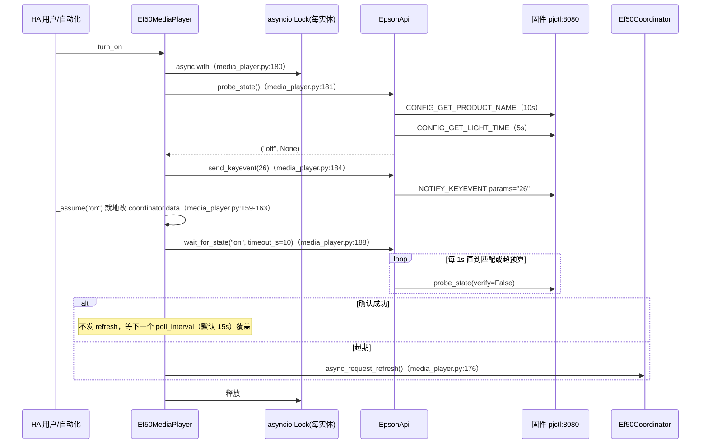
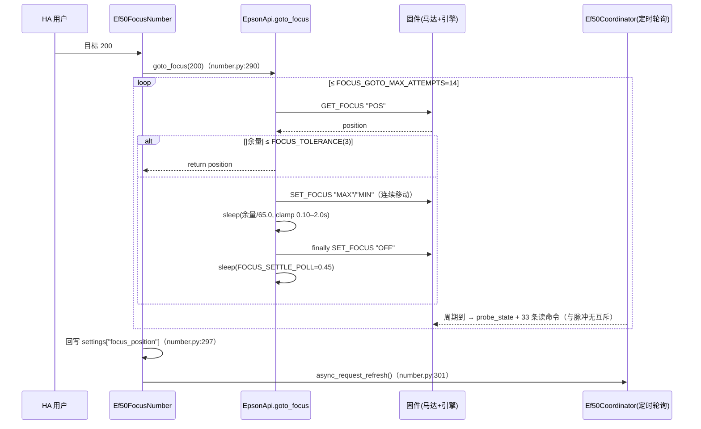
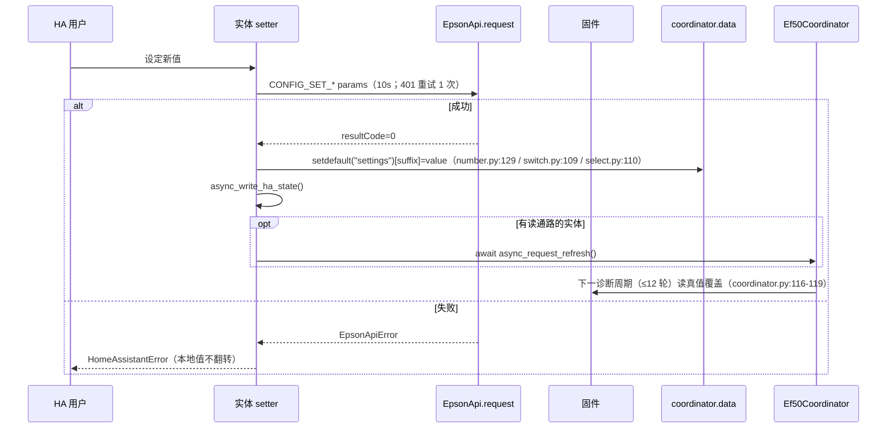
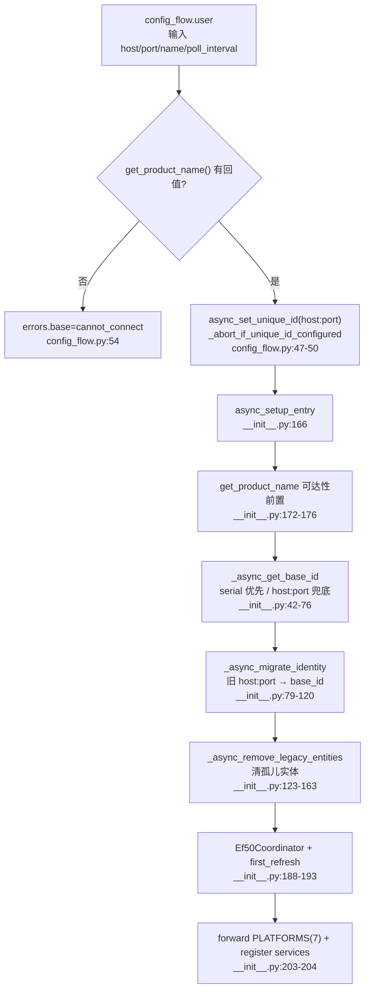

# 场景视图（核心场景与四视图追溯）

> 场景 = 从「用户/自动化触发」到「投影仪实际动作 + HA 状态收敛」的完整旅程。
> 本项目的特殊性：**设备没有推送能力**（`manifest.json:10` `iot_class=local_polling`），所有"设备侧事实"只能由轮询发现；同时**固件对多数能力没有读通路**，因此场景被两类约束塑形——"能读的靠轮询收敛，不能读的靠本地记忆"。
> 所有 `path/to/file:line` 相对仓库根，行号取自 `base_commit`。

## 1. 核心场景

| 场景 ID | 场景名称 | 触发者 | 涉及子系统（subsystems/ 模块） | 一致性级别 | 详情 |
|-|-|-|-|-|-|
| SC-001 | 开机 / 关机（盲 toggle 的强一致确认） | HA 用户、自动化、语音 | `entry-core`, `state-coordinator`, `pjctl-transport`, `entity-media-player` | 强一致（动作前探测 + 动作后确认） | §2.1 |
| SC-002 | 对焦绝对定位（无 set-absolute 命令的闭环） | HA 用户设置 number 目标值 | `entity-number`, `pjctl-transport`, `contract-const` | 强一致（每轮回读 POS） | §2.2 |
| SC-003 | 可写设置的读取与变更（亮度/投影方式/增益…） | HA 用户、自动化 | `entity-number`/`entity-select`/`entity-switch`, `contract-const`, `state-coordinator`, `pjctl-transport` | 最终一致（≤12 个轮询周期） | §2.3 |
| SC-004 | 无读通路能力的写入（氛围灯/自动对比度/测试图案/静音） | HA 用户 | `entity-switch`/`entity-select`/`entity-number`/`entity-media-player`, `pjctl-transport` | 无收敛（assumed_state + 本地记忆） | §2.4 |
| SC-005 | 首次接入、设备身份建立与地址漂移迁移 | HA 用户（配置流 / 重新配置） | `entry-core`, `entry-config-flow`, `pjctl-transport`, `diagnostics` | 强一致（身份写入成功才继续装配） | §2.5 |
| SC-006 | 任意命令注入与快捷动作（30 按钮 + 2 服务） | HA 用户、自动化、调试者 | `entity-button`, `action-services`, `pjctl-transport`, `contract-const` | 最弱（即发即弃，失败仅抛错/写事件） | §2.6 |

## 2. 场景详述

### 2.1 SC-001 开机 / 关机：先探测、再盲发、后确认

**触发者**：`media_player.turn_on` / `turn_off`。
**参与单元**：`Ef50MediaPlayer`、每实体一把 `asyncio.Lock`、`EpsonApi.probe_state` / `send_keyevent` / `wait_for_state`、固件 NanoHTTPD、`Ef50Coordinator`。
**一致性策略**：强一致。`KEYCODE_POWER(26)` 是**盲 toggle**（固件无 set-power 命令），所以必须"先探再发"；发完再"确认轮询"，确认失败则回落到协调器刷新。

**异常路径（代码事实）**
- 不可达：`probe_state` 把 liveness 阶段的 `EpsonApiTimeout` 归一化为 `EpsonApiUnavailable`（`custom_components/epson_ef/api.py:240-246`），`_probe` 再转 `HomeAssistantError`（`custom_components/epson_ef/media_player.py:154-156`）——**绝不误发 toggle**。
- 已在目标态：直接 `return`，不发命令（`custom_components/epson_ef/media_player.py:182-183`, `:194-195`）。
- 深待机导致引擎查询挂死：`CONFIG_GET_LIGHT_TIME` 5s 超时即判 `off`（`custom_components/epson_ef/api.py:252-259`），注释明确"绝不能上报为不可达"（`api.py:248-251`）。
- **锁的真实边界**：锁是**每实体实例**的（`custom_components/epson_ef/media_player.py:73`），只序列化同一设备的 turn_on/off；`services.send_key`（`custom_components/epson_ef/services.py:54`）与自动对焦按钮不经过它，仍可并发。

**追溯**：逻辑视图"实体平台层 + 传输协议层"、进程视图 GP-002（`architecture_views/process_view.md` §5.1）、部署视图 §4.1 入口表、开发视图 §3 测试层（`custom_components/../tests/test_regressions.py:186` 覆盖不可达语义）。

### 2.2 SC-002 对焦绝对定位：固件无绝对命令时的闭环

**触发者**：HA 用户设置 `number.*_focus_position`（0–264）。
**参与单元**：`Ef50FocusNumber`、`EpsonApi.goto_focus` / `focus_move_start` / `focus_move_stop` / `get_focus_position`、固件对焦马达、`Ef50Coordinator`（并发竞争者）。
**一致性策略**：强一致（闭环回读，非乐观）。

**关键事实与边界**
- 常量即真机结论：行程 0–264、连续移动 ≈65 单位/秒、容差 3、最多 14 次、停稳 0.45s（`custom_components/epson_ef/const.py:119-133`）。
- 马达保护：`try/finally` 保证即使 sleep 被取消也发 `OFF`（`custom_components/epson_ef/api.py:573-582`，注释见 `:575-578`）；但该 `await` **未用 `asyncio.shield`**，二次取消仍可能跳过。
- 无重入保护：`goto_focus` 与实体均无锁（`custom_components/epson_ef/api.py:561-583`、`custom_components/epson_ef/number.py:282-301`），并发两次定位会交错 `MAX/MIN/OFF`。
- POS 读不到（待机）→ 首轮 `return None`（`api.py:562-564`）→ 实体抛 `HomeAssistantError`（`number.py:293-296`）。

**追溯**：进程视图 GP-003（`process_view.md` §5.2）、逻辑视图"光学功能域"、开发视图 §4 的"改对焦"七步链路（`development_view.md` §4）、测试护栏 `tests/test_regressions.py:38-94`。

### 2.3 SC-003 可写设置的读取与变更：乐观写 + 慢轮询收敛

**触发者**：光源亮度（number）、投影方式/色温/动态对比度/投影偏好（select）、6 个 0/1 配置开关（switch）。
**参与单元**：对应实体、`EpsonApi.set_*` / `request`、`Ef50Coordinator` 的慢诊断段、`const.py` 声明式表。
**一致性策略**：最终一致——写成功后立刻改协调器缓存（UI 立即响应），真值由下一次诊断轮询覆盖。

**收敛时延差异（务必区分，逐实体核对）**

| 实体族 | 读通路来源 | 写入后是否立即 refresh | 最迟收敛时点 | 证据 |
|-|-|-|-|-|
| `Ef50LightOutputNumber` | `settings.light_output` | 是 | 下一诊断周期 | `custom_components/epson_ef/number.py:123-133`；`coordinator.py:102-104` |
| `Ef50RefreshTimerNumber` | `settings.refresh_timer` | 是 | 下一诊断周期 | `number.py:210-220`；`coordinator.py:106-108` |
| `Ef50ColorGainNumber` ×3 | `diag.color_gain`（三通道**共享一条 GET**） | 是 | 下一诊断周期 | `number.py:351-396`；`coordinator.py:77` |
| `Ef50ConfigSelect` ×4 | `settings.<suffix>` | 是 | 下一诊断周期 | `select.py:104-113`；`coordinator.py:97-101` |
| `Ef50StandbyModeSelect` | `coordinator.data["standby_mode"]`（仅诊断周期更新） | 是，但快周期不改该键 | 下一诊断周期 | `select.py:142-164`；`coordinator.py:130-132` |
| `Ef50ConfigSwitch` ×6 | `settings.<suffix>` | **否** | 下一诊断周期（≤12×poll_interval） | `switch.py:104-111`；`coordinator.py:92-96` |

**关键边界**：待机时整段 `settings` 不刷新（落位于 `if state == "on":` 内，`custom_components/epson_ef/coordinator.py:61`, `:116`），因此关机期间乐观值可持续偏离（例如他人用遥控器改过亮度）。

### 2.4 SC-004 无读通路能力的写入：纯本地记忆

**触发者**：氛围灯开/关 ×3、氛围灯亮度、氛围灯模式、自动对比度、测试图案、静音。
**参与单元**：乐观态实体、`EpsonApi.set_ambient_light` / `set_ambient_brightness` / `set_ambient_mode` / `set_auto_contrast` / `set_test_pattern` / `send_keyevent(164)`。
**一致性策略**：无收敛——固件 GET 全部 FAIL（HB71 实测），故不假装可读：写成功才翻本地值，跨重启用 `RestoreEntity` 恢复，并对 HA 显式声明 `assumed_state = True`。

| 能力 | 写命令 | 读通路 | 状态表达 | 证据 |
|-|-|-|-|-|
| 氛围灯开/关 ×3 | `CONFIG_SET_AMBIENT_LIGHT` `"3|4|5 <01> [48]"` | 无（本机全 FAIL） | `assumed_state=True` + RestoreEntity | `api.py:387-398`；`switch.py:120-185` |
| 氛围灯亮度 | `"9 <0-255> 48"`（UI 0–100 ×2.55） | 无 | `assumed_state=True` + RestoreEntity | `api.py:400-409`；`const.py:155-156`；`number.py:399-458` |
| 氛围灯模式 | `"1 <mode> 48"`（MODE1..4=3..6） | 无 | `assumed_state=True` + RestoreEntity | `api.py:411-418`；`const.py:158-163`；`select.py:167-219` |
| 自动对比度 | `CONFIG_SET_AUTO_CONTRAST` `"1"/"0"` | 无（带参 GET 亦 FAIL） | `assumed_state=True` + RestoreEntity | `api.py:623-632`；`switch.py:188-246` |
| 测试图案 | `CONFIG_GET_ESCVP` `"2 AGPATTERN 01/00"` | 无 | `assumed_state=True` + RestoreEntity | `api.py:420-430`；`const.py:182-183`；`switch.py:249-306` |
| 静音 | `NOTIFY_KEYEVENT 164`（纯 toggle） | 无 | RestoreEntity（**未**设 assumed_state） | `media_player.py:50`, `:75-81`, `:207-216` |

**已知漂移源**：物理遥控器或机身菜单改了状态，集成无从得知（无推送、无读通路），只能等用户手动同步——`media_player.py:208-211` 的注释明确承认这一点。

### 2.5 SC-005 首次接入、身份建立与地址漂移迁移

**触发者**：用户在 HA UI 添加集成 / 重新配置 IP。
**参与单元**：`Ef50ConfigFlow`、`async_setup_entry`、`_async_get_base_id`、`_async_migrate_identity`、`_async_remove_legacy_entities`、HA `Store`、实体/设备注册表。

**异常路径（代码事实）**
- 探活失败本应 `ConfigEntryNotReady`（`custom_components/epson_ef/__init__.py:172-176`），但 `get_product_name` 内部 `except EpsonApiError: return None`（`api.py:295-300`）**永不抛** → 该分支不可达；真正的降级来自协调器首刷（`__init__.py:189-193` + `coordinator.py:44-45`）。
- 无序列号时把首个 `host:port` 钉死为身份（`__init__.py:68-76`），换 IP 不改身份。
- 配置流 unique_id 用 `host:port`（`config_flow.py:47-49`），与实体身份（serial）**不同源** → "改 IP 后重新添加而非重新配置"会产生第二个 entry 并撞 unique_id。

### 2.6 SC-006 任意命令注入与快捷动作

**触发者**：30 个按钮实体（`POWER/HOME/BACK/MENU` 按键、`NOTIFY_*` 功能触发、`CONFIG_SET_QC` 几何步进）、`epson_ef.send_key` 服务、`epson_ef.raw_request` 服务。
**参与单元**：`Ef50Button` 表驱动（`BUTTON_DEFS` 30 条）、`services.py`、`EpsonApi.request`。

**一致性策略**：最弱——投影仪回 `resultCode=0` 即算成功，**不代表动作生效**；`raw_request` 把任意异常吞进事件。

| 入口 | 契约 | 失败表达 | 证据 |
|-|-|-|-|
| 按钮 | `(suffix, key, icon, cmd_id, params)` 5 元组表 | `EpsonApiError` → `HomeAssistantError`；实体 `available` 恒 `True`（离线也保留按钮以给出明确错误） | `button.py:17-83`；`:131-142` |
| `send_key` | `key` 可按键名（`KEYCODES`）或纯数字 keycode | 未知键 → `HomeAssistantError` | `services.py:43-54`；`const.py:195-219` |
| `raw_request` | 任意 `id` + `params`，**无白名单、无 admin 校验** | 异常吞成 `{"error": ...}`，经 `epson_ef_response` 事件返回；仓库内无订阅者 | `services.py:56-70` |

**危险面（代码已记录但未拦截）**：`raw_request` 可发送 `CONFIG_SET_REFRESH "1"`（立即刷新并关机，`api.py:481-488` 警示）、`CONFIG_SET_AMBIENT_LIGHT "255"`（清用户光效配置，`const.py:149`）、`CONFIG_GET_ESCVP` 工厂 NVRAM 写命令（仓库未暴露该命令，但 `raw_request` 服务可透传）。

## 3. 场景 × 四视图追溯矩阵

| 场景 | 逻辑视图（模块/层） | 开发视图（源码与测试） | 进程视图（协程/一致性） | 部署视图（拓扑/故障域） |
|-|-|-|-|-|
| SC-001 | 实体平台层 `media_player.py` → 传输层 `api.py`；锁在实体 `media_player.py:73` | `tests/test_regressions.py:186`（不可达语义）；`tests/test_api.py:165-216`（probe_state 判定） | GP-002 §5.1；`wait_for_state` 软超时（`api.py:284-292`） | 断电/深度待机断网 → 全部不可用，无 WOL；§6 容灾表 |
| SC-002 | 实体 `number.py` → 算法 `api.py:544-584` → 常量 `const.py:119-133` | `tests/test_regressions.py:38-94`、`tests/test_api.py:511-567` | GP-003 §5.2；无重入保护、与轮询争用单线程固件 | 马达命令走 8080；固件挂起则定位中断 |
| SC-003 | `const.py` 四张表 → `coordinator.py` 慢诊断 → 各平台 | `tests/test_const_contract.py`（表宽契约）；`tests/test_api.py:218-505`（载荷） | GP-001 §5.3 + GP-004 §5.4；carry-forward | 单轮 33 次串行 HTTP（§4.1 入口表） |
| SC-004 | 写-only 实体族（switch/select/number/media_player） | `tests/test_api.py:246-263`（氛围灯载荷）、`:382-424`（亮度/模式/图案） | GP-005 §5.4；无收敛 | 无读通路是**机型事实**（HB71），换机型可能变化 |
| SC-005 | 入口装配层 `__init__.py`/`config_flow.py`；`Store` 身份 | `tests/test_regressions.py:96-171`（清孤儿、弃用 API、实参顺序） | GP-007；setup 失败即整体回滚 | DHCP 漂移用"重新配置"；`.storage` 丢失退化 `host:port` |
| SC-006 | 动作入口层 `services.py` + 按钮表 `button.py` | 无单测覆盖 services（`tests/` 4 文件均不含） | GP-006；即发即弃、无重试 | 无 admin 门禁的入口面（§3 隔离边界表） |

## 4. 场景承载的非功能需求

| 非功能需求 | 目标（来自代码/配置的事实） | 达成方式 | 现状与缺口 |
|-|-|-|-|
| 可用性：设备离线可区分 | 离线判 `unavailable`，且"关机"与"卡死"不得混淆 | 4 类异常语义化 + liveness 超时归一化（`api.py:40-61`, `:236-246`）；`Ef50ConnectivitySensor` 恒 `available=True` 以便报告"离线"（`binary_sensor.py:49-52`） | 达成；但服务端真挂起时仍只能等 10s 超时，无熔断 |
| 时效性：状态可见延迟 | 电源态 ≤ 1 个 `poll_interval`（默认 15s，可配 5–300s，`const.py:11`、`config_flow.py:63`） | 快探针每轮执行（`coordinator.py:42-56`） | 达成；但慢诊断最坏 ≈330s（33×10s）可挤占后续轮询 |
| 一致性：可读设置 | 写后 ≤ 12 个轮询周期收敛到固件真值 | 乐观写 + 慢诊断回读覆盖（`coordinator.py:116-119`） | 达成；`Ef50ConfigSwitch` 不主动 refresh，收敛偏慢 |
| 可辨识性：不可读状态 | 不得伪装成真值 | `assumed_state=True`（`switch.py:166-169`、`number.py:444-447`、`select.py:203-206`）+ `raw_value` 属性 | 达成；静音例外（无 `assumed_state`，`media_player.py:50`） |
| 可运维性：身份稳定 | IP 变化不丢历史 | serial 优先 + `Store` 钉住 + 注册表迁移（`__init__.py:42-120`） | 达成；config entry unique_id 仍用 host:port 是缺口 |
| 可排障性 | 无需复现即可定位协议问题 | `diagnostics.py` 导出 entry/identity/coordinator/api 四段且不含密码（`diagnostics.py:19-39`）+ `raw_request` 透传 | 达成；无 trace/span |
| 可测试性 | 协议层可离线验证 | `api.py` 零 HA 依赖（`api.py:1-3`）+ 64 用例离线套件 | 达成；HA 装配层零覆盖（CI 不装 homeassistant，`.github/workflows/tests.yml:18`） |

## 5. 未覆盖 / 待确认场景

- **[未覆盖] 多投影仪并发场景**：代码支持多 entry（`services.py:32-35` 取"第一个 entry"当未指定 entity 时），但仓库无任何多实例测试或真机记录；`services.py:31-35` 的"取第一个"语义在多设备下是含糊的。
- **[未覆盖] 固件升级 / 换机型场景**：无版本探测、无兼容降级；`product name` 仅用于展示（`media_player.py:87`）。HB71 之外机型的读通路/命令可用性完全未知。
- **[待确认: 是否存在被刻意排除但用户期望的场景（如"立即开始刷新并关机"）？]** 代码把 `CONFIG_SET_REFRESH "1"` 判定为危险命令而不暴露（`api.py:481-488`、`const.py:50-52`），但 `raw_request` 服务仍可发；是否需要在服务层做参数级拦截，属产品决策。
- **[待确认: 自动对比度开关的实际效果]** `switch.py:196-198` 注释自承"效果未可感知验证"，是否为可发布功能需维护者裁决。
