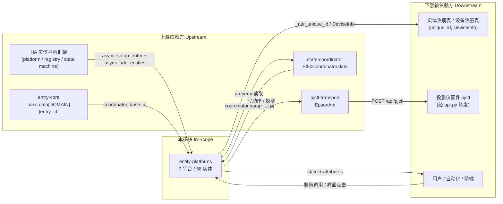

# 模块边界

## 模块范围

|维度|本领域负责|本领域不负责（属于其他领域）|
|-|-|-|
|核心职责|58 个实体对象的生命周期与状态投影；全部用户触发的写动作；写后乐观值回填；实体级错误翻译（`EpsonApiError` → `HomeAssistantError`）|HTTP/Digest/命令编码（`custom_components/epson_ef/api.py:1-656`）；轮询节奏与读数装配（`custom_components/epson_ef/coordinator.py:37-154`）；平台转发与身份解析（`custom_components/epson_ef/__init__.py:166-206`）|
|数据所有权|`DeviceInfo`（设备聚合）；`unique_id` 后缀命名；实体翻译键与图标；`theme`-无关的展示属性（`raw_value`/`stale`/`measured_at`）|`coordinator.data` 七类键的**生产**与**结转**（`state`/`light_hours`/`light_extra`/`light_measured_at`/`settings`/`diag`/`product`/`standby_mode`，`coordinator.py:51-153`）；表定义（`const.py:53-142`）|
|业务规则|幂等判定（先探测/先比对再发键）；写后回写协调器缓存；无读通路能力的诚实降级；模态化的可写性（哪些值域可下发）|固件命令语义与值域来源（`const.py`）；`size = params.split(" ")` 协议不变量（`api.py:160-171`）；电源态判定规则（`api.py:221-276`）|
|装配方式|每平台一个 `async_setup_entry`，从 `hass.data[DOMAIN][entry_id]` 取 `coordinator` / `base_id` 两个依赖|平台列表声明（`__init__.py:24-27`）；`hass.data` 写入（`__init__.py:195-201`）|
|演化责任|新增/删除实体的 unique_id 兼容与 `__init__.py` 遗留清理表的联动（`__init__.py:123-163`）|旧 identity（`host:port`）迁移（`__init__.py:79-120`）|

## 上下游总览

## 上游依赖（Inbound / 谁依赖我）

|依赖方 (Caller)|交互方式 (RPC/HTTP/Event/Direct)|契约/接口路径|
|-|-|-|
|HA 实体平台框架|Direct（框架回调）|每个平台模块导出 `async_setup_entry(hass, entry, async_add_entities)`；本模块 7 份实现见 `media_player.py:30`、`sensor.py:22`、`select.py:27`、`binary_sensor.py:18`、`button.py:86`、`switch.py:28`、`number.py:47`|
|`entry-core`|Direct（共享字典）|`hass.data[DOMAIN][entry.entry_id]["coordinator"]` 与 `["base_id"]`，读取点 `media_player.py:35-37`、`sensor.py:27-32`、`select.py:32-45`、`button.py:91-98`、`switch.py:33-53`、`number.py:52-63`、`binary_sensor.py:23-26`|
|`state-coordinator`|Direct（只读属性 + 就地改写）|读：`coordinator.data`；写：实体直接 `setdefault`/赋值（`number.py:129`, `:216`, `:297`, `:392`；`switch.py:109`；`select.py:110`, `:162`；`media_player.py:162`）|
|`services`（同包动作入口）|共享对象（`EpsonApi`）|`services.py:13-36` 经 `hass.data` 取 `api`，绕过实体直接发命令——与本模块构成平行写入口|
|用户 / 自动化|HA 服务调用|`media_player.turn_on/turn_off/volume_*`、`number.set_value`、`select.select_option`、`switch.turn_on/turn_off`、`button.press`|

## 下游依赖（Outbound / 我依赖谁）

|被依赖方 (Callee)|依赖目的|协议/驱动类型|强/弱|
|-|-|-|-|
|`Ef50Coordinator.data`|全部状态读取的唯一来源|进程内字典（`CoordinatorEntity`）|**强**（无此依赖实体无状态可显示）|
|`EpsonApi` 语义方法|**13 个方法**承载 **15 个实体**的动作（media_player 独占 3 个：`send_keyevent`/`probe_state`/`wait_for_state`；其余 10 个各对应 1 类实体）|Python 方法调用（`api.py`）|**强**|
|`EpsonApi.request(cmd, params)`|40 个实体直接拼命令字符串写入|Python 方法调用（`api.py:147-216`）|**强**（当前实现下的主要写通道）|
|`EpsonApi.probe_state` / `wait_for_state`|电源动作前后真值判定|Python 方法调用（`api.py:221-293`）|**强**（电源路径唯一可靠依据）|
|`const.py` 四张声明式表|实体装配与取值域|模块级常量解包|**强**（表宽度漂移会让平台 setup 直接 `ValueError`）|
|`homeassistant.*`|实体基类、`DeviceInfo`、`RestoreEntity`、`HomeAssistantError`|框架 API|**强**（无降级路径）|

## 防腐层与协议转换 (Anti-Corruption Layer)

- **外部系统隔离策略**：本模块**没有独立 ACL**。固件命令字符串与 `size` 语义被 `api.py` 隔离（协议层），但**实体层仍然直接拼写固件命令串**（`switch.py:106`、`select.py:107`、`button.py:138` 三处共 40 个实体），因此协议词汇（`CONFIG_SET_QC`、`NOTIFY_APP_*`）实际渗透到实体层，与 `const.py` 的表驱动路径并存。真正的隔离只有一层：`const.py` 把"命令名 + 值域 + 标签"抽成数据，实体只负责解包（`switch.py:38`, `select.py:40`, `button.py:96`）。
- **DTO / 领域对象映射**：
  - 固件原始值 → 展示值：select 的双向字典（`select.py:79-80`，`raw_value` 保原始值 `:100-102`）；启动模式的专门映射函数（`const.py:33-45`）；氛围灯 UI 0–100 ↔ 固件 0–255 的 ×2.55 换算下沉在 `api.py:408`。
  - 单位换算：测距 mm → m 保留 3 位（`sensor.py:106-109`），mm 原值进属性（`sensor.py:116-117`）。
  - 缺失映射：`Ef50ColorGainNumber` 三个实例共享 `diag["color_gain"]` 一个字符串三元组，各自按 `channel` 取位（`number.py:40-44`, `:364-368`），写入时反向拼回整串（`number.py:386-393`）——这是本模块唯一的"复合值 ↔ 单通道"映射，且映射逻辑在实体里而非 `api.py`（`api.get_color_gain` 零调用者）。

## 边界变更记录

|日期|变更内容|根因 / 触发|关联工件|
|-|-|-|-|
|2026-11-01|`refresh` 开关从 switch 迁出，改为 `refresh_timer` number（1–24 小时）|实测 `GET_REFRESH` 返回小时数而非 0/1；`SET_REFRESH "1"` 是"立即刷新并关机"|`const.py:48-52`、`number.py:143-220`、`__init__.py:136-139`|
|2026-11-01|`standby_mode` 从只读 sensor 迁为可写 select；`serial` 诊断 sensor 删除|只读能力升级为可写；序列号已由 identity 机制内部消化|`__init__.py:132-134`、`select.py:116-164`|
|2026-11-01|`engine_refresh` 按钮删除|该 NOTIFY 只是刷新确认应用的启动标记，单独发送无任何动作|`button.py:41-43`、`__init__.py:139-141`|
|2026-11-01|`light_output` 从诊断 sensor 迁为 number（50–100 步进 5）|写通路因 `size=token 数` 修复而打通，只读实体升级为可写|`__init__.py:135`、`number.py:66-140`|
|2026-11-07|对焦写入从"按 ±10 步数换算"改为 `goto_focus` 闭环（MAX/MIN + 定时 + OFF + 回读）|实测换向首步 ±10、同向后续仅 ±1，旧算法到不了远距离目标|`number.py:282-301`、`api.py:544-584`、`const.py:105-133`|

## 全局功能树映射

> 依据：`architecture_views/function_tree.yml`（跨模块业务能力合并产物）。
> 本模块在全局功能树中参与的 `function` 节点如下；合并依据与不合并理由见该文件头部注释。

| 全局 function id | 全局 function 名称 |
|-|-|
| `133` | 调整画面几何 |
| `134` | 定位对焦马达至目标位置 |
| `41` | 开关投影仪 |
| `42` | 注入遥控按键 |
| `43` | 切换静音状态 |
| `44` | 设定启动模式 |
| `51` | 调节光源亮度 |
| `52` | 调整画面档位设置 |
| `53` | 设定色彩增益 |
| `54` | 切换自动对比度 |
| `55` | 配置画面辅助开关 |
| `56` | 步进调整画面几何 |
| `61` | 开关氛围灯 |
| `62` | 调节氛围灯亮度与模式 |
| `71` | 显示设备读数 |
| `72` | 监测投影仪在线状态 |
| `73` | 暴露扩展诊断信息 |

**回写说明**：本模块的 `function_tree.yml` 描述"本模块内部能力结构"；全局树描述"跨模块的业务能力"，二者通过上表对齐。合并后本模块仍是该能力的实现方之一（`module_refs`），不因合并而失去边界。
