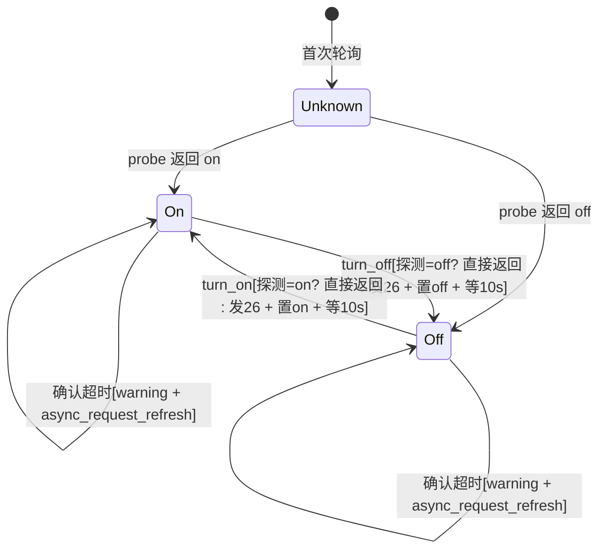
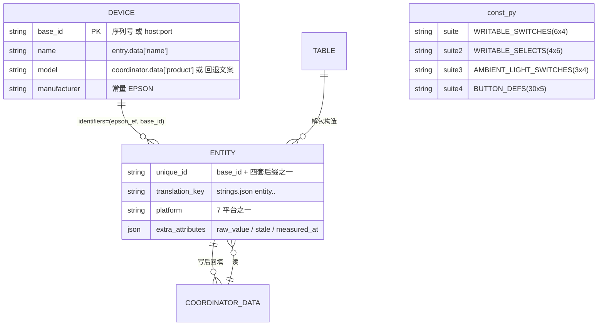
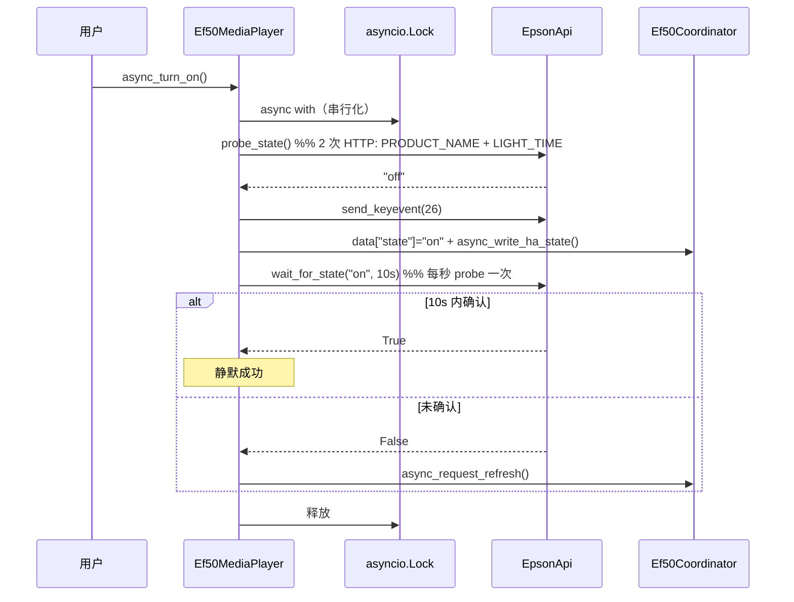
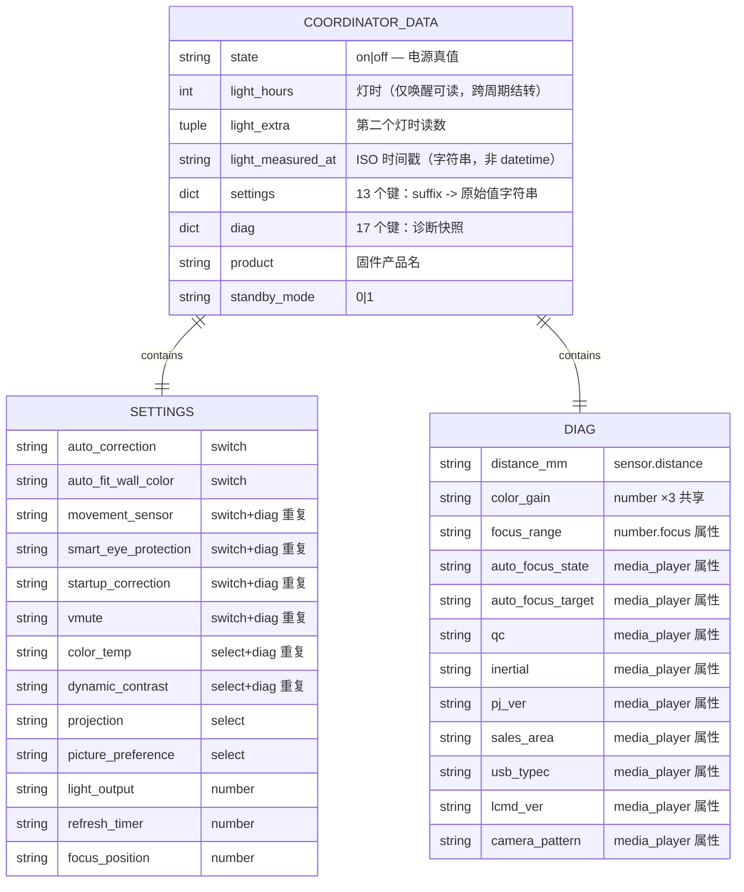
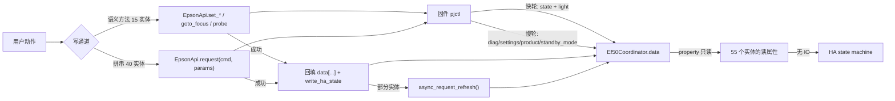

# 模块设计：entity-platforms（实体平台域）

## 模块定位与核心职责

- **一句话定义**：把「一份每轮重建的状态字典」翻译成「用户可点、可读、可自动化的 58 个 Home Assistant 实体」，并把用户的每个意图翻译成一条（或一组）固件命令。
- **核心业务/技术能力**：
  1. **投影**：7 个平台的 `async_setup_entry` 从 `hass.data[DOMAIN][entry_id]` 取 `coordinator`/`base_id`，实例化并注册实体（`media_player.py:35-38`、`button.py:91-98`、`number.py:52-63`）。
  2. **读**：全部实体 property 只读 `coordinator.data`，**零按需 IO**（唯一例外是电源动作前的 `probe_state`，`media_player.py:151-157`）。
  3. **写**：55 个可写实体承载全部用户意图；写后按模态回填缓存（`number.py:129-133`、`switch.py:109-111`、`select.py:110-113`、`media_player.py:159-163`）。
  4. **降级**：对固件不可读的 7 类能力，用 `RestoreEntity` + `assumed_state` 诚实标记为假设值（`switch.py:120-185`、`switch.py:188-246`、`switch.py:249-306`、`select.py:167-219`、`number.py:399-458`）。
  5. **错误翻译**：把传输层 4 类异常收敛成用户可读的 `HomeAssistantError`（本模块 7 个文件共 **21 处** `raise HomeAssistantError`：media_player 4 / number 7 / select 5 / switch 4 / button 1 / sensor 0 / binary_sensor 0；services.py 另有 5 处）。

## 58 实体的精确构成

> 逐平台数出，表驱动项按 `BUTTON_DEFS` 实际行数推导（30 行，`button.py:17-83`），非估算。

| 平台 | 实体类 | 实体数 | 装配方式 | 证据 |
|-|-|-|-|-|
| `media_player` | `Ef50MediaPlayer` | 1 | 单元素列表 | `media_player.py:36-38` |
| `sensor` | `Ef50LightHoursSensor`, `Ef50DistanceSensor`（共用 `_Ef50Sensor` 基类） | 2 | 列表字面量 | `sensor.py:28-33` |
| `select` | `Ef50StandbyModeSelect` ×1, `Ef50ConfigSelect` ×4, `Ef50AmbientModeSelect` ×1 | 6 | **3 次** `async_add_entities`：单例 + `WRITABLE_SELECTS` 推导 + 单例 | `select.py:33-45` |
| `binary_sensor` | `Ef50ConnectivitySensor` | 1 | 单元素列表 | `binary_sensor.py:24-26` |
| `button` | `Ef50Button` ×30 | 30 | **表驱动推导**：`BUTTON_DEFS` 30 行 × 单类 | `button.py:92-98`, `:17-83` |
| `switch` | `Ef50ConfigSwitch` ×6, `Ef50AmbientLightSwitch` ×3, `Ef50TestPatternSwitch` ×1, `Ef50AutoContrastSwitch` ×1 | 11 | **4 次** `async_add_entities`：6 表驱动 + 3 表驱动 + 2 单例 | `switch.py:34-53` |
| `number` | `Ef50LightOutputNumber`, `Ef50RefreshTimerNumber`, `Ef50FocusNumber`, `Ef50AmbientBrightnessNumber`（列表）+ `Ef50ColorGainNumber` ×3（**生成器 `extend`**） | 7 | 列表字面量 + `entities.extend(generator)` | `number.py:53-63`, `:40-44` |
| **合计** | **17 个实体类** | **58** | 17 次具体化 = 4 单例 + 1 三元组生成器 + 30 + 6 + 4 + 3 + 3 + 2 | — |

**表驱动推导的量**：`button` 30 + `switch` 6 + `switch` 3 + `select` 4 = **43 / 58（74%）** 的实体不是逐类实例化，而是「一个类 + 一张元组表 + 一次推导」。剩余 15 个是手写实例化（`number` 7、`select` 2、`switch` 2、`media_player` 1、`sensor` 2、`binary_sensor` 1）。`number.py` 的 RGB 三通道是唯一用 `extend(generator)` 的地方（`number.py:59-63`），因为三个通道共享 `_COLOR_GAIN_CHANNELS` 常量（`number.py:40-44`）而构造签名需要额外 `channel` 参数。

**读/写分布**：只读实体 3 个（sensor×2 + binary_sensor×1），可写实体 55 个。

## 内部架构与分层设计

- **分层模式**：**无模块内分层**——7 个平台文件互不 import（实测 0 处跨平台 import），彼此只共享 `const.py` 的常量与 `coordinator.data` 的键名。真正的结构是二维模态矩阵：

| 读模态 \ 写通道 | 语义方法（15） | 直接拼命令串（40） | 无写（3） | 小计 |
|-|-|-|-|-|
| ① 只读 coordinator | — | — | `sensor`×2, `binary_sensor`×1 | 3 |
| ② 乐观写 + 请求 refresh | `media_player`×1（电源）、`select.standby_mode`、`number`×6（light_output / refresh_timer / focus_position / color_gain×3） | `select` config×4（`select.py:107-113`） | — | 12 |
| ③ 乐观写 + **不** refresh（有读通路） | — | `switch` config×6（`switch.py:104-111`） | — | 6 |
| ④ 本地记忆 + `assumed_state` | `switch` ambient×3、`switch.test_pattern`、`switch.auto_contrast`、`number.ambient_brightness`、`select.ambient_mode` | — | — | 7 |
| ⑤ 无状态动作 | — | `button`×30（`button.py:136-142`） | — | 30 |

> 交叉校验：**3 + 12 + 6 + 7 + 30 = 58**；按写通道另算 **语义方法 8+7 = 15**、**裸串 4+6+30 = 40**、**无写 3**，15+40+3 = 58。两个维度自洽。
> `media_player` 的**静音**不属于上表任一格：它是本地记忆但**不**声明 `assumed_state`，属于第 6 种模态；因该实体整体已计入②的 media_player 行，此处仅作标注，详见下节"模态分类的 3 个例外"。

- **核心组件与分工**：

|组件/类名|职责描述|依赖|关键文件|
|-|-|-|-|
|`Ef50MediaPlayer`|唯一同时具备"状态机式写"（电源）与"盲 toggle"（静音）的实体；持有本模块唯一的 `asyncio.Lock`；同时是诊断属性的聚合出口|`probe_state`/`wait_for_state`/`send_keyevent`|`media_player.py:41-228`|
|`_Ef50Sensor` + 2 子类|共享 `unique_id = {base_id}-{suffix}` 与 `DeviceInfo` 构造；子类只声明 `_suffix`/`translation_key`/单位/值解析|`coordinator.data`|`sensor.py:36-120`|
|`Ef50ConfigSelect` / `Ef50ConfigSwitch`|一对同构的"档位/开关"适配器，参数全靠 `const` 表注入；存了 `_get_cmd` 但从不使用（读由协调器统一完成）|`WRITABLE_SELECTS`/`WRITABLE_SWITCHES`|`select.py:48-113`, `switch.py:56-117`|
|`Ef50StandbyModeSelect`|唯一有专门映射函数的设置实体（中文标签 ↔ 0/1）|`const.standby_*_option`|`select.py:116-164`|
|`Ef50AmbientModeSelect` / `Ef50AmbientLightSwitch` / `Ef50AmbientBrightnessNumber`|氛围灯三件套：同一命令 `CONFIG_SET_AMBIENT_LIGHT` 的三个子命令族（`1`/`3,4,5`/`9`），全部写-only|`set_ambient_mode`/`set_ambient_light`/`set_ambient_brightness`|`select.py:167-219`, `switch.py:120-185`, `number.py:399-458`|
|`Ef50ConfigSwitch` + `Ef50TestPatternSwitch` + `Ef50AutoContrastSwitch`|"同值回写"型开关与"纯探测打通"型开关；后者注释明确承认效果未可感知验证|`request`/`set_test_pattern`/`set_auto_contrast`|`switch.py:56-306`|
|`Ef50LightOutputNumber` / `Ef50RefreshTimerNumber`|有读通路的数值设置，`native_value` 走"轮询值优先 → 恢复值兜底"两级回退|`settings[...]` + `RestoreEntity`|`number.py:66-220`|
|`Ef50FocusNumber`|唯一带闭环控制的实体：把"绝对位置"翻译成多轮"连续移动+定时+停止+回读"|`goto_focus`|`number.py:223-301`|
|`Ef50ColorGainNumber`|一表三实例；读一条共享三元组，写整串|`diag["color_gain"]` + `set_color_gain`|`number.py:304-396`|
|`Ef50Button`|"命令发射器"：单类 × 30 表行，无状态、永不 unavailable|`request(cmd, params)`|`button.py:101-142`|

```mermaid
graph TD
    subgraph 平台层 Platform（7 文件 / 17 类 / 58 实体）
        MP["media_player ×1<br/>电源态机 + 盲 toggle"]
        SN["sensor ×2<br/>只读"]
        BS["binary_sensor ×1<br/>只读 + 恒可用"]
        SE["select ×6<br/>4 表驱动 + 2 单例"]
        SW["switch ×11<br/>6+3 表驱动 + 2 单例"]
        NB["number ×7<br/>4 单例 + 3 生成器"]
        BT["button ×30<br/>1 类 × 30 表行"]
    end
    subgraph 读通道（全部零 IO）
        RD["coordinator.data<br/>state / light_hours / light_extra<br/>light_measured_at / settings / diag<br/>product / standby_mode"]
    end
    subgraph 写通道 A（语义方法，15 实体）
        SEM["EpsonApi.probe_state / wait_for_state<br/>send_keyevent / goto_focus<br/>set_standby_mode / set_ambient_*<br/>set_light_output / set_refresh_timer<br/>set_color_gain / set_test_pattern / set_auto_contrast"]
    end
    subgraph 写通道 B（直接拼串，40 实体）
        RAW["EpsonApi.request(cmd_id, params)<br/>cmd 来自 const 表或 BUTTON_DEFS"]
    end
    subgraph 缓存回填（乐观值）
        WB["data['settings'][suffix] / data['diag'][key]<br/>data['state'] / data['standby_mode']"]
    end
    MP --> RD
    SN --> RD
    BS --> RD
    SE --> RD
    SW --> RD
    NB --> RD
    BT --> RD
    MP --> SEM
    SE --> SEM
    SW --> SEM
    NB --> SEM
    SE --> RAW
    SW --> RAW
    BT --> RAW
    MP --> WB
    SE --> WB
    SW --> WB
    NB --> WB
```

## 核心领域模型与状态机

- **关键实体（按读/写模态归类，完整清单）**：

**① 只读 coordinator（3 实体）**

| 实体 | 数据源 | 证据 |
|-|-|-|
|`sensor.light_hours`|`data["light_hours"]` + 结转|`sensor.py:66-83`|
|`sensor.distance`|`data["diag"]["distance_mm"]`|`sensor.py:101-120`|
|`binary_sensor.connectivity`|`coordinator.last_update_success`|`binary_sensor.py:54-56`|

**② 乐观写 + 请求 refresh（协调器下一轮覆盖，12 实体）**

| 实体 | 回填位置 | 是否 refresh | 证据 |
|-|-|-|-|
|`media_player`（电源）|`data["state"]`|是（仅在 10s 未确认时）|`media_player.py:159-163`, `:165-176`|
|`select.standby_mode`|`data["standby_mode"]`|是|`select.py:160-164`|
|`select.{color_temp,dynamic_contrast,projection,picture_preference}`|`data["settings"][suffix]`|是|`select.py:110-113`|
|`number.light_output`|`data["settings"]["light_output"]`|是|`number.py:129-133`|
|`number.refresh_timer`|`data["settings"]["refresh_timer"]`|是|`number.py:216-220`|
|`number.focus_position`|`data["settings"]["focus_position"]`|是|`number.py:297-301`|
|`number.color_gain_{red,green,blue}`|`data["diag"]["color_gain"]`|是|`number.py:392-396`|

**③ 乐观写 + 不 refresh（6 实体）**

| 实体 | 回填位置 | 证据 |
|-|-|-|
|`switch.{auto_correction,auto_fit_wall_color,movement_sensor,smart_eye_protection,startup_correction,vmute}`|`data["settings"][suffix]`|`switch.py:104-111`（写完 `async_write_ha_state()` 即返回，**无 refresh**）|

**④ 纯本地记忆 + `assumed_state`（7 实体）**

| 实体 | 本地字段 | 恢复机制 | 证据 |
|-|-|-|-|
|`switch.{ambient_light,welcome_light,touch_sensor_light}`|`_attr_is_on`|`RestoreEntity` + `assumed_state=True`|`switch.py:158-169`|
|`switch.test_pattern`|`_attr_is_on`|同上|`switch.py:279-290`|
|`switch.auto_contrast`|`_attr_is_on`|同上|`switch.py:219-230`|
|`select.ambient_mode`|`_attr_current_option`|同上|`select.py:197-206`|
|`number.ambient_brightness`|`_attr_native_value`|同上|`number.py:433-447`|

**模态分类的 3 个例外（必须显式指出）**：

1. **`media_player` 的静音**不落在上表任一模态：它是**本地记忆 + RestoreEntity，但没有 `assumed_state`**，构成独立的第 6 种形态。`_attr_is_volume_muted` 只有类默认值 `False`（`media_player.py:50`）与恢复路径（`:75-81`），写入时"目标态与本地相同则直接返回"（`:212-213`），写完 `async_write_ha_state()`（`:216`）而不 refresh。它既不像③那样回填 `coordinator.data`，也不像④那样标记 assumed_state——用户无法从界面判断"这是假设值"。
2. **`Ef50ConnectivitySensor.available` 恒 True**（`binary_sensor.py:50-52`），理由是"连通性传感器必须保持可用才能报告 off"；若沿用其它实体的 `last_update_success` 覆写，离线时实体会消失，该传感器的存在意义归零。
3. **`Ef50Button.available` 恒 True**（`button.py:132-134`），理由是"离线时保留按钮，按下会得到明确错误而不是被禁用"。两者是有意决策，不是遗漏。

**另 7 处 `available` 覆写与基类语义完全等价（冗余）**：`CoordinatorEntity.available` 本身即 `coordinator.last_update_success and super().available`，因此 `media_player.py:96-97`、`number.py:258-260`（对焦）、`number.py:348-349`（色彩增益）、`select.py:89-90`、`select.py:139-140`、`switch.py:87-88`、`sensor.py:53-54` 的覆写不改变任何行为。其中 `number.py:258` 的注释声称"对焦读数只在唤醒状态有效，跟随协调器在线状态"——但跟随 `last_update_success` 并不等价于"跟随唤醒状态"（设备待机时 HTTP 仍可达，`last_update_success` 为 True），该注释与实现不符。

- **状态转换逻辑（电源，唯一显式状态机）**：

| 当前态 | 目标动作 | 触发事件 | 执行动作 | 进入条件 |
|-|-|-|-|-|
|`on`|`turn_on`|用户/自动化|探测到已 on → **直接 return，零按键**|`probe_state()` 返回 "on"（`media_player.py:181-183`）|
|`off`/`unknown`|`turn_on`|同上|发 `KEYCODE_POWER(26)` → 乐观置 on → 等 10s 确认|探测未返回 "on"（`:184-188`）|
|`off`|`turn_off`|同上|探测到已 off → **直接 return**|`probe_state()` 返回 "off"（`:193-195`）|
|`on`/`unknown`|`turn_off`|同上|发 26 → 乐观置 off → 等 10s 确认|探测未返回 "off"（`:196-199`）|
|未确认|10s 超时|`wait_for_state` 未达目标|记 warning + `async_request_refresh()` 回落到权威轮询|`:170-176`|

分支冲突裁决：所有分支被同一把 `asyncio.Lock` 串行化（`media_player.py:73`, `:180`, `:192`），因此不存在"两个 turn_on 同时探测到 off 而各发一次键"的交错。



### 实体关系 (ER)



关系语义：**1 个设备聚合 58 个实体**（全部 `identifiers={(DOMAIN, base_id)}`）；**1 张表派生 N 个同构实体**；**1 份 `coordinator.data` 既是唯一读源也是写后回填目标**（双向箭头是设计要害：缓存被实体当本地变量用）。

## unique_id 的四套后缀约定

|约定|模式|实例数|实例|证据|
|-|-|-|-|-|
|① 平台前缀式|`{base_id}-<platform>-{key}`|**38**|`{base_id}-button-{suffix}`（30）、`{base_id}-number-{key}`（7：light_output / refresh_timer / focus_position / ambient_brightness / color_gain_{red,green,blue}）、`{base_id}-select-ambient_mode`（1）|`button.py:122`、`number.py:90/169/248/338/424`、`select.py:189`|
|② setting 式|`{base_id}-setting-{suffix}`|**15**|switch 11 个 + select 4 个**共用同一前缀**|`switch.py:78/148/210/270`；`select.py:75`|
|③ 裸后缀式|`{base_id}-{suffix}`|**4**|`{base_id}-connectivity`、`{base_id}-standby_mode`、`{base_id}-light_hours`、`{base_id}-distance`|`binary_sensor.py:41`、`select.py:130`、`sensor.py:44`|
|④ 直接用 base_id|`{base_id}`|**1**|媒体播放器|`media_player.py:68`|
|—|**合计**|**58**|38+15+4+1，实测 58 个 suffix **互不重复**、58 个 `(platform, unique_id)` 亦互不重复|—|

**潜在冲突点核查（逐项）**：

- **`setting-` 前缀的 switch/select 是否撞车？** switch 侧后缀集 = {auto_correction, auto_fit_wall_color, movement_sensor, smart_eye_protection, startup_correction, vmute, ambient_light, welcome_light, touch_sensor_light, auto_contrast, test_pattern}（11 个）；select 侧 = {color_temp, dynamic_contrast, projection, picture_preference}（4 个）。**交集为空**（实测 15 个后缀全不重复）。且 HA 实体注册表的 unique_id 唯一性作用域是 `(platform, unique_id)`，跨平台同名后缀本不冲突——因此这一处**不是**现实冲突，但它是**未受保护的隐式约定**：表里加一行叫 `color_temp` 的 switch 不会报错，而是与 select 抢同一个 `coordinator.data["settings"]["color_temp"]` 键（见下一条）。
- **真正的冲突面在数据层而非注册表**：`settings` 是**扁平字典，键 = suffix**，由 `WRITABLE_SWITCHES` 与 `WRITABLE_SELECTS` 共同写入（`coordinator.py:92-101`）。两张表的后缀若有交集，后写者会静默覆盖前者的值，表现为"两个实体联动、其中一个永远显示对方的值"。
- **`diag` 与 `settings` 有 6 个键同名**：`vmute`、`color_temp`、`dynamic_contrast`、`movement_sensor`、`smart_eye_protection`、`startup_correction` 同时存在于 `probes` 白名单（`coordinator.py:63-83`）与设置表回读（`:92-101`）。后果：慢轮对**同一条 GET 命令发两次请求**（每诊断轮多 6 次 HTTP），且同一真值存在两份副本（`diag` 版供给 `media_player` 属性白名单 `media_player.py:122-127`，`settings` 版供给开关/选择器）。
- **`standby_mode` 的历史陷阱**：`__init__.py:146-150` 的清理表登记了 `"sensor": ("standby_mode", ...)`，会把 `(sensor, "{base_id}-standby_mode")` 从注册表删除。当前 `standby_mode` 是 **select**（`select.py:130`），键不同故安全；但若有人把它搬回 sensor，**每次 reload 都会删掉活着的实体**。这与裸后缀式③的命名叠在一起，是本次核查发现的最高危命名耦合。

## 命名与设备聚合约定

### `_attr_has_entity_name` / `_attr_translation_key` 的使用规律

**规律：17 个具体实体类全部 `_attr_has_entity_name = True`；57 个实体用 `translation_key`，仅媒体播放器用 `_attr_name`。** 实测 16 处声明覆盖 17 个具体类——其中 `sensor.py:37` 声明在基类 `_Ef50Sensor` 上，由 `Ef50LightHoursSensor`/`Ef50DistanceSensor` 两个子类继承；其余 15 处逐一覆盖 15 个具体类（`binary_sensor.py:32`、`button.py:104`、`media_player.py:46`、`number.py:76/155/235/317/410`、`select.py:55/119/177`、`switch.py:59/132/201/261`）。**唯一不写 `_attr_name` 以外名称来源的，正是媒体播放器**（它是 16 处声明中唯一用 `_attr_name` 而非 `translation_key` 的）。

翻译键的三种来源：

| 来源 | 键数 | 覆盖实体数 | 取值方式 | 证据 |
|-|-|-|-|-|
|类内字面量|11|11|`_attr_translation_key = "light_hours"` 等|`sensor.py:61/95`、`number.py:77/156/236/411`、`select.py:120/178`、`switch.py:202/262`、`binary_sensor.py:33`|
|生成器注入|3|3|`_attr_translation_key = key`，key 来自 `_COLOR_GAIN_CHANNELS` 三元组|`number.py:40-44`, `:336`, `:338`|
|表列注入（switch 6 + ambient 3 + select 4）|13|13|`_attr_translation_key = key`，key 来自表第 2 列|`switch.py:77`, `:147`；`select.py:74`|
|表列注入（button）|30|30|`self._attr_translation_key = key`（构造参数）|`button.py:121`|
|**无翻译键**|0|**1**|**媒体播放器**用 `_attr_name`|`media_player.py:69`|
|**合计**|**57**|**58**|57 个键各覆盖 1 个实体 + media_player|—|

`strings.json` 的 `entity` 段共 **57 个键**，与代码的 57 个键**完全相同**（实测双向差集均为空）；`translations/en.json` 与 `translations/zh-Hans.json` 的键集亦与 `strings.json` 完全一致（三文件键数：sensor 2 / number 7 / select 6 / binary_sensor 1 / button 30 / switch 11 = 57）。**即：代码翻译键 ↔ strings.json ↔ 两份翻译文件，四者一一对应，无缺键也无冗余键。**

**为什么 media_player 例外**（`media_player.py:69`）：

```python
_attr_has_entity_name = True          # :46
self._attr_name = entry.data.get("name", DEFAULT_NAME)   # :69
```

三条事实：

1. **它是"设备本体"实体**，不是设备的某个功能面。HA 的 `has_entity_name` 语义是"实体名 = 设备名 + 实体名"；对设备本体，惯例是让实体名与设备名一致，因此这里把 `_attr_name` 直接赋成配置条目名（同一字符串又被用作 `DeviceInfo.name`，`:90`）。
2. **它没有 `translation_key`，`strings.json` 里也确实没有 `entity.media_player` 段**（实测 `strings.json` 的 `entity` 下只有 sensor/number/select/binary_sensor/button/switch 六个平台）。也就是说它不是"漏了翻译"，而是**有意走 `_attr_name` 路径**，因此它不受翻译文件的约束——配置条目名是用户自定义的，不可能预先翻译。
3. **它是唯一同时承载 20+ 诊断属性的实体**（`media_player.py:108-136`），作为设备的"主实体"存在，名称要能代表整机。

**副作用（未验证，标注）**：`_attr_has_entity_name = True` 与 `_attr_name` 同时非空时，HA 会把实体名渲染为"设备名 + 实体名"；而这里两者是**同一字符串**（`entry.data["name"]` 同时用于 `_attr_name` 与 `DeviceInfo.name`），理论上会渲染成重复的设备名。本环境未安装 `homeassistant`（`python3 -c "import homeassistant"` 失败），无法实测 HA 的渲染结果 → **[待确认：在实际 HA 实例上检查 media_player 的 friendly_name 是否出现设备名重复；若是，应删掉 `:69` 的 `_attr_name` 赋值或改为 `None`]**。

### 设备聚合：`DeviceInfo` 的 16 处构造与漂移风险

**16 处**（实测 `grep -c "DeviceInfo("`，其中 media_player 是 property 返回、其余 15 处是 `__init__` 内赋值）：

| 文件 | 行 | `identifiers` | `name` | `manufacturer` | `model` |
|-|-|-|-|-|-|
|`media_player.py`|88-93|`{(DOMAIN, self._base_id)}`|`self._attr_name`|`"EPSON"`|`(c.data or {}).get("product") or "Epson EF Projector"`|
|`sensor.py`|45-50|`{(DOMAIN, base_id)}`|`entry.data.get("name", DEFAULT_NAME)`|`"EPSON"`|同上（`coordinator.data`）|
|`select.py`|81-86 / 131-136 / 190-195|同上|同上|`"EPSON"`|同上|
|`binary_sensor.py`|42-47|同上|同上|`"EPSON"`|同上|
|`button.py`|124-129|同上|同上|`"EPSON"`|同上|
|`switch.py`|79-84 / 151-156 / 212-217 / 272-277|同上|同上|`"EPSON"`|同上|
|`number.py`|92-97 / 171-176 / 250-255 / 340-345 / 426-431|同上|同上|`"EPSON"`|同上|

**model 取值一致性核对结果：15 处完全一致，1 处形式不同但语义等价。**

- 15 处逐字相同：`model=(coordinator.data or {}).get("product") or "Epson EF Projector"`。
- `media_player.py:87` 先取局部变量 `model = (c.data or {}).get("product") or "Epson EF Projector"` 再传入 —— 等价。
- `manufacturer` 15 处均为字面量 `"EPSON"`（无常量）。
- `identifiers` 全部为 `{(DOMAIN, base_id)}`，即 **58 个实体聚合成 1 个设备**。

**与既有材料的数量差异（Doc Distrust 记录）**：本次任务简报称"11 处重复构造 DeviceInfo"，`architecture_views/logical_view.md` 亦未给出该数目；但 `grep -c "DeviceInfo(" custom_components/epson_ef/*.py` 实测为 **16 处**（binary_sensor 1、button 1、media_player 1、number 5、select 3、sensor 1、switch 4）。差异根因：以"实体类数"（17 类，其中 `_Ef50Sensor` 基类 1 处覆盖 2 实体）与"构造点数"（16）口径不同，且 `number.py` 一个文件就有 5 处。本文件采用**构造点数 16**，并已在风险表 R-EP 技术债务条目中同步。

**漂移风险评估**：

1. **`model` 的回退文案在两处来源不同**：实体侧回退 `"Epson EF Projector"`（15 处硬编码），而 `DEFAULT_NAME` 也是 `"Epson EF Projector"`（`const.py:9`）——当前字符串相同纯属巧合，不是引用同一常量。若改 `DEFAULT_NAME`，设备名会变而 model 回退不变（或反之）。且 `__init__.py:198` 把 `product` 存进 `hass.data`，但**实体从不读它**，只读 `coordinator.data["product"]`（`coordinator.py:121-123` 只在唤醒时填）。
2. **`product` 只在唤醒时被刷新**（`coordinator.py:120-123` 位于 `if state == "on":` 内），但会被 carry-forward 结转（`:135-136`）。首轮若设备处于待机，`product` 为 None → 15 处实体同时落回退文案；设备开机后 model 变更 —— **同一个设备在 HA 里的 model 会中途改变**。HA 允许 model 更新，但历史记录与用户认知会出现"型号变了"。
3. **`identifiers` 与 `base_id` 强耦合**：若 `base_id` 从序列号变回 `host:port`（如序列号在某固件版本读不到），`_async_migrate_identity`（`__init__.py:79-120`）会尝试改设备 identifier，失败只记 warning（`:117-120`）→ 设备可能变成两个。
4. **16 处构造无共享函数**：新增平台或新实体类必须复制这 5 行；漏掉 `manufacturer` 或改错 model 表达式不会有任何测试报警（`tests/` 无平台层测试）。这是本模块最容易被低质量提交破坏的契约之一。

## 关键工作流与算法实现

### 流程 1：有读通路的设置写入（以光源亮度为例）

1. 用户拖滑条 → `async_set_native_value(value)`（`number.py:123`）。
2. `set_light_output(int(value))` → `api.request("CONFIG_SET_LIGHT_OUTPUT", params="100")`（`api.py:376-378`）；`size` 自动算成 token 数 1（`api.py:171`）。
3. 失败 → `HomeAssistantError("设置光源亮度失败: …")`，**不写缓存、不改本地值**（`number.py:127-128`）。
4. 成功 → 双写：`data["settings"]["light_output"]=str(v)` **且** `_attr_native_value=float(v)`（`number.py:129-131`）。双写是必需的：`native_value` 优先读 `settings`（`:110-121`），只改一处会被另一处覆盖回旧值。
5. `async_write_ha_state()` 立即上屏 → `async_request_refresh()` 触发权威回读（`:132-133`）。
6. 收敛：下一次慢轮 `merged.update(settings)` 用固件真值覆盖乐观值（`coordinator.py:116-119`）。

### 流程 2：无读通路的写入（以氛围灯开关为例）

1. `set_ambient_light(kind, on)` → 参数按 kind 分支拼装：3 → `"3 1 48"`，4/5 → `"4 1"`（`api.py:394-398`）。
2. 失败 → `HomeAssistantError("氛围灯写入失败(投影仪需处于唤醒状态): …")`，状态**不翻转**（`switch.py:174-177`）。
3. 成功 → `_attr_is_on = on` + `async_write_ha_state()`（`switch.py:178-179`）。**不碰 `coordinator.data`**（因为无读通路，不存在需要覆盖的权威值）。
4. 无收敛：设备侧若被遥控器改动，本地记忆永久漂移；`assumed_state=True` 是唯一提示（`switch.py:166-169`）。

### 流程 3：电源动作（唯一强一致写）



### 流程 4：对焦闭环定位（本模块唯一闭环算法）

1. 实体 setter 取 `target=int(value)`，调用 `api.goto_focus(target)`（`number.py:290`）。
2. `goto_focus` 每轮：读 `POS` → 算 `remaining` → 落在容差 3 内则返回 → 按 `|remaining|/65` 估算脉冲时长并 clamp 到 0.1–2.0s → `focus_move_start(±1)` → `sleep` → **finally 必发 `focus_move_stop()`** → 再 `sleep(0.45)` 等马达停稳（`api.py:561-584`）。
3. 最多 14 轮；耗尽后再读一次 POS 作为最终值（`api.py:584`）。
4. POS 读不到（待机）→ 首轮即 `return None`（`api.py:562-564`）→ 实体抛 `HomeAssistantError("无法读取对焦位置(投影仪需处于唤醒状态)")`（`number.py:293-296`）。
5. 成功 → 把**实测终值**写回 `settings["focus_position"]`（`:297-299`）。**为什么必须回写**：该键只在慢速诊断轮（每 12 轮）由 `coordinator.py:113-115` 刷新；若只改 `_attr_native_value`，下一次状态写入仍会从 `settings` 取到旧位置，界面立刻弹回。"回写的是实测值而非目标值"也是有意的——闭环可能有 ±容差内偏差（注释记录 120 落到 122），界面必须显示真实落点。

### 流程 5：色彩增益三通道写（读-改-写）

1. 三实体共享 `diag["color_gain"]`（形如 `"81 90 100"`），各自 `_triple()` 解析后取 `channel` 位（`number.py:351-368`）。
2. 写入：`current = _triple()`；读不到 → 直接抛错"无法读取当前色彩增益"（`:381-385`）；否则 `rgb[channel]=new` → `set_color_gain(*rgb)` → 回填整串（`:386-393`）。
3. **为什么每个实体都暴露完整三元组 `raw_value`**：三通道共用一条 GET，用户调 R 通道时无法从自己的滑条得知 G/B 是否被别人（或遥控器）改过；把 `"81 90 100"` 整串放进属性，排障时可一眼看出色偏来自哪个通道（`number.py:370-377` 的注释原文即此意）。
4. 已知缺陷：两个通道并发写时，后写者基于**同一份旧三元组**覆盖整串 → 先写者的通道值被丢弃（无锁、无版本校验）。

## 设计模式

|模式|应用位置|解决的问题|关键文件|说明|
|-|-|-|-|-|
|Table-Driven Construction（表驱动装配）|`BUTTON_DEFS`(30)、`WRITABLE_SWITCHES`(6)、`WRITABLE_SELECTS`(4)、`AMBIENT_LIGHT_SWITCHES`(3)|43 个实体只在参数上不同，逐类建模会产生 43 个几乎相同的类|`button.py:17-83`, `const.py:53-142`|"一个类 + 一张元组表 + 一次推导"；代价是元组宽度成为跨文件契约（`tests/test_const_contract.py` 用 AST 守护）|
|Optimistic Write + Reconcile（乐观写后回填/刷新）|全部有读通路的设置实体|固件无推送、轮询间隔 15s，等回读再上屏会让界面"迟滞一个周期"|`number.py:129-133`, `select.py:110-113`, `switch.py:109-111`|回填位置必须是 `coordinator.data` 而不只是 `self._attr_*`，否则被下一帧覆盖|
|Local Memory + Declared Assumption（本地记忆 + 显式假设）|7 个写-only 实体|固件读通路根本不存在，"等回读"永远等不到|`switch.py:120-185` 等|用 `RestoreEntity` 保跨重启一致，用 `assumed_state` 声明这不是真值|
|Probe-Before-Act（探测后动作）|电源 turn_on/turn_off|固件只给 toggle，没有方向|`media_player.py:181`, `:193`|把"幂等"实现在**动作前**而不是命令里|
|Closed-Loop Actuation（闭环驱动）|对焦绝对定位|固件只给"连续移动/停止"，没有"移动到 X"|`api.py:544-584`|用"位置反馈 + 时间估算 + 强制停止"逼近目标，而非开环步数换算|
|Adapter / Value Mapping（值映射适配器）|select 的 `_raw_to_option`/`_option_to_raw`、启动模式映射函数|固件值是数字，用户要中文|`select.py:76-80`, `const.py:33-45`|双向字典在构造时一次建立；原始值始终留在 `raw_value` 属性里可核对|

## 数据设计

### 2.1 核心数据模型

本模块不拥有持久化模型，只消费 `coordinator.data` 这一个字典。它的**隐式 schema** 是本模块最关键的契约：



**类型陷阱（实测）**：`light_measured_at` 存的是 **ISO 字符串**而非 `datetime`（`coordinator.py:56` 注释明确"HA state attributes 必须可 JSON 序列化"），但两个消费点都写了 `measured.isoformat() if hasattr(measured, "isoformat") else measured` 的防御分支（`media_player.py:118-120`、`sensor.py:80-82`）——该分支对字符串永远走 else，属**防御性死代码**。

### 2.2 存储与持久化设计

不适用（本模块零持久化）。唯一的"持久化"是 HA 自身提供的两处：`RestoreEntity` 的历史 state（7 个假设态实体 + 3 个 number + 电源静音）与实体注册表的 `unique_id`。

### 2.3 缓存策略

本模块把 `coordinator.data` 当**可写缓存**使用，这是它与 state-coordinator 的核心耦合点：

|缓存对象|写入者|失效策略|一致性保证|
|-|-|-|-|
|`data["settings"][suffix]`|**13 个实体**：`switch` 6（`switch.py:109`）、`select` 4（`select.py:110`）、`number` 3 个键（`number.py:129/216/297`）|下一轮慢诊断轮由固件真值覆盖（`coordinator.py:116-119`）；非诊断轮由 carry-forward 原样搬回（`:150-153`）|**无**：无版本号、无 CAS、后写覆盖先写|
|`data["diag"]["color_gain"]`|`Ef50ColorGainNumber` ×3|同上（`:124-127`）|**无**：三通道并发即丢更新|
|`data["state"]`|`Ef50MediaPlayer`|下一次快轮（≤15s）覆盖|**弱**：乐观值可能领先设备真实过渡状态|
|`data["standby_mode"]`|`Ef50StandbyModeSelect`|慢轮覆盖|**无**|

### 数据流图



## 未决事项（[待确认]）

1. **[待确认：对焦实体的值域应静态写死 0–264 还是跟随 `diag["focus_range"]` 动态取值？]**
   现状是静态常量（`const.py:119-120` → `number.py:237-238`），而协调器每慢轮都会读到真实行程并放在 `diag["focus_range"]`（`coordinator.py:110-112`），同时该值又被实体当作只读属性暴露（`number.py:274-280`）。也就是说：**界面显示的可用范围**与**实际可用范围**有两个来源，若换型号（非 HB71）或固件改变行程，滑条边界会与属性里的 `focus_range` 矛盾。代码中没有说明为何不采用动态值（例如：`_attr_native_min_value` 是类属性、动态更新需在 `async_added_to_hass` 后改写并在失败时回退）。

2. **[待确认：30 个按钮与 11 个开关是否应设置 `entity_category`？]**
   实测只有 2 个实体设置了分类：`sensor.distance` 为 `EntityCategory.DIAGNOSTIC`（`sensor.py:99`）、`number.color_gain_*` 为 `EntityCategory.CONFIG`（`number.py:322`）。而 30 个按钮（含"相机标定""重力传感器标定""生成标定图案"等工厂/实验性动作，`button.py:50-58`）**全部无分类**，会与日常实体混在同一分组；6 个配置开关则被显式置为 `None` 并附注释"用户可操作的开关，放常规分组"（`switch.py:60`）。这说明分类是逐项人工判断的，但判断标准未成文——`input_source`/`manual_zoom` 等标注"实验"的按钮与"心跳"类日常按钮在 UI 上无法区分。代码无法回答"实验性按钮是否该收进 DIAGNOSTIC"。

3. **[待确认：`_attr_has_entity_name = True` 与 `_attr_name` 同为配置条目名时，HA 实际渲染结果]**
   见上节"为什么 media_player 例外"末尾 —— 本环境无 `homeassistant` 包，无法实测 friendly_name 是否重复。

## 接口契约

### 外部接口（HA 平台回调）

|名称|描述|请求方式|请求参数|返回参数|错误码|
|-|-|-|-|-|-|
|`async_setup_entry_media_player`|注册 1 个媒体播放器|平台转发|`hass, entry, add_entities`|None|注册失败由 HA 记日志|
|`async_setup_entry_button`|注册 30 个按钮|平台转发|同上|None|同上|
|`turn_on` / `turn_off`|电源切换|HA 服务|`entity_id`|None|`HomeAssistantError`（3 类文案）|
|`volume_up` / `volume_down`|音量步进|HA 服务|`entity_id`|None|`HomeAssistantError`|
|`volume_mute`|静音切换|HA 服务|`entity_id, is_volume_muted`|None|`HomeAssistantError`|
|`set_value`|数值设置（亮度/定时器/对焦/增益/氛围亮度）|HA 服务|`entity_id, value`|None|`HomeAssistantError`（4 类文案）|
|`select_option`|档位选择|HA 服务|`entity_id, option`|None|`HomeAssistantError`（含"未知选项"前置校验）|
|`press`|按钮触发|HA 服务|`entity_id`|None|`HomeAssistantError("按钮 {key} 执行失败")`|

### 内部接口（平台 → 传输层）

|名称|描述|调用方|提供方|请求参数|返回参数|
|-|-|-|-|-|-|
|`probe_state()`|电源真值 + 灯时|`Ef50MediaPlayer`|`EpsonApi`|`verify: bool`|`tuple[str, tuple[int,int] \| None]`|
|`wait_for_state(target, timeout_s)`|等待电源进入目标态|`Ef50MediaPlayer`|`EpsonApi`|target, 10.0|`bool`|
|`send_keyevent(keycode)`|按键注入|`Ef50MediaPlayer`|`EpsonApi`|int|None|
|`goto_focus(target)`|闭环定位|`Ef50FocusNumber`|`EpsonApi`|int|`int \| None`（最终位置）|
|`request(cmd_id, params)`|裸命令（**40 实体走这条**）|button/switch/select|`EpsonApi`|cmd 字符串 + 空格分隔 params|`dict`（含 `response`）|

**跨模块契约的脆弱点**：`request` 被 40 个实体当"语义方法"用，而 `api.py` 为同样的命令族同时提供了语义封装（`geometry_zoom`/`geometry_shift`/`geometry_reset` 在 `api.py:590-618` 已有真机验证的实现，但生产调用者为 **0**，被 `button.py:68-82` 的 7 行裸串取代）。同一份协议知识因此存在两份编码。

### 配置接口

|名称|描述|类型|默认值|取值范围|
|-|-|-|-|-|
|`entry.data["name"]`|设备/实体展示名|str|`"Epson EF Projector"`|任意（`media_player.py:69`、各平台 `DeviceInfo`）|
|`base_id`|实体 unique_id 前缀 + 设备 identifier|str|固件序列号，回退 `host:port`|由 `__init__.py:42-76` 决定|
|`coordinator.data["product"]`|`DeviceInfo.model`|str|回退 `"Epson EF Projector"`|固件返回串|
|`luminosity` 等值域|各实体的 min/max/step|常量|见 `const.py`|`light_output 50–100/5`、`focus 0–264/1`、`color_gain 0–255/1`、`refresh_timer 1–24/1`、`ambient 0–100/1`|

### 错误码与异常定义

|错误码|协议层状态|含义|触发场景|处理建议|
|-|-|-|-|-|
|`投影仪不可达: {err}`|`EpsonApiUnavailable`|HTTP 层不可达（断电/网络）|`media_player.py:142-143`, `:155-156`|用户检查供电与网络|
|`投影仪未执行该按键(可能处于待机或正在切换电源状态)`|`EpsonApiCommandFailed`|命令被固件拒绝|`media_player.py:144-147`|等待电源过渡完成后重试|
|`投影仪返回错误: {err}`|其它 `EpsonApiError`|通用失败|`media_player.py:148-149`|重试或上报|
|`设置光源亮度失败: {err}` / `设置刷新定时器失败` / `设置色彩增益失败` / `对焦调整失败`|`EpsonApiError`|按实体定制的统一文案|`number.py:128`, `:215`, `:391`, `:292`|多为待机写入导致；注释提示"投影仪需处于唤醒状态"|
|`无法读取对焦位置(投影仪需处于唤醒状态)`|无异常来源|前置条件不满足|`number.py:293-296`|先开机|
|`无法读取当前色彩增益(投影仪需处于唤醒状态并完成一次诊断轮询)`|无异常来源|三元组不可读|`number.py:382-385`|等待一次慢轮|
|`氛围灯写入失败(...)` / `自动对比度写入失败(...)` / `测试图案切换失败(...)`|`EpsonApiError`|写-only 能力的失败文案|`switch.py:175-177`, `:236-238`, `:296-298`|同上|
|`写入 {suffix} 失败: {err}`|**`except Exception`**|配置开关/选择器的宽捕获|`switch.py:107-108`, `select.py:108-109`|吞掉一切异常类型（含编程错误）|
|`未知的启动模式选项: {option}` / `未知的氛围灯模式选项: {option}`|无异常来源|选项不在映射表内|`select.py:154-155`, `:210-211`|前端选项与 `const` 漂移所致|
|`按钮 {translation_key} 执行失败: {err}`|`EpsonApiError`|按钮动作失败|`button.py:139-141`|—|

**文案粒度差异（事实对比）**：只有 `media_player` 做了**三分类**文案（不可达/命令被拒/通用），其余 54 个可写实体（55 可写 − 1 媒体播放器）一律是**单一模板** `"<动作>失败: {err}"`。且 2 处用 `except Exception`（`switch.py:107`、`select.py:108`）而非 `except EpsonApiError`——这意味着哪怕是 `AttributeError`/`KeyError` 这类编程错误，也会被包装成"写入失败"上抛给用户，掩盖真实缺陷。

## 开发指南

### 洞察

- [x] **本模块 74% 的实体是表派生的**，因此"新增一个实体的成本"主要不是写类，而是**四方登记**：`const.py` 表行、`strings.json` 键、`_COLOR_GAIN_CHANNELS` 类常量、以及 `__init__.py` 的遗留清理表（若同时删除旧实体）。
- [x] **写通道分裂是历史产物而非设计**：`api.py` 有 **14 个公开方法在 `custom_components/` 内零生产调用者**（AST 级实测），其中 **12 个连 `api.py` 内部也不调用**：`geometry_zoom`/`geometry_shift`/`geometry_reset`(3)、`focus_step`、`get_light_output`、`get_color_gain`、`get_distance_mm`、`get_auto_focus_state`/`get_auto_focus_target`、`get_light_time`、`get_picture_preference`/`set_picture_preference`；另 2 个（`focus_move_start`/`focus_move_stop`）由 `goto_focus` 内部调用，故非死代码。真正的"封装完成但实体层绕行"是前 12 个中的 9 个 —— 实体层用裸 `request` 干了同样的事。
- [x] **"跟随协调器"不等于"跟随唤醒状态"**：待机时 HTTP 仍可达，`last_update_success` 为 True，因此 7 处 `available` 覆写对"只在唤醒时有效"的读值（对焦、亮度、增益）**不做任何屏蔽**，用户看到的是陈旧值而非 unavailable。
- [x] **`Ef50ConfigSwitch._write` 写完不刷新的代价**：开关状态要等下一个慢诊断轮（默认 15s×12=180s 最坏）才被固件真值确认；期间若固件回绝（如待机写入），界面与设备会背离最长 3 分钟。

### 扩展指南

**新增一个 0/1 型配置开关**（走表驱动，最小改动）：
1. `const.py:53-66` 的 `WRITABLE_SWITCHES` 追加 4 元组 `(suffix, translation_key, "CONFIG_GET_X", "CONFIG_SET_X")`。
2. `strings.json` 的 `entity.switch` 下加同名键（`translations/en.json`、`zh-Hans.json` 必须同步，实测三文件键集完全一致）。
3. 若该键需要出现在 `coordinator.data["settings"]` 之外，不要动协调器——`coordinator.py:92-96` 会自动回读。
4. 若旧版本曾以其它平台/后缀暴露同名实体，必须追加到 `__init__.py:146-150` 的 `legacy` 表，否则升级用户会留下永久 unavailable 的孤儿。
5. 跑 `tests/test_const_contract.py`（表宽度契约）与 `python -m pyflakes`（`tests/test_static.py`）。

**新增一个需要"写后立即回读"的实体**：照抄 `Ef50LightOutputNumber.async_set_native_value`（`number.py:123-133`）——写 → 双写缓存与本地值 → `async_write_ha_state()` → `await async_request_refresh()`。**不要**照抄 `Ef50ConfigSwitch._write`（它不刷新）。

**新增一个写-only 能力**：必须同时满足三件套 —— 继承 `RestoreEntity`、`assumed_state` 返回 `True`、`async_added_to_hass` 里从 `last_state` 恢复（模板见 `switch.py:219-230`）。缺任一即违反本模块的诚实性约定。

### 风格与约定

- **唯一 ID**：按上表四套约定择一，禁止发明第五套；`suffix` 必须与 `settings` 键、`translation_key` 三者同名（当前 15/15 个 setting 项全部满足）。
- **实体属性**：所有可写实体都必须暴露 `raw_value`（`switch.py:100-102`、`select.py:99-102`、`number.py:135-140`, `:201-208`, `:274-280`, `:370-377`），让用户能对照机身菜单核对固件真值。
- **错误文案**：中文、以动作开头、以 `: {err}` 收尾、`raise ... from err` 保留链。禁止 `except Exception`（现有 2 处是待偿债务）。
- **注释即规格**：涉及固件语义的地方必须写明"第 N 轮确认 / 真机回环 / 实测值"，这是本项目的事实载体（如 `number.py:226-232`, `switch.py:252-258`）。
- **死字段不要照抄**：全模块 **15 处** 都存了 `self._entry = entry`（`binary_sensor.py:40`、`button.py:118`、`media_player.py:66`、`number.py:89/168/247/334/423`、`select.py:128/186`、`sensor.py:43`、`switch.py:73/145/209/269`），而 `self._entry.` 的读取次数为 **0**；`Ef50ConfigSwitch`/`Ef50ConfigSelect` 存了 `_get_cmd`（`switch.py:75`, `select.py:71`）也从不使用。新增代码不应扩大这类复制。

### 设计哲学

1. **"能读就回读，不能读就声明"**：状态诚实性优先于界面完整性。宁可让 7 个实体带 `assumed_state` 徽标，也不伪造一个看起来精确的值。
2. **"幂等放在动作前"**：固件只提供 toggle，所以幂等不是命令属性而是调用方义务——电源先探测、静音先比对、设置先读三元组。
3. **"一次轮询供全模块"**：58 个实体的读路径零 IO，把设备压力集中到唯一一条轮询链；代价是任何读值都带轮询间隔的陈旧度，且写后必须靠"回填 + 刷新"弥补。

### 修改检查清单

- [ ] 新增/改名实体的 `unique_id` 是否落在四套约定内？是否与既有 15 个 setting 后缀冲突？
- [ ] `strings.json` + `translations/{en,zh-Hans}.json` 三处键集是否仍完全一致（当前 57 键）？
- [ ] 若删除了实体，`__init__.py` 的 `legacy` 表是否已覆盖（否则升级用户留下孤儿）？
- [ ] 写路径是否走了 `api.py` 语义方法？若必须裸写，命令串是否引用了 `const.py` 常量而非字面量？
- [ ] 写成功后是否同时回填 `coordinator.data` 与 `self._attr_*`？是否调用了 `async_request_refresh()`？
- [ ] 若该能力无读通路，是否同时具备 `RestoreEntity` + `assumed_state` + 属性 `raw_value`？
- [ ] 异常捕获是否为 `EpsonApiError` 而非 `Exception`？文案是否以动作开头并 `from err`？
- [ ] `DeviceInfo` 是否与其它 15 处保持一致（`identifiers`/`manufacturer`/`model` 表达式逐字相同）？
