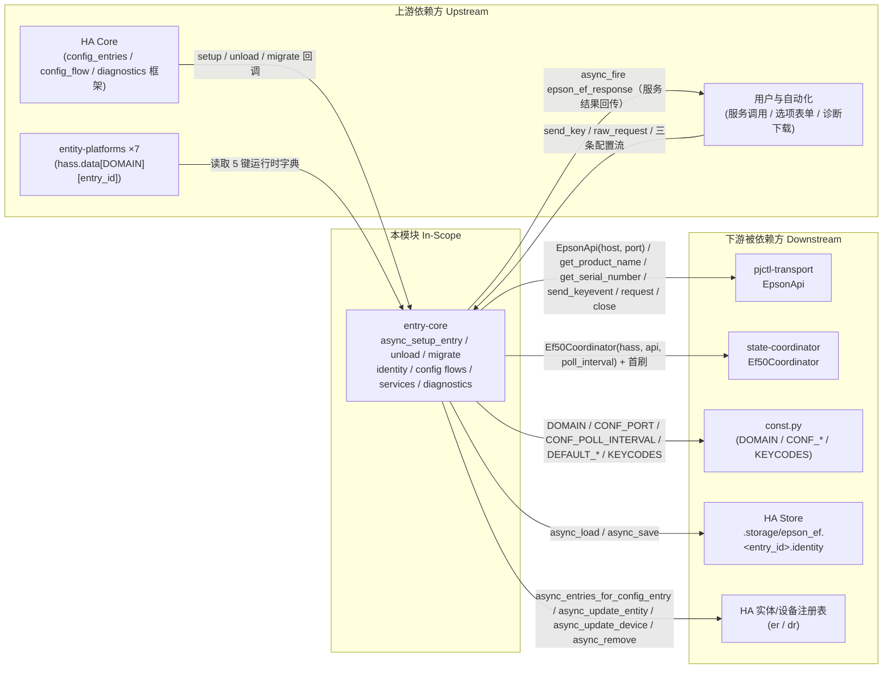

# 模块边界

## 模块范围

<!-- 依据：逐行核对 4 个文件全文（494 行），并反查包内所有调用点。 -->

|维度|本领域负责|本领域不负责（属于其他领域）|
|-|-|-|
|核心职责|setup/unload 编排、`hass.data` 运行时发布、身份解析与持久化、注册表身份迁移、遗留实体清理、v1→v2 条目迁移、user/reconfigure/options 三条配置流、`send_key`/`raw_request` 服务、诊断包导出（`custom_components/epson_ef/__init__.py:166-221`、`config_flow.py:23-132`、`services.py:38-102`、`diagnostics.py:12-39`）|pjctl 命令编解码与 Digest 认证（pjctl-transport：`api.py`）、轮询节奏与状态快照装配（state-coordinator：`coordinator.py`）、实体投影与可用性判定（entity-platforms：7 个平台模块）、测试与探测脚本（verification-harness：`tests/`、`tools/`）|
|数据所有权|`hass.data["epson_ef"][entry_id]` 五键运行时字典（`__init__.py:195-201`）；HA Store `.storage/epson_ef.<entry_id>.identity` 的 `serial`/`identity` 两键（`:53-55`）；config entry 的 data/options 形状与 version（`config_flow.py:56-66`、`__init__.py:31-39`）|`coordinator.data` 快照内容（state-coordinator）；实体 `unique_id` 的**后缀语义**（entity-platforms 定义，本模块只做前缀替换 `__init__.py:88-94`）；`KEYCODES`/`WRITABLE_*` 常量表（const.py 属共享契约层）|
|业务规则|身份优先级 serial → 钉死 host:port（`:58-76`）；迁移幂等（`:83-84`）；服务最终一致地随条目计数装卸（`:218-220`、`services.py:40-41`）；选项覆盖 data（`:184-187`）；「能取到 product name 才算连得上」（`config_flow.py:40-54`）|协议层的 `size`=token 数规则（`api.py:163-172`）；"待机时哪些命令会 FAIL"（`api.py:221-276`）；实体状态机与乐观写（entity-platforms）|
|不拥有的横切能力|—|日志格式化、HA 版本兼容策略、发布版本号（`manifest.json:18`）|

## 上下游总览

## 上游依赖（Inbound / 谁依赖我）

|依赖方 (Caller)|交互方式 (RPC/HTTP/Event/Direct)|契约/接口路径|
|-|-|-|
|HA Core `config_entries`|框架回调（Direct）|`async_setup_entry(hass, entry) -> bool`（`__init__.py:166`）、`async_unload_entry`（`:213`）、`async_migrate_entry`（`:31`）；更新监听经 `entry.add_update_listener`（`:205`）|
|HA Core `config_flow`|框架注册（Direct）|`Ef50ConfigFlow(domain=DOMAIN)`、`VERSION=2`、`async_get_options_flow`（`config_flow.py:23-33`）|
|HA Core `diagnostics`|框架回调（Direct）|`async_get_config_entry_diagnostics(hass, entry)`（`diagnostics.py:12-14`）|
|entity-platforms（7 个平台）|直接读共享字典|`hass.data[DOMAIN][entry.entry_id]["coordinator"｜"base_id"]`（`binary_sensor.py:23-25`、`media_player.py:35-37`、`number.py:52-60`、`select.py:32`、`sensor.py:27-31`、`switch.py:33-49`、`button.py:91`）|
|用户 / 自动化|HA 服务调用|`epson_ef.send_key`（`services.py:72-82`）、`epson_ef.raw_request`（`:83-94`）|
|自动化 / 前端|HA 事件总线|订阅 `epson_ef_response`（`services.py:67-70`）|
|用户（配置界面）|HA 配置流 UI|`user` → `reconfigure` → `options/init` 三步（`config_flow.py:35`、`:68`、`:111`）|
|用户（排障）|诊断下载|`diagnostics.py:19-38` 四段载荷|

<!-- 说明：verification-harness 以 AST 静态校验方式反向约束本模块（`tests/test_regressions.py:96-171` 锁定清理表内容、禁用 async_get_device(identifiers=...)、锁定 async_get_entity_id 实参顺序），属只读契约依赖，不改写运行期行为。 -->

## 下游依赖（Outbound / 我依赖谁）

|被依赖方 (Callee)|依赖目的|协议/驱动类型|强/弱|
|-|-|-|-|
|`EpsonApi`（pjctl-transport）|连通性探测、序列号读取、按键下发、raw 命令透传、会话关闭|进程内调用（aiohttp HTTP Digest 由下层负责）|**强**：构造即依赖，`get_product_name`/`get_serial_number`/`send_keyevent`/`request`/`close` 五个方法（`__init__.py:170-176`、`:60`、`services.py:54`、`:64`、`__init__.py:217`）|
|`Ef50Coordinator`（state-coordinator）|建协调器并强制首刷，首刷失败即拒载|进程内调用（`DataUpdateCoordinator` 子类）|**强**：`Ef50Coordinator(hass, api, poll_interval)` + `async_config_entry_first_refresh()`（`__init__.py:188-193`）|
|`const.py`|domain、配置键、默认值、按键映射|进程内常量 import|**强**（编译期）：`DOMAIN`/`CONF_PORT`/`CONF_POLL_INTERVAL`/`DEFAULT_*`（`__init__.py:14-20`）、`KEYCODES`（`services.py:10`）|
|HA `Store`|身份持久化（serial / 钉死 identity）|HA 存储 helper（JSON 落 `.storage`）|**弱**：`async_load` 无异常保护，但语义上「取不到就当空」（`__init__.py:53-56`）；Store 损坏会直接抛给 setup|
|HA 实体注册表 `er`|身份迁移、遗留清理|HA helper 同步 API|**强**（功能依赖）：`async_entries_for_config_entry`/`async_update_entity`/`async_remove`（`__init__.py:86-96`、`:143-162`）|
|HA 设备注册表 `dr`|设备 identifier 迁移|HA helper 同步 API|**弱**：仅身份变更时使用，设备不存在则循环体空转（`__init__.py:110-120`）|
|HA 服务总线|注册/注销两个服务、发事件|HA helper 同步 API|**强**（功能依赖）：`has_service`/`async_register`/`async_remove`（`services.py:40`、`:72`、`:101`）、`bus.async_fire`（`:67`）|
|HA 平台转发|把 7 个平台交给 HA setup|HA helper 异步 API|**强**：`async_forward_entry_setups(entry, PLATFORMS)`，失败即 setup 失败（`__init__.py:203`）|

## 防腐层与协议转换 (Anti-Corruption Layer)

- **外部系统隔离策略**：本模块是「HA 配置模型 ↔ 设备身份模型」的转换层，隔离靠三条边界：
  1. **配置数据 vs 身份数据物理分离**——设备身份（序列号/钉死地址）写 HA `Store`，绝不写 config entry，理由是写 entry 会触发 update listener 的 reload（`__init__.py:48-51`、listener `:209-210`）。因此 entry.data 只承载「用户可改的连接参数」（`config_flow.py:56-66`）。
  2. **身份形态转换集中在一处**——`host:port` ←→ `base_id` 的两种形态只在 `_async_migrate_identity`/`_async_remove_legacy_entities` 内互相换算，其余模块只见到 `base_id`（`__init__.py:79-163`）；实体平台拿到的 `base_id` 已是不含协议细节的稳定串。
  3. **服务层不暴露传输层类型**——`send_key`/`raw_request` 面的输入只有字符串键名/命令 id/参数串，异常被折成 `{"error": str(err)}` 事件载荷（`services.py:61-70`），固件错误类型（`EpsonApiCommandFailed` 等）不外泄给自动化。

- **DTO / 领域对象映射**：
  |外部形态|内部形态|转换点|
  |-|-|-|
  |`entry.data` 四键（host/port/name/poll_interval）|`(host, port, poll_interval)` 局部变量，poll_interval 经 options 覆盖|`__init__.py:168-187`|
  |v1 条目 data（含 `enable_camera`、ADB 端口语义）|v2 条目 data（强制 `port=8080`、无 `enable_camera`）|`__init__.py:33-38`|
  |Store `{serial}` 或 `{identity}`|`(base_id, serial|None)` 二元组|`__init__.py:56-76`|
  |旧 `host:port` 前缀 unique_id|`{base_id}{后缀}` / `(DOMAIN, base_id)` identifier|`__init__.py:88-116`|
  |键名字符串 / 数字串|Android keycode int（`KEYCODES` 表 + 数字兜底）|`services.py:48-53`|
  |服务调用结果|`epson_ef_response` 事件载荷 `{entity_id, id, response}`|`services.py:67-70`|

## 边界变更记录

|日期|变更内容|根因 / 触发|关联工件|
|-|-|-|-|
|2026-11-01|剥离 ADB 通路：config entry 升到 v2，`async_migrate_entry` 强制 `port=8080` 并删除 `enable_camera`|`__init__.py:32` docstring 明示 v1 为 "ADB-based"，v2 为 "native-API format"|`__init__.py:31-39`、`config_flow.py:26`|
|2026-11-01|`switch.*_setting-refresh` 从产品移除（`GET_REFRESH` 实为小时数），改由 `number.*_refresh_timer` 承接；旧开关加入清理表|固件语义纠正（`const.py:50-52` 注释记录）|`__init__.py:136-138`、`:148`、`README.md:102`|
|2026-11-01|`button.*_engine_refresh` 移除（NOTIFY 仅标记刷新确认应用启动，单独发送无动作）|真机验证后判定为无效入口|`__init__.py:139-141`、`:149`、`README.md:103`|
|2026-11-07（真机测试）|修复遗留实体清理静默失效：弃用 `registry.async_get_entity_id(platform, DOMAIN, uid)` 反序调用，改为遍历条目 + 集合判定；弃用 `dr.async_get_device(identifiers=...)`|3.5.6→3.10.0 升级后 `setting-refresh`/`button-engine_refresh` 永久 unavailable（事故记录 `tests/test_regressions.py:1-11`、`:141-148`）|`__init__.py:157-162`、`:105-109`、`tests/test_regressions.py:96-171`|
|2026-11-07|身份从「始终 host:port」改为「serial 优先 + Store 持久化」，setup 内新增 `_async_get_base_id` 与 `_async_migrate_identity` 调用|DHCP 漂移导致实体历史与自动化引用断档；README 承诺「序列号作为稳定身份」|`__init__.py:42-120`、`:178-181`、`README.md:87`、`:156`|

## 全局功能树映射

> 依据：`architecture_views/function_tree.yml`（跨模块业务能力合并产物）。
> 本模块在全局功能树中参与的 `function` 节点如下；合并依据与不合并理由见该文件头部注释。

| 全局 function id | 全局 function 名称 |
|-|-|
| `21` | 装配集成运行时 |
| `22` | 释放集成运行时 |
| `23` | 解析并治理设备身份 |
| `24` | 迁移配置条目版本 |
| `25` | 配置连接与轮询 |
| `42` | 注入遥控按键 |
| `73` | 暴露扩展诊断信息 |
| `74` | 透传原生命令 |

**回写说明**：本模块的 `function_tree.yml` 描述"本模块内部能力结构"；全局树描述"跨模块的业务能力"，二者通过上表对齐。合并后本模块仍是该能力的实现方之一（`module_refs`），不因合并而失去边界。
