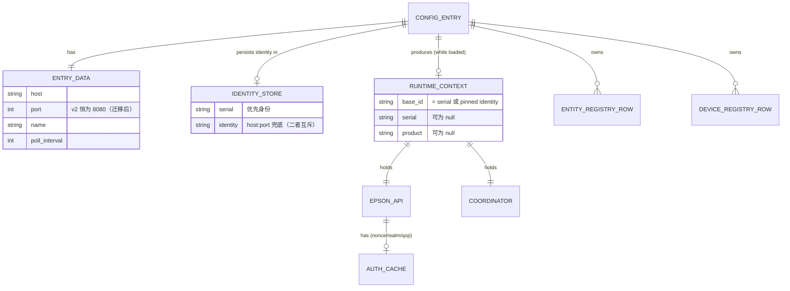
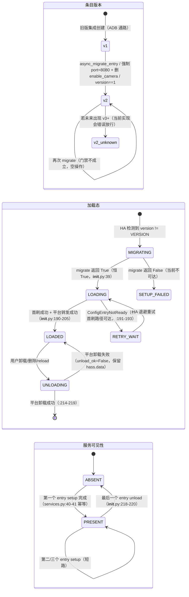
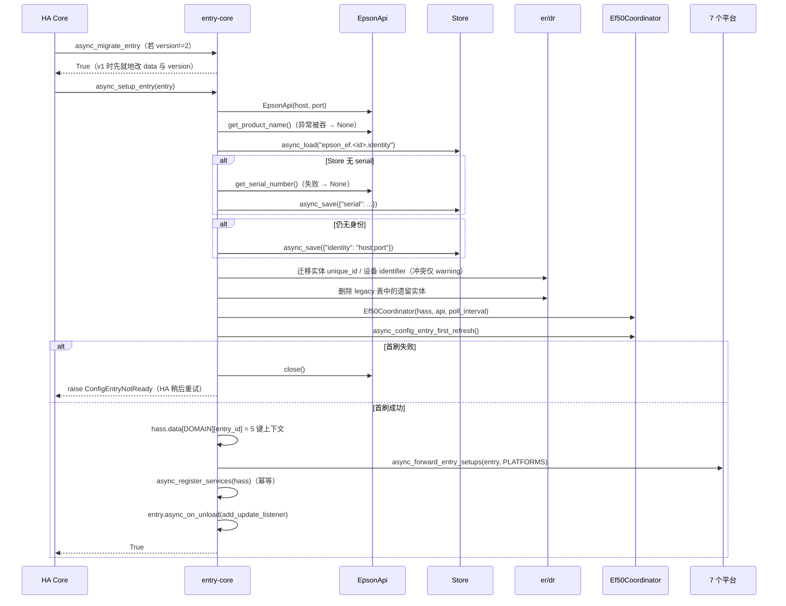
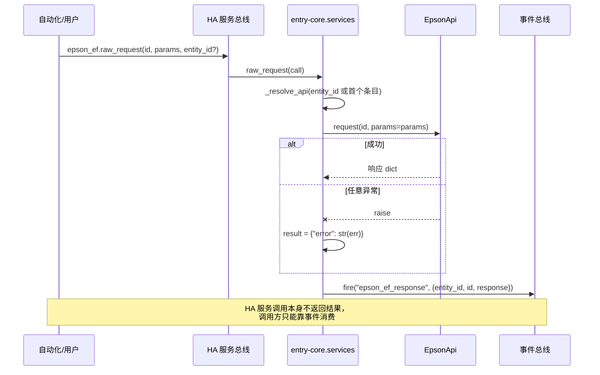
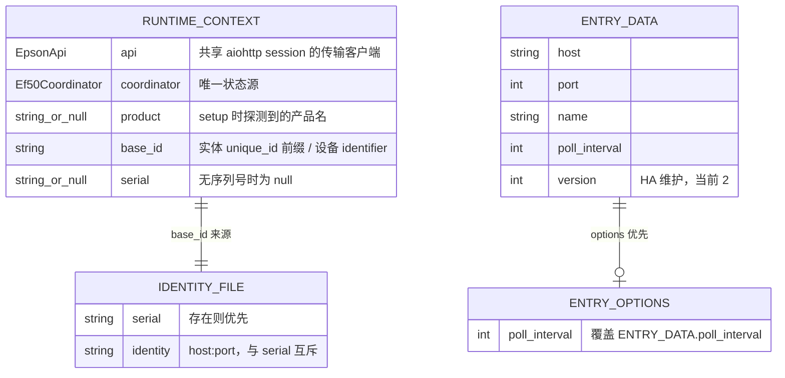
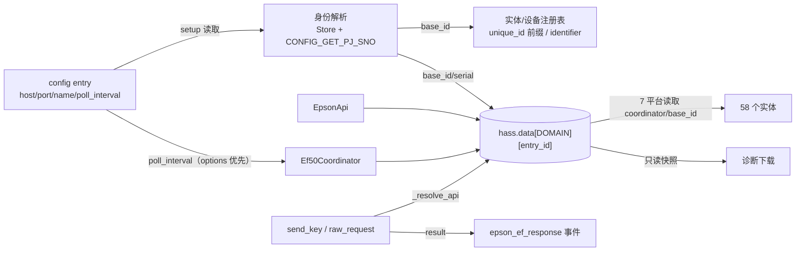

# 模块设计：entry-core（集成装配与生命周期）

## 模块定位与核心职责

- **一句话定义**：把一条 HA config entry 变成一个可运行、可升级、可拆卸的集成实例——产出 `hass.data[DOMAIN][entry_id]` 这一份被 7 个实体平台和诊断共用的运行时上下文（`__init__.py:195-201`）。
- **核心业务/技术能力**：
  1. **装配**：连接参数解析 → 可达性探测 → 身份解析 → 注册表修复 → 协调器首刷 → 发布上下文 → 平台转发 → 服务注册 → 更新监听（`__init__.py:166-206`）。
  2. **身份治理**：serial 优先、`host:port` 兜底、Store 持久化、注册表迁移、遗留实体清理（`__init__.py:42-163`）。
  3. **配置交互**：新增 / 改地址 / 改间隔三条流，唯一校验手段是"取到 product name"（`config_flow.py:35-131`）。
  4. **运行期接口**：`send_key`、`raw_request` 两个 domain 级服务 + `epson_ef_response` 事件回传 + 诊断包导出（`services.py:38-102`、`diagnostics.py:12-39`）。

## 内部架构与分层设计

- **分层模式**：HA 框架回调层（Adapter）→ 编排层（setup/unload/migrate 三个 async 函数）→ 治理函数层（无 HA 生命周期依赖的同步注册表操作）→ 下游端口（`EpsonApi` / `Ef50Coordinator` / `Store` / registries）。本模块**没有** Repository/Domain Model 层：设备身份以裸字符串（`base_id`）在层间传递。

- **核心组件与分工**：

|组件/类名|职责描述|依赖|关键文件|
|-|-|-|-|
|`async_setup_entry`（模块级函数，非类）|唯一装配入口，串起 9 个步骤并负责两条失败出口的资源归还|`EpsonApi`、`Ef50Coordinator`、`_async_get_base_id`、`_async_migrate_identity`、`_async_remove_legacy_entities`、`async_register_services`|`custom_components/epson_ef/__init__.py:166-206`|
|`async_unload_entry`|平台卸载 → 弹上下文 → 关会话 → 末条目时注销服务|`async_unload_platforms`、`async_unregister_services`|`__init__.py:213-221`|
|`async_migrate_entry`|v1→v2 数据整形（强制 8080、删 `enable_camera`、写回 version）|`hass.config_entries.async_update_entry`|`__init__.py:31-39`|
|`_async_get_base_id`|身份解析（Store → serial → 钉死地址）|`Store`、`EpsonApi.get_serial_number`|`__init__.py:42-76`|
|`_async_migrate_identity`|实体 unique_id 前缀 + 设备 identifier 改写|`er`、`dr`|`__init__.py:79-120`|
|`_async_remove_legacy_entities`|按「平台×后缀」表删除遗留实体|`er`|`__init__.py:123-163`|
|`Ef50ConfigFlow`|user / reconfigure 两条流 + options flow 工厂|`EpsonApi.get_product_name`|`config_flow.py:23-105`|
|`Ef50OptionsFlow`|轮询间隔单字段选项流|`self.config_entry`|`config_flow.py:108-131`|
|`async_register_services` / `async_unregister_services`|幂等注册 / 统一注销两个服务|`hass.services`、`_resolve_api`|`services.py:38-41`、`:97-102`|
|`_resolve_api`|entity_id → config_entry_id → API 的解析（含"第一个条目"兜底）|`er`、`hass.data`|`services.py:15-35`|
|`async_get_config_entry_diagnostics`|四段式诊断载荷组装|`hass.data`、`getattr` 读私有字段|`diagnostics.py:12-39`|
|`PLATFORMS`（常量）|7 个平台的唯一权威清单|—|`__init__.py:24-27`|

```mermaid
graph TD
    subgraph 框架回调层 Adapter
        A1["async_setup_entry"]
        A2["async_unload_entry"]
        A3["async_migrate_entry"]
        A4["Ef50ConfigFlow / Ef50OptionsFlow"]
        A5["async_register_services"]
        A6["async_get_config_entry_diagnostics"]
    end
    subgraph 编排层 Orchestration
        O1["装配顺序编排<br/>探测→身份→修复→首刷→发布→转发"]
        O2["卸载顺序编排<br/>平台→上下文→会话→服务"]
        O3["版本迁移编排<br/>data 整形 + version 写回"]
    end
    subgraph 治理函数层 Governance (无生命周期依赖)
        G1["_async_get_base_id"]
        G2["_async_migrate_identity"]
        G3["_async_remove_legacy_entities"]
        G4["_resolve_api"]
    end
    subgraph 下游端口 Ports
        P1["EpsonApi<br/>(pjctl-transport)"]
        P2["Ef50Coordinator<br/>(state-coordinator)"]
        P3["HA Store<br/>身份持久化"]
        P4["er / dr<br/>注册表"]
        P5["hass.services / hass.bus"]
    end
    A1 --> O1
    A2 --> O2
    A3 --> O3
    A4 --> P1
    A5 --> G4
    A6 -->|"只读"| M1[("hass.data[DOMAIN][entry_id]")]
    O1 --> G1 & G2 & G3
    O1 --> P1 & P2
    O1 -->|"发布"| M1
    O2 -->|"弹出"| M1
    G1 --> P3 & P1
    G2 --> P4
    G3 --> P4
    G4 --> P4 & M1
    A5 --> P5
```

## 核心领域模型与状态机

- **关键实体 (Entities / Value Objects)**：
  - **`RuntimeContext`**（隐式，无类型）：`hass.data[DOMAIN][entry_id]` 的 5 键字典——`api`（EpsonApi 实例）、`coordinator`（Ef50Coordinator 实例）、`product`（`str | None`）、`base_id`（`str`，永不为空）、`serial`（`str | None`）（`__init__.py:195-201`）。
  - **`DeviceIdentity`**（隐式，散落在三处）：HA Store 的 `{"serial": str}` 或 `{"identity": "host:port"}`（`__init__.py:56-76`）；实体 `unique_id` 的 `{base_id}-{suffix}` 形态（`sensor.py:44`、`number.py:90`、`switch.py:78`、`button.py:122`、`select.py:75`）；设备 `identifier = (DOMAIN, base_id)`（`media_player.py:89`）。
  - **`ConfigEntryData`**：`{host, port, name, poll_interval}` 四键（`config_flow.py:56-65`），外加 HA 管理的 `version=2`（`config_flow.py:26`）。
  - **`LegacyEntityTable`**：`dict[platform, tuple[suffix, ...]]`，当前 5 条（`__init__.py:146-150`）。

- **状态转换逻辑**：本模块真实的状态机是 **config entry 生命周期**，不是设备状态。状态由 HA 持有（`entry.version` + `entry.state`），本模块是状态迁移的执行者。

### 实体关系 (ER)



### 状态机

<!-- 三个正交状态机：条目版本、条目加载态、服务可见性。 -->



**迁移触发条件与动作（逐条）**：

|转换|触发事件|执行动作|进入条件/守卫|证据|
|-|-|-|-|-|
|v1 → v2|HA 加载条目时发现 `entry.version != VERSION(2)`|`data[port]=8080`；`data.pop("enable_camera")`；`async_update_entry(data, version=2)`；info 日志|`entry.version == 1`|`__init__.py:33-38`、`config_flow.py:26`|
|v2 → v2|重复调用 migrate|无（直接 `return True`）|`entry.version != 1`|`__init__.py:33`、`:39`|
|v3+ → 放行|加载未来版本条目|无（仍 `return True`）|无守卫 —— **缺陷**|`__init__.py:33-39` 无 else|
|LOADING → LOADED|首刷返回 + 7 平台转发成功|发布 hass.data、注册服务、挂监听|`async_config_entry_first_refresh` 不抛|`__init__.py:188-205`|
|LOADING → RETRY_WAIT|首刷抛 `ConfigEntryNotReady`|`await api.close()` 后重抛|仅此一处可达|`__init__.py:190-193`|
|LOADED → UNLOADING|`async_unload_entry`|`async_unload_platforms(entry, PLATFORMS)`|—|`__init__.py:214`|
|UNLOADING → 终止|`unload_ok is True`|pop 上下文 → `api.close()` → 若 DOMAIN 空则摘键并注销服务|—|`__init__.py:215-220`|
|UNLOADING → LOADED|`unload_ok is False`|无动作（保留 hass.data 与 session）|`unload_ok` 假|`__init__.py:215`|

## 关键工作流与算法实现

### 工作流 1：setup 的 9 步顺序与失败回滚点

|#|步骤|代码|失败时的后果（当前实现）|
|-|-|-|-|
|1|取 host/port，构造 `EpsonApi`|`__init__.py:168-170`|`entry.data["host"]` 缺失 → KeyError，HA 记为 setup 错误（不可重试）|
|2|探测可达性（取 product name）|`:172-176`|分支**不可达**：`get_product_name` 已吞 `EpsonApiError` 返回 None（`api.py:295-300`）|
|3|解析身份（Store → serial → 钉死地址）|`:178` → `:42-76`|Store/网络异常直接冒泡；已建 session **不关闭**（泄漏点 A）|
|4|迁移注册表身份（旧 host:port → base_id）|`:180` → `:79-120`|冲突仅 warning；非冲突异常冒泡且 session 不关（泄漏点 B）|
|5|清理遗留实体|`:181` → `:123-163`|同上（泄漏点 C）|
|6|解析轮询间隔（options > data > 默认）|`:184-187`|不会失败|
|7|建协调器并首刷|`:188-193`|**唯一可达**的 `ConfigEntryNotReady`：先 `api.close()` 再重抛 ✅|
|8|发布 `hass.data[DOMAIN][entry_id]`|`:195-201`|不会失败；一旦发布即成为 7 平台的唯一数据源|
|9|转发 7 平台 + 注册服务 + 挂监听|`:203-205`|平台 setup 抛异常 → setup 失败，但 hass.data 条目**已发布且未回收**（泄漏点 D）|



### 工作流 2：unload 的资源释放顺序

1. `async_unload_platforms(entry, PLATFORMS)` —— 7 个平台批量卸载，返回布尔（`__init__.py:214`）。
2. 仅当成功：`hass.data[DOMAIN].pop(entry.entry_id)` 取出上下文（`:216`）。
3. `await data["api"].close()` 关闭该条目的 aiohttp session（`:217`）。
4. 若 `hass.data[DOMAIN]` 已空：`hass.data.pop(DOMAIN, None)` 摘掉域键（`:219`）。
5. 紧接着 `async_unregister_services(hass)` 注销两个服务（`:220` → `services.py:97-102`）。

顺序约束：**会话必须在所有平台卸载之后才关**（否则卸载期间实体的迟到请求会打到已关 session）；**服务必须在条目计数归零后才注销**（否则多设备场景第一台卸载会掐掉第二台的服务入口）。`coordinator` **没有显式关闭**：四个文件中不存在 `async_shutdown()` 调用（`grep` 无命中），调度停止依赖 HA `DataUpdateCoordinator` 在监听者归零时自行退订的内部行为——该行为本环境无法验证（`import homeassistant` → `ModuleNotFoundError`），标 `[待确认: 最后一批 CoordinatorEntity 移除后，DataUpdateCoordinator 的定时刷新是否确实停止]`。

### 工作流 3：身份解析的优先级决策

```
读 Store
 ├─ 有 serial ────────────────────────────→ base_id = serial, serial 返回 serial
 ├─ 无 serial → 问固件 CONFIG_GET_PJ_SNO(1)
 │    ├─ 有值 → 落库 {serial} ─────────────→ base_id = serial
 │    └─ 无值/命令失败 ─┐
 └─ 有 pinned identity ─┴─→ base_id = pinned（不再改动）, serial = None
      └─ 都没有 → identity = f"{host}:{port}" → 落库 → base_id = identity
```
（实现：`__init__.py:56-76`；序列号获取：`api.py:302-315`）

**算法要点**：`stored.get("serial")` 先查存储再查设备，是"记忆优先"而非"设备真值优先"——一旦序列号落库，更换主板/换机也不会刷新（Store 命中即短路，`:58-64`）。

### 工作流 4：raw_request 的事件回传（无返回值服务的补偿设计）


（实现：`services.py:56-70`）

## 设计模式

|模式|应用位置|解决的问题|关键文件|说明|
|-|-|-|-|-|
|Template Method（框架）|`async_setup_entry` / `async_unload_entry` / `async_migrate_entry` / `async_get_options_flow` / `async_get_config_entry_diagnostics`|HA 用固定签名回调集成；集成只需填充实现|`__init__.py:31`、`:166`、`:213`；`config_flow.py:30`；`diagnostics.py:12`|框架驱动，不是自研调度|
|Idempotent Guard（显式门禁）|迁移 `if old_id == new_id: return`（`:83`）、版本 `if entry.version == 1`（`:33`）、服务 `has_service` 短路（`services.py:40`）|HA 会在重启/重试/多 entry 场景重复调用同一入口；用「读当前状态再决定」代替持久化标记位|`__init__.py:33`、`:83-84`；`services.py:40-41`|避免引入迁移状态字段（见 ADR-entry-core-002）|
|Store-as-Identity（外部化身份）|`Store(hass, 1, f"{DOMAIN}.{entry_id}.identity")`|身份属于设备而非配置，写 config entry 会触发 reload 循环|`__init__.py:48-55`|见 ADR-entry-core-001|
|Symmetric Teardown（对称拆卸）|`async_unload_entry` 严格逆序于 setup|资源（session/服务）由 setup 获得，必须由 unload 释放|`__init__.py:213-221`|唯一未被对称覆盖的是协调器未显式 shutdown|
|Declarative Legacy Table（声明式清理表）|`legacy: dict[platform, tuple[suffix,...]]`|孤儿实体清理需要「历史上存在过什么」的显式知识，无法从代码推导|`__init__.py:146-150`|表外的新孤儿不会被清理；由 AST 测试锁定内容（`tests/test_regressions.py:112-119`）|
|Event Compensation（事件补偿）|`raw_request` 结果经 `epson_ef_response` 广播|HA 服务调用无返回通道|`services.py:61-70`|代价：无 correlation id，无法配对请求与响应|
|Counter-Based Singleton（按计数单例）|服务在第一个条目注册、最后一个条目注销|服务是 domain 级资源，但生命周期绑在 entry 级实例上|`__init__.py:218-220`、`services.py:40`|判定依据是 `hass.data[DOMAIN]` 是否为空字典|

## 数据设计

### 2.1 核心数据模型



### 2.2 存储与持久化设计

本模块不拥有数据库，只有两类持久化面：

|持久化面|载体|内容|写入点|本模块的读/写|
|-|-|-|-|-|
|身份文件|HA `Store`（JSON，`.storage/epson_ef.<entry_id>.identity`）|`{"serial": str}` 或 `{"identity": "host:port"}`|`__init__.py:62-63`、`:73-74`|读 `:56`；整字典回写|
|配置条目|HA `core.config_entries`|`data{host,port,name,poll_interval}`、`options{poll_interval}`、`version`|HA 由 `async_create_entry`/`async_update_and_abort`/`async_update_entry` 落盘|v1→v2 改写 `:37`；reconfigure `config_flow.py:87-89`；options `:113`|
|注册表|HA `core.entity_registry` / `core.device_registry`|实体 `unique_id`、设备 `identifiers`|本模块直接改写|`:96`、`:114-116`、`:162`|

> 无 DDL（不适用）；无缓存层（不适用）。

### 2.3 缓存策略

|缓存|Key|Value|失效|证据|
|-|-|-|-|-|
|身份缓存（持久）|`epson_ef.{entry_id}.identity`|serial 或钉死地址|**无失效机制**（不随设备变化刷新，不随 reconfigure 清除）|`__init__.py:53-76`|
|可达性探测结果（内存）|`hass.data[DOMAIN][entry_id]["product"]`|setup 时的产品名|entry reload 即丢；平台实际改用 `coordinator.data["product"]`（`media_player.py:87`）|`__init__.py:173`、`:198`|
|服务处理器（内存）|`(DOMAIN, "send_key"/"raw_request")`|闭包，捕获 `hass`|最后一个条目卸载时移除|`services.py:72-102`|

### 数据流图



## 接口契约

### 外部接口

|名称|描述|请求方式|请求参数|返回参数|错误码|
|-|-|-|-|-|-|
|`epson_ef.send_key`|发送遥控按键|HA 服务调用|`key: str`（键名或数字 keycode，必填）、`entity_id: str`（可选）|无返回值（失败抛异常）|`HomeAssistantError("Unknown key: <KEY>")`（`services.py:53`）；`"No loaded epson_ef entry found"`（`:19`、`:35`）；`"<id> is not a registry entity"`（`:26`）；`"<id> does not belong to a loaded entry"`（`:30`）|
|`epson_ef.raw_request`|透传任意 pjctl 命令|HA 服务调用|`id: str`（必填）、`params: str`（可选）、`entity_id: str`（可选）|无返回值；结果经 `epson_ef_response` 事件|同上 4 类；命令本身的失败被折成事件载荷 `{"error": ...}` 而**不抛异常**（`services.py:65-66`）|
|`epson_ef_response`（事件）|服务结果回传|事件总线|—|`{"entity_id", "id", "response"}`（`services.py:67-70`）|无|
|配置流 `user`|新增设备|HA 配置 UI|host(str)、port(int)、name(str)、poll_interval(int 5–300)|创建条目（title=name 或 `"Epson EF Projector"`）|`cannot_connect`（`config_flow.py:54`）|
|配置流 `reconfigure`|改地址|HA 配置 UI|host、port（默认取当前值）|更新条目 data 并 abort，触发 reload|`cannot_connect`（`:90`）|
|配置流 `options/init`|改轮询间隔|HA 配置 UI|poll_interval(int 5–300)|写 options|无显式错误码|
|诊断下载|导出排障包|HA 诊断框架|—|四段 dict（entry/identity/coordinator/api）|条目未加载时返回空段（`diagnostics.py:16`）|

### 内部接口

|名称|描述|调用方|提供方|请求参数|返回参数|
|-|-|-|-|-|-|
|`EpsonApi(host, port)`|构造传输客户端|`async_setup_entry`、两条配置流|pjctl-transport|host: str, port: int|实例|
|`get_product_name()`|可达性探测 / 产品名|setup、user flow、reconfigure flow|pjctl-transport|—|`str | None`（**吞所有 EpsonApiError**）|
|`get_serial_number()`|读设备序列号|`_async_get_base_id`|pjctl-transport|—|`str | None`（内部 `CONFIG_GET_PJ_SNO` params="1"）|
|`send_keyevent(keycode)`|下发按键|`send_key` 服务|pjctl-transport|keycode: int|`None`（异常冒泡）|
|`request(cmd_id, params=None)`|透传命令|`raw_request` 服务|pjctl-transport|cmd_id: str, params: str|None|响应 dict（异常冒泡）|
|`close()`|关闭 session|setup 失败出口、unload|pjctl-transport|—|`None`|
|`Ef50Coordinator(hass, api, poll_interval)`|状态协调器|`async_setup_entry`|state-coordinator|hass, api, poll_interval: int|实例|
|`async_config_entry_first_refresh()`|首刷（失败抛 ConfigEntryNotReady）|`async_setup_entry`|HA `DataUpdateCoordinator`|—|`None` / 抛错|
|`hass.data[DOMAIN][entry_id]`|运行时上下文|7 个平台、`_resolve_api`、diagnostics|`async_setup_entry`|entry_id: str|5 键 dict（无类型约束）|

### 配置接口

|名称|描述|类型|默认值|取值范围|
|-|-|-|-|-|
|`host`|投影仪局域网地址|`entry.data["host"]`|无（必填）|任意字符串；**不校验 IP/主机名格式**（`config_flow.py:58`）|
|`port`|pjctl 端口|`entry.data["port"]`|`DEFAULT_PORT = 8080`（`const.py:10`）|任意 int；schema 无范围校验（`config_flow.py:59`）；v1 迁移强制 8080（`__init__.py:35`）|
|`name`|条目/设备显示名|`entry.data["name"]`|`DEFAULT_NAME = "Epson EF Projector"`（`const.py:9`）|任意字符串|
|`poll_interval`|轮询间隔（秒）|`entry.options` 优先，回退 `entry.data`|`DEFAULT_POLL_INTERVAL = 15`（`const.py:11`）|5–300（`config_flow.py:63`、`:129`）|
|`VERSION`|config entry 版本|类属性|2（`config_flow.py:26`）|由 `async_migrate_entry` 推进|

### 错误码与异常定义

|错误码|协议层状态|含义|触发场景|处理建议|
|-|-|-|-|-|
|`ConfigEntryNotReady`|HA setup 重试|设备暂不可用，稍后重试|**仅** `coordinator.async_config_entry_first_refresh()` 抛错（`__init__.py:190-193`）；`get_product_name` 分支不可达（`api.py:295-300`）|无需干预，HA 自动退避重试|
|`cannot_connect`|配置流表单错误|探测未取到 product name|user/reconfigure 流（`config_flow.py:54`、`:90`）|用户检查 IP/电源/网络|
|`HomeAssistantError("Unknown key: X")`|服务调用失败|键名不在 `KEYCODES` 且非纯数字|`send_key`（`services.py:53`）|改用 `KEYCODES` 内键名或数字 keycode（`const.py:195-219`）|
|`HomeAssistantError("No loaded epson_ef entry found")`|服务调用失败|`hass.data[DOMAIN]` 为空/无带 api 条目|`send_key`/`raw_request`（`services.py:19`、`:35`）|确认集成已加载|
|`HomeAssistantError("<id> is not a registry entity")`|服务调用失败|entity_id 不在实体注册表|同上（`services.py:26`）|传 `media_player` 实体或省略|
|`HomeAssistantError("<id> does not belong to a loaded entry")`|服务调用失败|实体所属 entry 未加载|同上（`services.py:30`）|检查条目状态|
|`{"error": "<str>"}`（事件载荷）|非异常|raw 命令失败的软错误|`raw_request` 任意异常（`services.py:65-66`）|订阅 `epson_ef_response` 并判 `response.error`|
|`ValueError`（内部吞掉）|无|注册表 unique_id 冲突|身份迁移时目标已存在（`__init__.py:97`、`:117`）|降级为 warning 日志，实体保持旧身份|

## 开发指南

### 洞察

- **`hass.data` 是本模块唯一对外产物**：7 个平台全部通过 `hass.data[DOMAIN][entry.entry_id]["coordinator"|"base_id"]` 取依赖（`binary_sensor.py:23`、`media_player.py:35`、`number.py:52`、`select.py:32`、`sensor.py:27`、`switch.py:33`、`button.py:91`），没有任何一个平台 import `__init__.py`。改键名等于改一个 9 处消费的隐式契约。
- **`get_product_name` 吞异常让 setup 的"可达性门"失效**（`api.py:295-300` vs `__init__.py:172-176`）：真实门在首刷。想真正实现"setup 早失败"，必须让探测抛错或改用 `probe_state`。
- **身份是"记忆优先"**：Store 命中即不再问设备（`__init__.py:58-64`），所以换机/换主板后 base_id 不会自动更新，需要手工删 Store 文件 `[待确认: 是否有支持文档/自动化手段]`。
- **清理表是纯手工知识**：`legacy` 只含 5 条（`__init__.py:146-150`），任何一次"删实体"的发版都必须同时改它，否则孤儿永久残留——这是历史上真实发生过的故障（`tests/test_regressions.py:1-11`）。
- **两条失败出口的 `api.close()` 不对称**：`:175`（不可达分支，实际死代码）与 `:192`（首刷失败）有关闭，身份/迁移/平台转发路径没有。

### 扩展指南

**新增一个实体（跨模块，但需本模块配合）**
1. 在对应平台模块里用 `f"{base_id}-{稳定后缀}"` 定义 `_attr_unique_id`，`DeviceInfo.identifiers={(DOMAIN, base_id)}`（范例 `number.py:86-97`）。
2. **不需要**改 `PLATFORMS`（只在新增平台文件时才改，`__init__.py:24-27`）。
3. 若同时**删除或改型**了旧实体：把旧后缀加进 `legacy` 表对应平台元组（`__init__.py:146-150`），否则升级用户会看到永久 unavailable 的孤儿。
4. 运行 `tests/test_regressions.py` 的 `LegacyEntityCleanupTests` 确认表内容断言仍通过。

**新增一个 domain 级服务**
1. 在 `services.py` 的 `async_register_services` 内定义 `async def` 处理器，用 `_resolve_api(hass, entity_id)` 解析目标客户端（`services.py:45-47`）。
2. `hass.services.async_register(DOMAIN, "<name>", handler, schema=vol.Schema({...}))`（范例 `:72-94`）。
3. 在 `async_unregister_services` 的元组里追加服务名，否则卸载后服务残留（`services.py:100`）。
4. 在 `services.yaml` 补 UI 字段描述、`strings.json`/`translations` 补文案。
5. 若服务需要管理员门禁，注意当前代码**没有任何** `require_admin` 用例（`grep -rn require_admin custom_components/` 为空）——需自行引入 `homeassistant.auth.permissions` 或 `@require_admin`。

**新增一个选项字段**
1. 在 `Ef50OptionsFlow.async_step_init` 的 schema 加字段（`config_flow.py:117-131`）。
2. 在 `async_setup_entry` 的取数处加读 `entry.options.get(...)` 并给出 data/默认值回退（范例 `__init__.py:184-187`）。
3. **同步 `async_step_init` 的默认值回显**，保持与 setup 的取值优先级逐级一致（否则出现"表单显示 A、实际跑 B"）。

**提升 config entry 版本（v2 → v3）**
1. 改 `config_flow.py:26` 的 `VERSION = 3`。
2. 在 `async_migrate_entry` 增加 `if entry.version == 2:` 分支，**并补一个 `else: return False`** 防止更高版本被静默放行（当前实现缺此守卫，`__init__.py:33-39`）。
3. 迁移必须幂等：只读 `entry.version` 判定，不引入额外标记字段（见 ADR-entry-core-002）。

### 风格与约定

- **身份字符串约定**：`base_id` 是唯一身份载体，实体 unique_id 一律 `{base_id}-{后缀}`，设备 identifier 一律 `(DOMAIN, base_id)`；禁止在任何新代码里用 `host:port` 作身份（现存偏差：config entry 的 unique_id 仍是 `host:port`，`config_flow.py:47-49`）。
- **注册表遍历约定**：用 `er/dr.async_entries_for_config_entry`，禁止 `async_get_device(identifiers=...)`（HA 2026.x 弃用、2027.8.0 移除，注释 `__init__.py:106-109`）；禁止依赖 `async_get_entity_id(domain, platform, uid)` 的参数顺序（历史事故，`__init__.py:157-159`）。
- **日志约定**：迁移/清理用 `info` 且带实体 ID（`:38`、`:163`），冲突用 `warning` 且带新旧身份（`:98-103`、`:118-120`），探测用 `debug`（`:64`、`:75`）。本模块不打 `error`。
- **失败倾向**：装配备份动作（迁移/清理）失败要"降级不中断"（`except ValueError` → warning），而装配必需动作（首刷/平台转发）失败要"中断并归还资源"。
- **无 admin 门禁是既有事实**：两个服务都不校验调用者权限，README 仅文字提示（`README.md:111`）。

### 设计哲学

- **"身份与配置分家"**：设备身份是物理事实（序列号），用户配置是可变偏好（地址/间隔）。把前者写进后者会互相污染——写 entry 触发 reload（`__init__.py:48-51`），而地址漂移不该改变身份。这是本模块最核心的取舍，代价是多了一个 `.storage` 文件与一套迁移逻辑。
- **"注册表是负债不是缓存"**：HA 注册表只增不删，旧版本创建过的实体不会自动消失。因此每次升级新增/删除实体，都必须显式清偿——清理表是这套设计的必要成本。
- **"装配顺序即契约"**：身份解析 → 迁移 → 清理 → 首刷 → 转发，重排任何一步都会产生"用旧身份建新实体"或"实体比协调器先上线"的中间态。
- **"服务是 domain 的、实例是 entry 的"**：两个服务天然是全局单例，但它们操作的 API 属于具体条目；用"条目计数归零即注销"把两种粒度粘起来（`__init__.py:218-220`）。

### 修改检查清单

- [ ] 若改了 `hass.data[DOMAIN][entry_id]` 的键名或结构，同步 9 处读取点（`binary_sensor.py:23`、`media_player.py:35`、`number.py:52`、`select.py:32`、`sensor.py:27`、`switch.py:33`、`button.py:91`、`services.py:17`、`diagnostics.py:16`）。
- [ ] 若删除/改型任何实体，`legacy` 表（`__init__.py:146-150`）与 `tests/test_regressions.py:112-119` 的断言同步更新。
- [ ] 若改 setup 步骤顺序，确认身份相关三步（`:178`、`:180`、`:181`）仍在平台转发（`:203`）之前。
- [ ] 若新增失败出口，是否 `await api.close()`？（现有泄漏点 `:178`、`:180`、`:181`、`:203`）
- [ ] 若改 `PLATFORMS`，确认新增平台模块的 `async_setup_entry` 能处理 `hass.data` 缺失（当前 7 个平台均为直接下标取值，缺失即 KeyError）。
- [ ] 若改服务的 schema 或名称，同步 `services.yaml`、`async_unregister_services` 元组（`services.py:100`）、`strings.json`。
- [ ] 若改 options 字段，`config_flow.py:119-128` 的回显链与 `__init__.py:184-187` 的取值链必须逐级一致。
- [ ] 若升级 config entry 版本，`async_migrate_entry` 要补更高版本的 `return False` 守卫。
- [ ] 若改 `diagnostics.py`，确认不把 `entry.data` 之外的新凭据字段塞进 entry（`dict(entry.data)` 会全量导出，`:22`）。
