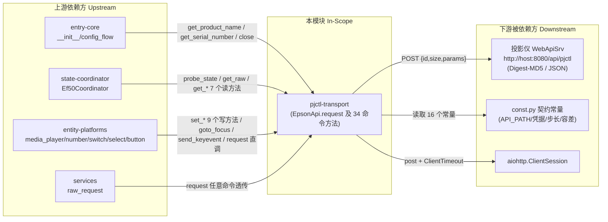

---

project: "ha-epson-ef-projector"

type: boundaries

description: "pjctl-transport 是整仓唯一的设备 I/O 边界：一个纯 aiohttp + stdlib 的异步客户端，负责 Digest-MD5 认证、`{id,size,params}` 请求封装、四类失败语义分类，以及 34 个固件命令的高层封装（含对焦闭环）。它只依赖 const.py 的协议契约常量，**不 import homeassistant**，因此可在无 HA 环境独立单元测试。它不负责轮询编排、实体投影、配置装配，也不决定参数的业务语义枚举。"

base_commit: 52928ed9d1ac925ad7d87f47a0dd1af9a24fb3a3

---

# 模块边界

## 模块范围

|维度|本领域负责|本领域不负责（属于其他领域）|
|-|-|-|
|核心职责|Digest 挑战解析/nonce 缓存/401 单次重试（`api.py:99-145`, `:180-204`）；`{id,size,params}` 请求封装与 `resultCode` 判定（`api.py:147-199`）；四类异常分类（`api.py:40-61`）；34 个固件命令方法（`api.py:295-656`）；对焦闭环定位（`api.py:544-584`）|定时轮询节奏与快/慢双速装配（state-coordinator：`coordinator.py:37-154`）；实体状态投影与乐观回写（entity-platforms）；config entry 装配与身份迁移（entry-core：`__init__.py:166-212`, `config_flow.py:35-105`）；`hass.data` 生命周期（entry-core：`__init__.py:213-221`）|
|数据所有权|认证会话状态 `_auth`/`_nc`（`api.py:84-85`）；HTTP session 所有权 `_session`/`_owns_session`（`api.py:80-81`）；对焦闭环的瞬时位置与脉冲预算（`api.py:559-584`）|`coordinator.data` 字典（state/settings/diag/product/standby_mode）归 state-coordinator（`coordinator.py:39`, `:51-53`, `:116-127`）；实体 unique_id/`RestoreEntity` 快照归 entity-platforms（如 `number.py:170-183`）|
|业务规则|"size = 参数串 token 数"协议约定（`api.py:163-171`）；读失败→None、写失败→上抛的不对称约定（`api.py:298-299` vs `api.py:325`）；liveness 探针的异常归一化方向（`api.py:236-264`）；对焦脉冲 clamp 与 try/finally 兜底（`api.py:571-582`）|参数取值域（50–100 亮度、0–264 行程、0–255 增益）与标签映射由 const.py 声明（`const.py:95-97`, `:119-120`, `:190-191`），业务级钳制由实体的 `_attr_native_min/max_value` 承担（`number.py:78-79`, `:237-238`）；轮询降级策略（`coordinator.py:44-49`）|
|协议知识|Digest 字段解析、MD5 摘要合成、`nc` 递增（`api.py:119-145`）；pjctl 命令 ID 与子索引参数（"0"/"1"/"RANGE"/"POS"/"MIN"/"MAX"/"OFF"，`api.py:366-656`）；危险参数变体的排除（`api.py:481-488`, `:411-418`）|命令 ID 的**声明式枚举表**（`WRITABLE_SWITCHES`/`WRITABLE_SELECTS`/`AMBIENT_LIGHT_SWITCHES`/`BUTTON_DEFS`）归 const.py + 平台层（`const.py:53-92`, `:138-142`；`button.py:17-83`）|

## 上下游总览

## 上游依赖（Inbound / 谁依赖我）

|依赖方 (Caller)|交互方式 (RPC/HTTP/Event/Direct)|契约/接口路径|
|-|-|-|
|`entry-core`（`__init__.py`）|Direct（构造 + 首检 + 卸载）|`EpsonApi(host, port)`（`api.py:71-85`，调用点 `__init__.py:170`）；`get_product_name()`（`__init__.py:173`）；`get_serial_number()`（`__init__.py:60`）；`close()`（`__init__.py:175`, `:192`, `:219`）|
|`entry-core`（`config_flow.py`）|Direct（配置期一次性探针）|`EpsonApi(...)` + `get_product_name()` + `close()`（`config_flow.py:38-44`, `:76-82`）|
|`state-coordinator`|Direct（每轮轮询）|`probe_state()`（`coordinator.py:43`）；`get_raw(cmd, params)`（`coordinator.py:85`, `:93`, `:98`, `:102`）；`get_refresh_timer/get_focus_range/get_focus_position/get_product_name/get_standby_mode`（`coordinator.py:106-130`）|
|`entity-platforms`|Direct（用户动作）|`request()` 直调（`button.py:138`, `select.py:107`, `switch.py:106`）；`set_standby_mode`（`select.py:157`）；`set_ambient_light`（`switch.py:173`）；`set_ambient_mode`（`select.py:213`）；`set_auto_contrast`（`switch.py:234`）；`set_test_pattern`（`switch.py:294`）；`set_light_output`（`number.py:126`）；`set_refresh_timer`（`number.py:213`）；`goto_focus`（`number.py:290`）；`set_color_gain`（`number.py:389`）；`set_ambient_brightness`（`number.py:452`）；`send_keyevent`（`media_player.py:141`）；`probe_state`/`wait_for_state`（`media_player.py:154`, `:167`）|
|`services` 层|Direct（调试服务透传）|`request(command_id, params)`（`services.py:64`）；`send_keyevent`（`services.py:54`）|

## 下游依赖（Outbound / 我依赖谁）

|被依赖方 (Callee)|依赖目的|协议/驱动类型|强/弱|
|-|-|-|-|
|`const.py` 契约常量|URL 路径、Digest 凭据、对焦参数、几何步长、测试图案串（共 16 个 import 名，`api.py:16-33`）|同包静态 import|强（缺失即 ImportError，模块不可加载）|
|投影仪 `WebApiSrv`|全部设备读写|HTTP/1.1 POST + Digest-MD5 + JSON（`api.py:186-199`，路径 `const.py:14`）|强（不可达即全部方法失败）|
|`aiohttp.ClientSession`|HTTP 传输与会话复用|第三方库，`manifest.json` `requirements: []` 表示由 HA 内置提供|强|
|Python stdlib（`hashlib`/`re`/`random`/`asyncio`）|MD5、挑战解析、cnonce、超时与休眠（`api.py:7-12`）|标准库|强|
|Home Assistant（**否**）|—|`api.py:1-3` 明示"No Home Assistant imports so it can be tested standalone"，模块内零 HA 符号|不依赖|

## 防腐层与协议转换 (Anti-Corruption Layer)

- **外部系统隔离策略**：本模块本身就是整个集成的 ACL——固件的命令 ID、子索引参数、`size` 语义、`resultCode` 约定全部被吸收在 `EpsonApi` 内部，上游只看到有语义的方法名（`get_serial_number` / `set_ambient_brightness` / `goto_focus`）。反向也成立：模块不向上暴露固件的失败码细节，只暴露四个异常类型（`api.py:40-61`）。但**该隔离不完整**：`request()` 是公开方法且被平台层与服务层直接调用 4 处（`button.py:138`, `select.py:107`, `switch.py:106`, `services.py:64`；另有 `tools/` 探测脚本与测试直调），命令 ID 与参数串因此仍向上渗透。
- **DTO / 领域对象映射**：无显式 DTO 类；映射在方法体内以"原始响应串 → Python 原生类型"完成：`"191 2971"` → `(191, 2971)`（`api.py:265-275`），`"R G B"` → 三元组且要求恰好 3 token（`api.py:441-447`），`"min max"` → `(min, max)` 且要求恰好 2 token（`api.py:498-504`）。失败映射一律折叠为 `None`，语义是"当前电源态不可用"而非"值为空"。
- **协议约定的单向依赖**：`size=token 数` 这一固件约定只在 `api.py:171` 一处实现，const.py 不重复定义；反之 `QC_ZOOM_STEP=104`、`FOCUS_TRAVEL_UNITS_PER_SEC=65.0` 这类"实测物理量"放在 const.py，由 api.py 消费（`api.py:597`, `:570`）——即 const 存事实常量、api 存协议逻辑。

## 边界变更记录

|日期|变更内容|根因 / 触发|关联工件|
|-|-|-|-|
|2026-11-01|新增 `size=token 数` 协议约定；SET_PICTURE / SET_LIGHT_OUTPUT 写通路打通|错把 size 当字节长度，MCU 以 FAIL 拒绝写入（`api.py:163-170`）|`api.py:147-175`；ADR-global-002|
|2026-11-01|对焦从"按 ±10 步数换算"改为"连续移动 + 定时 + OFF + 回读"闭环|真机实测换向后首步 ±10、同向后续仅 ±1，旧算法到不了远距离目标（`const.py:108-118`）|`api.py:544-584`；ADR-global-006|
|2026-11-01|新增 `EpsonApiTimeout`，并从 `EpsonApiError` 平级拆出|需要区分"端点不可达"与"端点存活但命令未答"（`api.py:56-61`, `:238-246`）|[待确认: 该拆分与 `probe_state` 归一化同批引入，git 历史被单次快照压缩，无法从提交分离]|
|2026-11-01|`set_refresh_timer` 改为只发 `"0 <h>"`，拒绝 `"1"`|`SET_REFRESH "1"` = 立即开始刷新并关机（`api.py:481-488`）|`const.py:50-52`；`number.py:143-152`|
|2026-11-01|固化「不实现危险变体」的边界：光效槽 11、氛围灯 `"255"`、ESCVP 工厂写命令一律不暴露|会清用户配置或进入工厂态（`const.py:146-149`, `:179-183`）|本文件 §防腐层|

## 全局功能树映射（A3 合并回写）

> 依据：`architecture_views/function_tree.yml`（A3 业务去重合并产物，base_commit 52928ed9）。
> 本模块在全局功能树中参与的 `function` 节点如下；合并依据与不合并理由见该文件头部注释。

| 全局 function id | 全局 function 名称 |
|-|-|
| `10` | 建立摘要认证会话 |
| `11` | 收发原生命令 |
| `12` | 判定投影仪电源状态 |
| `131` | 查询设备读数 |
| `132` | 写入设备设置 |
| `133` | 调整画面几何 |
| `134` | 定位对焦马达至目标位置 |

**回写说明**：本模块的 `function_tree.yml` 描述"本模块内部能力结构"；全局树描述"跨模块的业务能力"，二者通过上表对齐。合并后本模块仍是该能力的实现方之一（`module_refs`），不因合并而失去边界。
