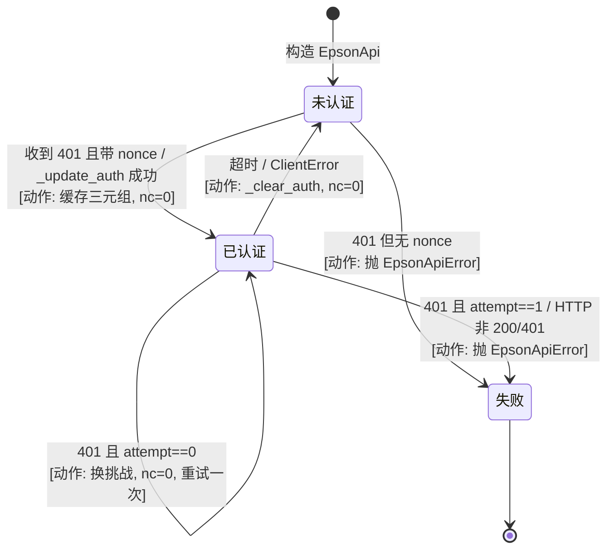
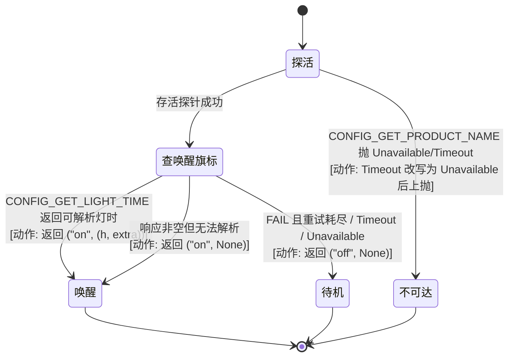
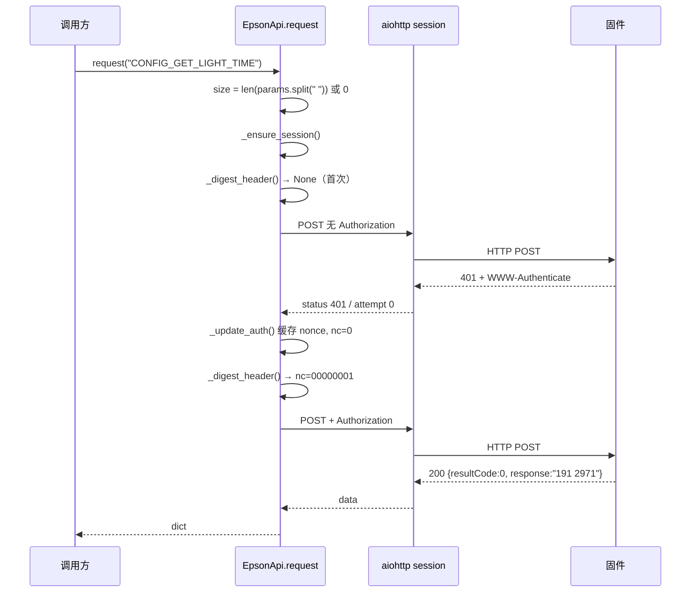
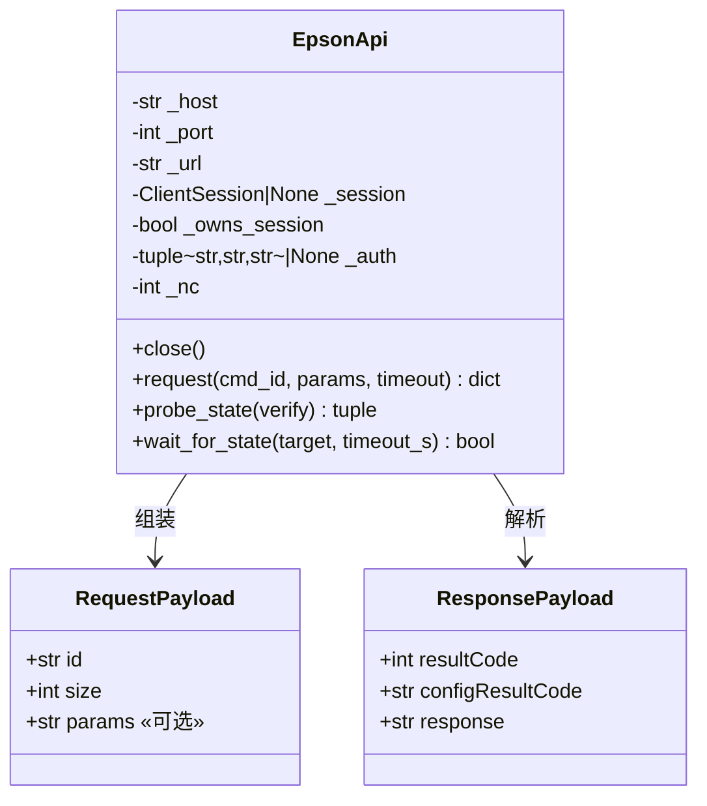
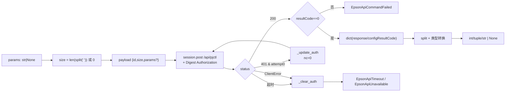

---

project: "ha-epson-ef-projector"

type: module-design

description: "pjctl-transport 是一个刻意做成「可脱离 Home Assistant 单测」的传输层：单类 EpsonApi 承载认证子层（挑战解析 + nonce 缓存 + 摘要头合成）、传输子层（请求封装 + 四类异常映射）、命令子层（34 个语义方法，读→None / 写→上抛的不对称契约），以及对焦闭环算法。核心数据模型只有三个实例字段（session 所有权、认证三元组、nonce 计数）与一个跨调用延续的算法上下文（对焦目标与脉冲预算）。对外接口就是这 36 个公开协程方法，其中 `request()` 同时是内部隧道与对外逃生门。"

base_commit: 2ac3d734d748f9a524f168520baf21307fc7b42c

---

# 模块设计：pjctl-transport（固件 pjctl 传输层）

## 模块定位与核心职责

- **一句话定义**：把「投影仪固件只认的 `{id,size,params}` + Digest-MD5 HTTP 报文」翻译成「有语义、有类型、有失败分类的异步 Python 方法」。
- **核心业务/技术能力**：
  1. Digest 会话维持（挑战被动获取、nonce 缓存、`nc` 单调递增、401 单次重试、失败即清缓存）——`api.py:99-145`, `:180-216`
  2. 协议契约实现（`size` = 参数串 token 数，不是字节数）——`api.py:160-175`
  3. 失败语义分类（Unavailable / CommandFailed / Timeout / 通用 Error）——`api.py:40-61`
  4. 电源状态判定（双重探针 + 异常归一化）——`api.py:221-276`
  5. 34 个固件命令的语义封装（14 个 `get_*` 读方法 + 10 个 `set_*` 写方法 + 10 个行为方法；读失败→None、写失败→上抛）——`api.py:295-656`
  6. 对焦绝对定位闭环（连续移动 + 定时 + OFF + 回读）——`api.py:544-584`

## 内部架构与分层设计

- **分层模式**：单类内四层（方法级分层，非包级分层）。没有 Port/Adapter 抽象：`aiohttp.ClientSession` 直接作为构造参数注入（`api.py:75`），这就是本模块唯一的可替换点，单测通过伪造 session 对象完成（`tests/test_api.py:64-97`）。

- **核心组件与分工**：

|组件/类名|职责描述|依赖|关键文件|
|-|-|-|-|
|`EpsonApi`（构造/会话）|持有 URL、session、所有权标志、认证三元组、nonce 计数|`aiohttp`|`api.py:68-97`|
|`_update_auth` / `_clear_auth` / `_digest_header`|认证子层：解析挑战、失效缓存、合成 Digest 头|`re`/`hashlib`/`random`|`api.py:99-145`|
|`request`|传输子层：请求体装配、401 重试、`resultCode` 判定、异常映射|`_ensure_session`、认证子层|`api.py:147-216`|
|`probe_state` / `wait_for_state`|状态子层：双重探针、异常归一化、限时确认|`request`|`api.py:221-293`|
|14 个 `get_*`（含 `get_raw`）|读命令族：解析 + 失败降级为 None（`get_light_time` 例外，待机抛异常）|`request`|`api.py:295-351`, `:432-514`, `:634-656`|
|10 个 `set_*` + `send_keyevent` / `focus_step` / `focus_move_*` / `geometry_*`|写命令族：参数模板化 + 失败上抛|`request`|`api.py:324-430`, `:449-488`, `:516-542`, `:590-632`|
|`goto_focus`|算法层：闭环定位（唯一含控制流的命令方法）|`get_focus_position`、`focus_move_start/stop`、`asyncio.sleep`|`api.py:544-584`|
|4 个异常类 `EpsonApiError` 及 3 个子类|契约层：失败的语义分类|无|`api.py:40-61`|

```mermaid
graph TD
    subgraph 调用方（模块外）
        U1["entry-core / coordinator<br/>probe_state, get_raw, get_*"]
        U2["entity-platforms<br/>set_*, goto_focus, request"]
        U3["services.raw_request<br/>request 直调"]
    end
    subgraph EpsonApi
        subgraph 命令子层
            C1["14 个 get_* 读方法<br/>失败→None"]
            C2["10 个 set_* + 7 个行为写<br/>失败→上抛"]
            C3["goto_focus<br/>闭环算法"]
            C4["probe_state / wait_for_state<br/>状态判定"]
        end
        subgraph 传输子层
            T1["request<br/>封装 + 401 重试 + resultCode"]
        end
        subgraph 认证子层
            A1["_update_auth / _clear_auth"]
            A2["_digest_header<br/>nc++ / MD5"]
        end
        subgraph 会话子层
            S1["_ensure_session / close<br/>_owns_session"]
        end
    end
    subgraph 外部
        DEV["固件 WebApiSrv<br/>/api/pjctl"]
        CON["const.py 16 个常量"]
    end
    U1 --> C1
    U1 --> C4
    U2 --> C2
    U2 --> C3
    U2 --> T1
    U3 --> T1
    C1 --> T1
    C2 --> T1
    C3 --> C1
    C3 --> C2
    C4 --> T1
    T1 --> A2
    T1 --> S1
    T1 -->|"POST JSON"| DEV
    A1 --> A2
    A2 --> CON
    DEV -.->|"401 + WWW-Authenticate"| A1
```

**依赖方向说明**：全部单向向下，无回边；`goto_focus` 是唯一"命令方法调用命令方法"的位置（`api.py:562`, `:572`, `:580`），因此它是本模块内耦合度最高的节点。

## 核心领域模型与状态机

- **关键实体 (Entities / Value Objects)**：

|实体/值对象|载体|属性与语义|
|-|-|-|
|认证三元组|`self._auth: tuple[str,str,str] \| None`（`api.py:84`）|`(nonce, realm, qop)`；None 表示"尚未挑战"或"已失效"|
|nonce 计数|`self._nc: int`（`api.py:85`）|每请求 +1，8 位十六进制格式化为 `nc`；换挑战或失败时归零|
|会话所有权|`self._session` + `self._owns_session`（`api.py:80-81`）|外部注入 session 时 `_owns_session=False`，`close()` 不得关闭别人的 session|
|响应载荷|`dict[str, Any]`|`{"resultCode": int, "configResultCode": str, "response": str}`；`resultCode != 0` 即命令失败（`api.py:195-198`）|
|对焦定位上下文|局部变量 `position`（`api.py:560`）|每轮重新测量，无跨调用持久化；无锁、无"正在定位"标志|

- **状态转换逻辑**：

### 状态机（认证会话）



> 分支裁决：`attempt == 0` 的 401 走"换挑战+重试"，`attempt == 1` 的 401 落入通用错误分支（`api.py:200-206`）；循环最多两轮，正常退出后仍能落到 `raise EpsonApiError("digest authentication failed")`（`api.py:216`）——该行在当前分支结构下不可达（两轮内必 return 或 raise），属防御性死代码。

### 状态机（电源判定）



> 分支裁决细节：`verify=True` 时 FAIL 会重试一次并 `sleep(1.5)`（`api.py:261-263`）；解析失败不判 off 而判 "on" 且灯时为 None（`api.py:273-274`）——因为能返回响应说明设备醒着。

## 关键工作流与算法实现

### 3.1 单条命令的完整生命周期（含 401）

1. 计算 `size`：`0 if params is None else len(params.split(" "))`（`api.py:171`），params 非 None 才写入键（`api.py:173-174`）。
2. 取 session：`_ensure_session()`，若为 None 或已 close 则新建并**把 `_owns_session` 置 True**（`api.py:93-97`）。
3. 进入 `for attempt in range(2)`：
   - 每次重新调 `_digest_header("POST", API_PATH)`——注意是**每条重试都重新取头**，因此重试会消耗一个新的 `nc`（`api.py:182`）。
   - 有头则加 `Authorization`，无头（首次）则裸发。
   - `session.post(url, json=payload, headers=..., timeout=ClientTimeout(total=total))`。
4. `status == 200` → 解析 JSON（`content_type=None` 容忍错误 MIME）→ `resultCode != 0` 抛 `CommandFailed` → 否则返回整个 data（`api.py:190-199`）。
5. `status == 401 且 attempt == 0` → 读 `WWW-Authenticate` → `_update_auth` 失败则抛 `EpsonApiError("401 without digest challenge")` → 成功则 `continue`（`api.py:200-204`）。
6. 其它状态 → 抛 `EpsonApiError(f"HTTP {status}: {text[:120]}")`（`api.py:205-206`）。
7. `asyncio.TimeoutError` → 清认证 → 抛 `EpsonApiTimeout`（`api.py:207-209`）。
8. `aiohttp.ClientError` → 清认证 → 抛 `EpsonApiUnavailable`（`api.py:210-214`）。



### 3.2 对焦闭环算法（`goto_focus`，`api.py:544-584`）

每一轮的六步：

1. **回读**：`position = await get_focus_position()`；读不到 → 立刻 `return None`（`api.py:562-564`）。不猜、不盲走。
2. **收敛判定**：`remaining = int(target) - position`；`abs(remaining) <= FOCUS_TOLERANCE(3)` → `return position`（`api.py:565-567`）。返回的是**实测位置**，非目标值。
3. **估算脉冲**：`duration = abs(remaining) / FOCUS_TRAVEL_UNITS_PER_SEC(65.0)`（`api.py:570`）。
4. **钳制**：`duration = max(0.10, min(2.0, duration))`（`api.py:571`）。
5. **起转**：`focus_move_start(1 if remaining > 0 else -1)` → 固件侧 `SET_FOCUS "MAX"/"MIN"`（`api.py:572`, `:531-538`）。
6. **定时 + 兜底停止**：`try: await asyncio.sleep(duration) finally: try: focus_move_stop() except EpsonApiError: _LOGGER.warning(...)`（`api.py:573-582`）。OFF 失败只记 warning，不掩盖原异常。
7. **静置**：`await asyncio.sleep(FOCUS_SETTLE_POLL=0.45)` 后进入下一轮（`api.py:583`）。
8. **预算耗尽**：`FOCUS_GOTO_MAX_ATTEMPTS=14` 轮后不抛错，`return await get_focus_position()`（`api.py:584`）——把"未收敛"降级为数据返回。

> 参数来源：65.0 单位/秒、[0.10, 2.0] 秒、容差 3、14 次、0.45s 全部来自 const.py（`const.py:124-133`），且注释标注为真机实测值（"目标 60/200/94 误差 0，120 误差 2"，`api.py:553-554`）。

### 3.3 会话生命周期

|阶段|行为|证据|
|-|-|-|
|构造|`session` 可选；`_owns_session = session is None`|`api.py:71-85`|
|懒创建|首次请求或 session 已 close 时新建 `ClientSession()`，并**强制** `_owns_session = True`|`api.py:93-97`|
|正常关闭|仅当自身拥有才 close；随后 `_session = None`|`api.py:87-90`|
|缺口 1|`_owns_session` 关闭后不复位，仍为 True|`api.py:87-90`|
|缺口 2|`close()` 后无 `_closed` 标志，迟到的协程调用 `_ensure_session()` 会**静默重建 session**|`api.py:93-97`|
|缺口 3|注入的外部 session 若被外部关闭，`_ensure_session` 会新建并接管所有权，即"借来的 session 变成自己的"|`api.py:94-96`|

## 设计模式

|模式|应用位置|解决的问题|关键文件|说明|
|-|-|-|-|-|
|Facade（门面）|34 个命令方法统一收口到 `request`|把固件命令表的细节挡在上层之外，平台层只说业务语义|`api.py:147-216`|但 `request` 本身公开，门面有后门（见风险 R-T08）|
|Strategy-like 注入（构造注入）|`session` 构造参数|无 HA 环境下单测，避免依赖真实网络|`api.py:75`, `tests/test_api.py:64-97`|唯一的接缝，没有为 auth/clock 提供注入点，导致 `random`/`sleep` 只能靠 patch|
|Template Method（参数模板）|每个写方法的 params 拼装|把"命令 ID + 子索引 + 值"的固定形状固化，避免调用方拼错|`api.py:394-418`, `:597-608`|模板是硬编码而非数据驱动，新增参数形态要改方法|
|Closed-loop Control（闭环控制）|`goto_focus`|固件无绝对定位命令，只能靠"估计-执行-测量"逼近|`api.py:544-584`|纯前馈估计 + 反馈修正，无 PID、无自适应速度|
|Null Object（失败即 None）|14 个 `get_*` 读方法（`get_light_time` 除外）|"当前电源态不可用"是常态而非异常，用 None 让上层做 carry-forward|`api.py:298-299`, `:347-351`|与写方法的"失败即抛"形成有意的不对称|
|Exception Taxonomy（异常分类）|4 个异常类|让上层能区分"重试有意义"（Timeout）与"重试无意义"（CommandFailed）|`api.py:40-61`|分类粒度只到传输语义，不含业务错误码|

## 数据设计

### 2.1 核心数据模型

本模块无持久化实体，只有两种内存结构：**请求载荷**与**响应载荷**。



|结构|字段|约束|证据|
|-|-|-|-|
|请求载荷|`id`|固件命令 ID 字符串，如 `CONFIG_SET_FOCUS`|`api.py:162`|
||`size`|参数串按单空格切分的 token 数；无 params 时为 0|`api.py:171`|
||`params`|可选；**仅当非 None 才出现**（`size=0` 时键缺失）|`api.py:173-174`|
|响应载荷|`resultCode`|`int(...) != 0` 即失败；缺失时默认 -1（也判失败）|`api.py:195`|
||`configResultCode`|错误信息载体，缺失时回退字符串 `'FAIL'`|`api.py:197`|
||`response`|字符串载荷，多数方法 `strip()` 后按空格切分|`api.py:265`, `:333`, `:441`|

### 2.2 存储与持久化设计

不适用。本模块无任何持久化（无文件、无 DB、无 HA Store）；唯一跨重启的状态（实体乐观值）由平台层的 `RestoreEntity` 承担，不属本模块。

### 2.3 缓存策略

|缓存对象|Key|TTL / 失效|一致性保证|证据|
|-|-|-|-|-|
|Digest 挑战|进程内单实例（`_auth` 三元组，无 key）|无 TTL；401 换挑战、超时/网络错误清空|`nc` 同步自增保证并发不重放；但清空是"任一方失败即全局失效"|`api.py:84`, `:111`, `:116-117`, `:125`|
|HTTP 连接|`aiohttp.ClientSession` 内部连接池|随 `close()` 释放|无显式配置，用 aiohttp 默认值|`api.py:95`|
|对焦位置读数|无缓存——每轮强制回读|—|闭环正确性依赖"每轮实测"|`api.py:562`|

### 数据流图



## 接口契约

### 外部接口

|名称|描述|请求方式|请求参数|返回参数|错误码|
|-|-|-|-|-|-|
|`POST /api/pjctl`（固件侧）|唯一设备端点|HTTP/1.1 POST + JSON + Digest-MD5|`{id: str, size: int, params?: str}`|`{resultCode: int, configResultCode: str, response: str}`|`resultCode != 0` → `EpsonApiCommandFailed`；401 → 换挑战重试一次；其它状态 → `EpsonApiError`|

### 内部接口

|名称|描述|调用方|提供方|请求参数|返回参数|
|-|-|-|-|-|-|
|`request`|任意命令透传（也是所有高层方法的底座）|`button.py:138`、`select.py:107`、`switch.py:106`、`services.py:64`|`EpsonApi`|`cmd_id, params, timeout`|`dict`|
|`probe_state`|电源态判定|`coordinator.py:43`、`media_player.py:154`|`EpsonApi`|`verify: bool=True`|`(str, tuple[int,int]\|None)`|
|`wait_for_state`|限时确认目标态|`media_player.py:167`|`EpsonApi`|`target: str, timeout_s: float=10.0`|`bool`|
|`get_raw`|通用读（返回原始串）|`coordinator.py:85/93/98/102`|`EpsonApi`|`cmd_id, params`|`str \| None`|
|`get_product_name` / `get_serial_number` / `get_standby_mode`|身份与模式读|`__init__.py:60/173`、`config_flow.py:40/78`、`coordinator.py:121/130`|`EpsonApi`|—|`str \| None`|
|`set_standby_mode` / `set_light_output` / `set_ambient_light` / `set_ambient_brightness` / `set_ambient_mode` / `set_test_pattern` / `set_color_gain` / `set_refresh_timer` / `set_auto_contrast`|九类写命令|`select.py:157/213`、`number.py:126/213/389/452`、`switch.py:173/234/294`|`EpsonApi`|各自业务参数|`None`|
|`send_keyevent`|按键注入|`media_player.py:141`、`services.py:54`|`EpsonApi`|`keycode: int`|`None`|
|`goto_focus`|对焦绝对定位|`number.py:290`|`EpsonApi`|`target: int`|`int \| None`|
|`close`|释放自身 session|`__init__.py:175/192/219`、`config_flow.py:44/82`|`EpsonApi`|—|`None`|

### 配置接口

|名称|描述|类型|默认值|取值范围|
|-|-|-|-|-|
|`host`|投影仪地址|构造参数（来自 config entry `CONF_HOST`）|—|任意可解析主机|
|`port`|pjctl 端口|构造参数（来自 `CONF_PORT`）|`8080`（`const.py:10`）|`config_flow` 未加 Range 约束（`config_flow.py:55`）|
|`timeout`（每请求）|单次请求超时|`request` 参数|`10.0`（`api.py:160`）|任意浮点；无上限校验|
|`_TIMEOUT`|模块级默认超时常量|常量|`ClientTimeout(total=10)`（`api.py:37`）|**从未被引用**（死常量）|

### 错误码与异常定义

|错误码|协议层状态|含义|触发场景|处理建议|
|-|-|-|-|-|
|`EpsonApiUnavailable`|连接失败 / 存活探针超时|端点不可达（市电断、IP 错、防火墙 DROP）|`aiohttp.ClientError`（`api.py:210-214`）；存活探针 `EpsonApiTimeout` 被改写（`api.py:240-246`）|上层判设备离线；协调器 → `UpdateFailed`（`coordinator.py:44-45`）|
|`EpsonApiCommandFailed`|HTTP 200 + `resultCode != 0`|端点应答但命令被固件拒绝|任何 `resultCode != 0`（`api.py:195-198`）；灯时响应为空（`api.py:334-335`）|多数场景视为"当前电源态不支持"；协调器探针分支直接判 off（`coordinator.py:46-49`）|
|`EpsonApiTimeout`|请求超时|端点存活但命令未在预算内答完（深待机典型）|`asyncio.TimeoutError`（`api.py:207-209`）|可重试类；`probe_state` 第二步把它归为 off（`api.py:258-259`）|
|`EpsonApiError`|HTTP 非 200/401、bad JSON、401 无 nonce、认证失败|其它协议层错误|`api.py:194`, `:203`, `:206`, `:216`|不可自动恢复，需人工排查|
|（读方法专属）`None`|—|"当前电源态不可用"，非错误|`get_*` 内 `except EpsonApiError`（`api.py:298`, `:313`, `:349`）|按 carry-forward 处理，不覆盖旧值（`coordinator.py:128-132`）|

## 开发指南

### 洞察

- **不对称契约是本模块最重要的隐式接口**：读→`None`、写→抛异常。任何新方法必须选边并在 docstring 里写明，否则上层无法决定"是否覆盖旧值"。
- **`size` 是唯一的协议陷阱**：错算不会报错，只会让固件 FAIL；`params=""` 会被算成 1 个 token（`"".split(" ")` → `[""]`），传空串等价于声明"有一个空参数"。
- **归一化方向不可逆**：`probe_state` 把 Timeout→Unavailable、引擎失败→off 是**有意的单向重分类**（`api.py:240-246`, `:258-264`），改动方向会同时破坏协调器的 `UpdateFailed` 判据和媒体播放器的"活着但卡住"识别。
- **`probe_state` 一次调用最坏 3 条 HTTP**：liveness 1 条 + 引擎查询最多 2 条（verify=True 时），且引擎查询超时 5s（`api.py:256`），因此单次探针最坏 ≈ 10+5 ≈ 15s（verify=True 时再加 1.5s 退避 + 一条 ≤5s 查询 ≈ 21.5s）。

### 扩展指南

新增一条固件命令（以读为例）的固定五步：

1. 在 const.py 增加需要固件确认的**实测常量**（步长/容差/换算比），不要放协议字面量。
2. 在 `api.py` 命令区新增 `async def get_xxx(self) -> T | None`，用 `get_raw(cmd, params=...)` 取原始串。
3. 解析：先 `strip().split()`，再**校验 token 个数**，再 `try: int(...) except (ValueError, IndexError): return None`（照 `api.py:441-447` 的三段式）。
4. 若该命令在待机时会挂起 HTTP 线程，调用方必须自己限时——`get_raw` 不接受 timeout（`api.py:340-351`），这是已知限制。
5. 补测试到 `tests/test_api.py`，断言**完整请求体**（含 `size`）而不是只断言 response 解析（照 `tests/test_api.py:235-245`）。

写命令则在 const.py 的声明式表里加行（`WRITABLE_SWITCHES`/`WRITABLE_SELECTS`，`const.py:53-92`）由平台层表驱动装配，不必新增 `EpsonApi` 方法——这是当前两条并存的扩展路径，选哪条取决于是否需要"非 0/1、非固定档位"的参数形态（如 `set_ambient_light` 的三 token 模板只能写成方法，`api.py:387-398`）。

### 风格与约定

- **方法 docstring 必须记录真机实测结论**（含日期与机型），例如 `api.py:163-170`、`:419-427`、`:519-527`——这是本仓库最强的知识传递载体，新增方法应延续。
- **危险变体用"不实现"表达**，并在 docstring 写明为什么（`api.py:481-487`, `:411-417`），不要写运行时校验。
- **私有方法前缀 `_`**：`_update_auth`/`_clear_auth`/`_digest_header`/`_ensure_session` 四个（`api.py:93-145`），测试直接打这些私有方法（`tests/test_api.py:101-117`），因此改名会破坏测试契约。
- **日志级别**：仅在换 nonce 时 debug（`api.py:112`）、OFF 失败时 warning（`api.py:582`）；请求失败不打日志，靠异常上抛——因为协调器每 15s 就会失败一次，打日志会淹没。

### 设计哲学

- **"可脱离 HA 单测"优先于"复用 HA 工具"**：文件头明示无 HA import（`api.py:1-3`），代价是丢失 HA 的 `async_timeout`/`aiohttp_client` 会话复用，收益是 64 个测试可在纯 Python 环境跑（`python3 -m unittest discover -s tests` → 64 tests OK）。
- **"失败分类"优先于"失败重试"**：模块内只有 401 一处重试，其余一律上抛或降级为 None。原因是固件是单线程 NanoHTTPD，盲目重试会放大拥塞。
- **"闭环在客户端"优先于"假设固件能力"**：对焦定位是唯一主动实现控制算法的地方（`api.py:544-584`），因为固件明确没有绝对定位命令（`const.py:108-118` 记录了两次真机复测的纠正）。

### 修改检查清单

- [ ] 改 `request()` 的 `size` 计算后，跑 `tests/test_api.py` 中全部 payload 断言（`tests/test_api.py:219-280`, `:299-520`）
- [ ] 改异常类型继承关系后，检查 `coordinator.py:44-49`、`media_player.py:141-176`、`number.py:290-295` 的 except 顺序（`EpsonApiTimeout` 是 `EpsonApiError` 子类，宽捕获会吞掉细分语义）
- [ ] 改 `probe_state` 归一化方向后，同步检查 `coordinator.py:42-49` 与 `media_player.py:150-176`
- [ ] 改 `goto_focus` 循环后，必须保留 `try/finally` 与"每轮回读位置"两条不变量（`tests/test_regressions.py:63-86` 有对应回归测试）
- [ ] 改 session 生命周期后，检查 `__init__.py:213-221` 卸载路径与 `config_flow.py:38-44`/`:76-82` 的 `finally: close()`
- [ ] 新增公开方法后，确认是否有包内调用者——否则会落入"零调用者"技术债（见 risk R-T01 / `risk.md`）
