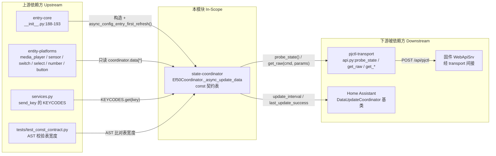

# 模块边界

## 模块范围

|维度|本领域负责|本领域不负责（属于其他领域）|
|-|-|-|
|核心职责|快/慢双速轮询编排（`coordinator.py:37-154`）；轮询快照字典的装配与跨轮结转（`coordinator.py:39`, `:134-153`）；待机态下跳过引擎类只读命令的判定（`coordinator.py:61`）；契约常量与 4 张声明式实体表的声明（`const.py:53-92`, `:138-142`, `:195-219`）；固件值域与换算参数的唯一来源（`const.py:94-191`）|HTTP 会话/Digest 认证/超时（`api.py:93-216`）；`size=token 数` 的载荷拼装（`api.py:161-174`）；实体类定义与状态属性映射（`media_player.py`/`switch.py`/`select.py`/`number.py`/`sensor.py`/`button.py`/`binary_sensor.py`）；config entry 生命周期与平台转发（`__init__.py:166-206`）；服务注册（`services.py:38-94`）|
|数据所有权|`coordinator.data` 这份快照：键集 `state`/`light_hours`/`light_extra`/`light_measured_at`/`diag`/`settings`/`product`/`standby_mode`（`coordinator.py:51-153`）；`_poll_count` 轮次计数（`coordinator.py:35`, `:38`）；`const.py` 全部模块级常量与 4 张表|实体对象自身的 `_attr_*` 与 `unique_id`；`api.py` 的 `_auth`/`_nc` 会话态（`api.py:84-85`）；`hass.data[DOMAIN][entry_id]` 字典（`__init__.py:195-201`）|
|业务规则|「读失败不写 None，末尾统一结转」（`coordinator.py:124-153` 的 `is not None` 守卫与 `:135-153` 的 carry-forward）；「待机不读引擎查询」（`coordinator.py:61`）；「慢值每 12 轮刷一次」（`coordinator.py:59`）；「表宽度必须等于全部解包点宽度」（`tests/test_const_contract.py:111-125`）；「值域常量必须标注证据来源等级」（`const.py:68-74`, `:144-151`）|写入语义与乐观状态（`switch.py:104-117`、`select.py:104-113`、`number.py:123-133`）；盲 toggle 前的探针（`media_player.py:151-157`）；按键→keycode 解析（`services.py:48-53`）|

## 上下游总览

## 上游依赖（Inbound / 谁依赖我）

|依赖方 (Caller)|交互方式 (RPC/HTTP/Event/Direct)|契约/接口路径|
|-|-|-|
|entry-core（`__init__.py`）|Direct（构造 + 首刷）|`Ef50Coordinator(hass, api, poll_interval)`（`__init__.py:188`）、`async_config_entry_first_refresh()`（`:190`）；`:191` 只捕获 `ConfigEntryNotReady`，而本模块 `:45` 抛的是 `UpdateFailed` —— 两者是否为同一异常需查 HA 基类实现，本环境未安装 HA 无法核实 → `[待确认]`，见 risk.md R-SC-10|
|entity-platforms（全部 7 个平台）|Direct（只读属性）|`coordinator.data[*]`：`media_player.py:100-136`、`sensor.py:67-119`、`switch.py:90-102`、`select.py:93-102`, `:143-150`、`number.py:111-140`, `:189-208`, `:263-280`, `:351-377`、`button.py:124-129`、`binary_sensor.py:52-56`|
|entity-platforms（设备信息）|Direct|`coordinator.data["product"]` 作 `DeviceInfo.model`：`switch.py:83`、`select.py:85`、`number.py:96`、`button.py:128`、`sensor.py:49`、`binary_sensor.py:47`、`media_player.py:87`|
|entity-platforms（解包声明式表）|Direct（解包表元组）|`WRITABLE_SWITCHES` → `switch.py:38`；`WRITABLE_SELECTS` → `select.py:40`；`AMBIENT_LIGHT_SWITCHES` → `switch.py:45`；`AMBIENT_MODE_OPTIONS` → `select.py:180`, `:187`|
|services.py|Direct（查表）|`KEYCODES.get(key)`（`services.py:49`），未命中且 key 是纯数字则直接当 keycode（`:50-51`）|
|diagnostics.py|Direct（整份快照导出）|`dict(getattr(coordinator, "data", None) or {})`（`diagnostics.py:33`）|
|tests/|AST 静态约束|`tests/test_const_contract.py:27-32`（4 张表的宽度与解包点）、`tests/test_regressions.py:89-95`（锁 `FOCUS_STEP_UNIT == 1`）、`:176-181`|

## 下游依赖（Outbound / 我依赖谁）

|被依赖方 (Callee)|依赖目的|协议/驱动类型|强/弱|
|-|-|-|-|
|`api.py::probe_state`|每轮必调：判活性 + 判唤醒 + 取灯时|Python async call（内部走 HTTP）|强（抛 `EpsonApiUnavailable` 即 `UpdateFailed`，`coordinator.py:44-45`）|
|`api.py::get_raw`|慢轮通用只读：27 条（17 诊断 + 6 开关 + 4 选择）|Python async call|弱（失败返回 `None`，跳过键，`coordinator.py:86`, `:94`, `:99`）|
|`api.py::get_refresh_timer`|慢轮读刷新定时器小时数|Python async call|弱（`None` 跳过，`coordinator.py:107`）|
|`api.py::get_focus_range`|慢轮读对焦行程，写入 `diag["focus_range"]`|Python async call|弱（`coordinator.py:111`）|
|`api.py::get_focus_position`|慢轮读对焦当前位置，写入 `settings["focus_position"]`|Python async call|弱（`coordinator.py:114`）|
|`api.py::get_standby_mode`|慢轮（含待机）读启动模式|Python async call|弱（`None` 时保留旧值，`coordinator.py:128-132`）|
|`api.py::get_product_name`|慢轮唤醒态读产品名|Python async call|弱（`coordinator.py:122`）|
|`homeassistant.helpers.update_coordinator.DataUpdateCoordinator`|调度、`update_interval`、`last_update_success`、`async_request_refresh`|HA 框架基类|强|
|`homeassistant.util.dt`|生成 `light_measured_at` 的 ISO 时间戳|HA 工具|弱（仅时间戳）|

## 防腐层与协议转换 (Anti-Corruption Layer)

- **外部系统隔离策略**：本模块**不接触任何传输细节**——不建 `aiohttp.ClientSession`、不算 Digest、不拼 `size`。所有固件差异被收敛到 `api.py` 的方法名上（`probe_state`/`get_raw`/`get_focus_range`…），本模块只认方法语义（`coordinator.py:13` 的 import 只有 `EpsonApi` 与两个异常）。反向的隔离体现在 `const.py`：它把「固件命令号 + 取值域 + 档位语义」声明成纯数据，使实体平台无需知道任何 pjctl 细节。
- **DTO / 领域对象映射**：`diag`/`settings` 两个字典的值**统一归一为 `str`**（`coordinator.py:87`, `:95`, `:100`, `:104`, `:108`, `:115` 直接存 `raw`；整数由 `str()` 显式转换 `:108`, `:115`）。这是一条隐式 ACL：固件返回的原始文本原样透传，解析责任下推到消费方（如 `number.py:118` 的 `float(raw)`、`number.py:355-361` 的 `split()` 三通道、`sensor.py:107` 的 `float(raw)/1000`）。唯一例外是 `diag["focus_range"]`，由本模块把二元组重新拼成 `"min max"` 字符串（`coordinator.py:112`）。

## 边界变更记录

|日期|变更内容|根因 / 触发|关联工件|
|-|-|-|-|
|2026-11-01|从 `WRITABLE_SWITCHES` 移除 `refresh` 项；刷新定时器改由 `number` 实体 + `settings["refresh_timer"]` 承载|`GET_REFRESH` 实测返回小时数 1–24 而非 0/1，`SET_REFRESH "1"` 是「立即刷新并关机」（`const.py:50-52`）|`const.py:50-52`、`number.py:143-153`、`__init__.py:139-141`|
|2026-11-01|新增对焦只读量（`diag["focus_range"]`、`settings["focus_position"]`）进入慢轮|`GET_FOCUS "RANGE"/"POS"` 子命令经真机确认（`coordinator.py:109-115`）|`const.py:105-133`、`api.py:490-514`|
|2026-11-01|新增 `refresh_timer` 只读量进入慢轮|同上，取代被删的 refresh 开关回读|`coordinator.py:105-108`|
|2026-11-01|诊断表新增 `auto_focus_state`/`auto_focus_target`（带参 `"0"`/`"1"` 才不挂）|无参数 `GET_AUTO_FOCUS` 挂死 NanoHTTPD，带参秒回（`coordinator.py:78-81`）|`coordinator.py:78-81`、`api.py:634-656`|
|2026-11-07|`FOCUS_STEP_UNIT` 的语义被纠正为「同向稳态步长 = 1」，闭环定位改由 `FOCUS_TRAVEL_UNITS_PER_SEC` 驱动|真机复测：换向首步 ±10、同向后续 ±1（`const.py:108-118`）|`const.py:119-133`、`api.py:516-584`、`number.py:282-301`|

## 全局功能树映射

> 依据：`architecture_views/function_tree.yml`（跨模块业务能力合并产物）。
> 本模块在全局功能树中参与的 `function` 节点如下；合并依据与不合并理由见该文件头部注释。

| 全局 function id | 全局 function 名称 |
|-|-|
| `12` | 判定投影仪电源状态 |
| `31` | 轮询并装配状态快照 |
| `32` | 声明可写设置与值域契约 |
| `44` | 设定启动模式 |
| `52` | 调整画面档位设置 |
| `71` | 显示设备读数 |

**回写说明**：本模块的 `function_tree.yml` 描述"本模块内部能力结构"；全局树描述"跨模块的业务能力"，二者通过上表对齐。合并后本模块仍是该能力的实现方之一（`module_refs`），不因合并而失去边界。
