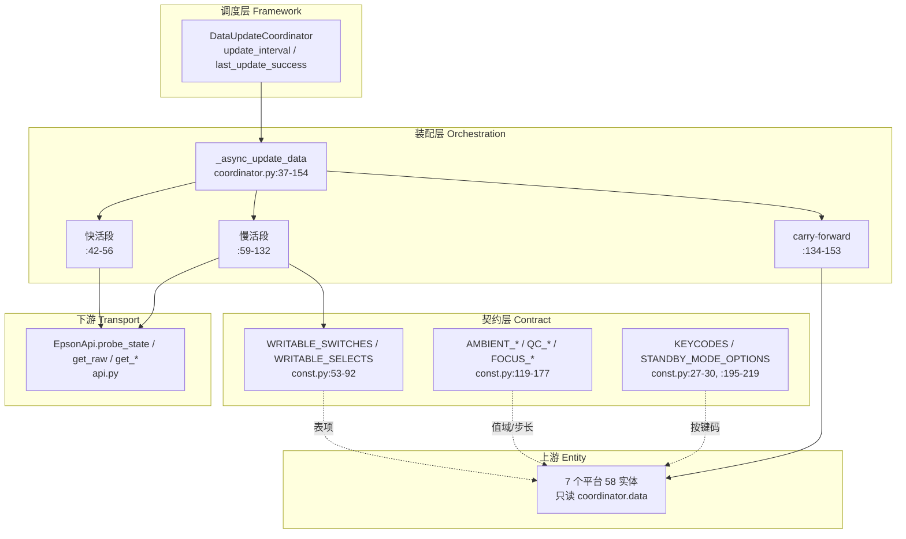
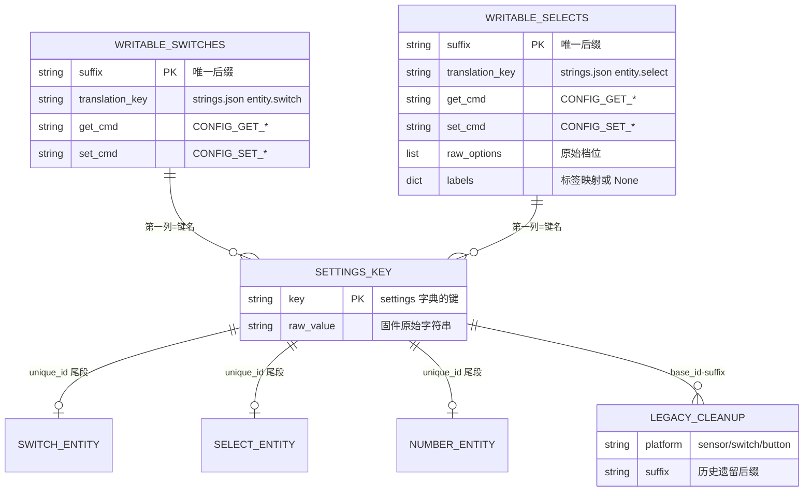
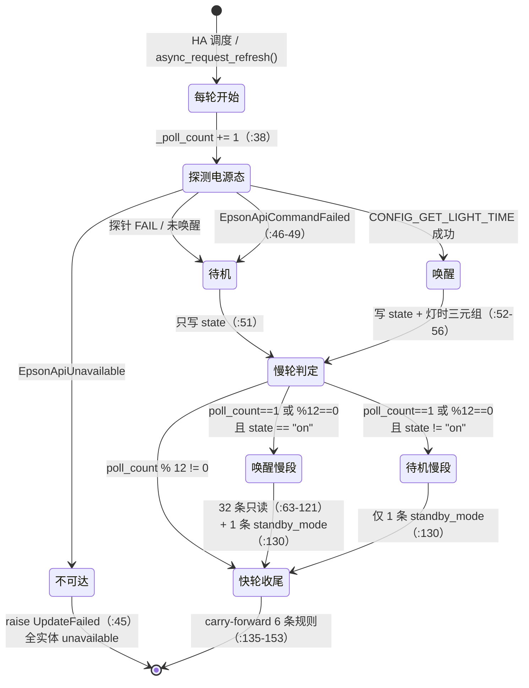

# 模块设计：state-coordinator（状态协调域）

## 模块定位与核心职责

- **一句话定义**：把设备侧「无推送、弱固件、命令时灵时不灵」的现实，翻译成一份每轮全量重建、可被 58 个实体直接读取的 JSON 安全字典；同时把「能写什么、值域多少」固化成声明式契约。
- **核心业务/技术能力**：
  1. **快/慢双速节流**：每轮固定探电源态，每 12 轮才追加 33 条只读命令（`coordinator.py:38-59`）。
  2. **读失败结转**：任何 `None` 结果都不入快照，由末尾 carry-forward 用上一轮值补齐（`coordinator.py:134-153`）。
  3. **待机短路**：`state != "on"` 时 `if state == "on":` 块内的 **32 条**引擎查询整段跳过，仅剩块外的 1 条 `standby_mode`（`coordinator.py:61`, `:130`）。
  4. **声明式契约**：4 张定宽元组表 + 6 组值域常量，一处声明、多处解包（`const.py:53-92`, `:138-142`, `:152-163`, `:195-219`）。

## 内部架构与分层设计

- **分层模式**：扁平三层——**调度层**（HA `DataUpdateCoordinator` 基类的模板方法 `_async_update_data`）、**装配层**（本模块内的快照字典构造与结转）、**契约层**（纯数据常量，无逻辑）。契约层不依赖任何其他层，可被实体平台与传输层同时引用。

- **核心组件与分工**：

|组件/类名|职责描述|依赖|关键文件|
|-|-|-|-|
|`Ef50Coordinator`|调度入口；持有 `api` 与 `_poll_count`；实现 `_async_update_data` 模板方法|`DataUpdateCoordinator`、`EpsonApi`|`coordinator.py:19-154`|
|`_async_update_data`（快活段）|无条件探电源态 + 灯时 + 时间戳|`api.probe_state`|`coordinator.py:42-56`|
|`_async_update_data`（慢活段）|每 12 轮执行：17 诊断 + 6 开关 + 4 选择 + 6 后置命令|`api.get_raw` / `get_refresh_timer` / `get_focus_*` / `get_product_name` / `get_standby_mode`|`coordinator.py:59-132`|
|carry-forward 段|6 条结转规则，把上一轮未刷新的键带进本轮|`self.data`|`coordinator.py:134-153`|
|契约表 ×4|`WRITABLE_SWITCHES`(6×4)、`WRITABLE_SELECTS`(4×6)、`AMBIENT_LIGHT_SWITCHES`(3×4)、`AMBIENT_MODE_OPTIONS`(4×2)|无|`const.py:53-66`, `:75-92`, `:138-142`, `:158-163`|
|值域常量 ×6 组|光源亮度 / 刷新定时器 / 对焦 / 氛围灯 / 几何步进 / 色彩增益 + 按键码表|无|`const.py:94-191`, `:195-219`|
|启动模式双向映射|`standby_option_to_raw` / `standby_raw_to_option`，未知值返 `None` 不猜测|`STANDBY_MODE_OPTIONS`|`const.py:27-45`|



## 核心领域模型与状态机

### 快照字典（本模块唯一数据模型）

`coordinator.data` 是一个**扁平的、值全为 JSON 标量或 str→str 字典**的结构，固定 8 个可能的顶层键：

|键|类型|生产位置|更新频率|缺失时的消费方行为|
|-|-|-|-|-|
|`state`|`"on"` \| `"off"`|`coordinator.py:51`|每轮必有|不可能缺失；`media_player.py:100-106` 直接映射|
|`light_hours`|`int`|`coordinator.py:53`|唤醒时每轮|`sensor.py:67-68` 返回 `None` → `unknown`|
|`light_extra`|`int \| None`|`coordinator.py:53`|同上|`sensor.py:74` 原样暴露|
|`light_measured_at`|ISO `str`|`coordinator.py:56`|同上|`sensor.py:78-83` 兼容 str 与 datetime|
|`diag`|`dict[str,str]`|`coordinator.py:60-88`, `:124-127`|每 12 轮|`sensor.py:103`、`number.py:352` 返回 `None`|
|`settings`|`dict[str,str]`|`coordinator.py:91-119`|每 12 轮|`switch.py:91`、`select.py:94` 返回 `None`|
|`product`|`str`|`coordinator.py:121-123`|每 12 轮 + 唤醒态|`switch.py:83` 回退到 `"Epson EF Projector"`|
|`standby_mode`|`str`|`coordinator.py:130-132`|每 12 轮（含待机）|`select.py:144-145` 返回 `None`|

### 实体关系 (ER)

本模块没有持久化实体，关系发生在「契约表 → `settings` 键 → 实体 `unique_id`」这条链上。第一列后缀是三者共用的主键：



关系语义：

- **契约表 → `settings` 键**：`coordinator.py:95`/`:100` 把第一列后缀直接当作 `settings` 的键写入。
- **`settings` 键 → 实体**：`switch.py:78`、`select.py:75` 用 `f"{base_id}-setting-{suffix}"` 拼出 `unique_id`；`number.py` 的三个数值键（`light_output`/`refresh_timer`/`focus_position`）虽然不在两张表里，但用的是同一批键名。
- **`settings` 键 → legacy 清理**：`__init__.py:146-156` 的 `legacy` 表用 `f"{base_id}-{suffix}"` 匹配待清理的孤儿实体。注意该表里的 `suffix` **已经包含 `setting-`/`button-` 前缀**（如 `"setting-refresh"`、`"button-engine_refresh"`、`"standby_mode"`），因此最终形态与 `unique_id` 一致。这说明前缀 `setting-` 是实体类各自硬编码的（`switch.py:78`、`select.py:75`），而非集中定义——清理表必须手工跟上。
- **无外键约束**：以上全是命名约定，没有任何代码强制。改名不会报错，只会让关系静默断裂（R-SC-15）。

### 轮询状态机



### 状态转换的触发事件 / 执行动作 / 进入条件

|转换|触发事件|执行动作|进入条件|
|-|-|-|-|
|→ 不可达|`probe_state` 抛 `EpsonApiUnavailable`|`raise UpdateFailed`（`:44-45`）|TCP 连接失败 / 活性探针超时（`api.py:236-246` 把 timeout 归一为 unavailable）|
|→ 待机|唤醒探针任何失败|`data["state"]="off"`；不写灯时|`CONFIG_GET_LIGHT_TIME` FAIL/超时/断连（`api.py:252-276`）|
|→ 待机（降级）|`probe_state` 抛 `EpsonApiCommandFailed`|`state, light = "off", None` + debug 日志（`:46-49`）|端点可达但探针命令失败——注释明示「treat as off」|
|→ 唤醒慢段|`_poll_count==1 or _poll_count%12==0` 且 `state=="on"`|32 条只读（`if state == "on":` 块内）+ 1 条 `standby_mode`（块外）+ 合并进 `settings`/`diag`|`coordinator.py:59-61`, `:130`|
|→ 待机慢段|同上节流条件 且 `state!="on"`|**仅 1 条** `get_standby_mode()`（`:130`）；`:62-123` 整块被跳过|`if state == "on":` 为假|
|→ 快轮收尾|恒在每轮末尾|6 条 carry-forward|`coordinator.py:134-153`|

**分支冲突裁决**：`standby_mode` 是本模块唯一的「待机也要读」的慢值，它在 `if state == "on":` 块**之外**但在慢轮节流**之内**（`:130`，缩进 12 = `if self._poll_count...` 的直接子节点）。这是刻意设计而非遗漏：启动模式是待机态唯一可读的设备配置。

## 关键工作流与算法实现

### 流程一：一轮轮询的精确 HTTP 数量（本模块最关键的量化事实）

```
_async_update_data()                                    缩进  证据
├─ _poll_count += 1                                            :38
├─ probe_state()  ──────────────── 2 条 HTTP（在线）          :43
│                                  └ 3 条（待机 + verify 重试）api.py:252-264
├─ if light: 写灯时三元组（0 条 HTTP）                          :52-56
└─ if _poll_count==1 or _poll_count % 12 == 0:      [ind=8]    :59
   ├─ diag = {}                                              :60
   ├─ if state == "on":                            [ind=12]   :61
   │  ├─ 17 条诊断探针 for probes  ─────────── 17 条          :63-88
   │  ├─ 6 条开关回读 for WRITABLE_SWITCHES ──  6 条          :92-96
   │  ├─ 4 条选择回读 for WRITABLE_SELECTS ───  4 条          :97-101
   │  ├─ CONFIG_GET_LIGHT_OUTPUT(params="0") ──  1 条         :102
   │  ├─ get_refresh_timer() ─────────────────  1 条          :106
   │  ├─ get_focus_range() ───────────────────  1 条          :110
   │  ├─ get_focus_position() ────────────────  1 条          :113
   │  ├─ if settings: 合并（0 条 HTTP）                        :116-119
   │  └─ if state == "on":  ← 冗余的二次判定      [ind=16]     :120
   │     └─ get_product_name() ───────────────  1 条          :121
   ├─ if diag: 合并（0 条 HTTP）                               :124-127
   └─ get_standby_mode() ─────────────────────  1 条          :130
```

**精确计数与公式**：

|场景|HTTP 条数|公式|证据|
|-|-|-|-|
|快轮（唤醒）|**2**|`probe_state` 内部 2 条（`CONFIG_GET_PRODUCT_NAME` + `CONFIG_GET_LIGHT_TIME`）|`api.py:237`, `:255`；`coordinator.py:43`|
|快轮（普通待机）|**2** 或 **3**|2 条；若唤醒探针 FAIL 且 `verify=True` 则重试 1 次 → 3 条|`api.py:252-264`（`attempts = 2 if verify else 1`）|
|慢轮（唤醒）|**35**|= `2(probe) + 17(diag) + 6(switch) + 4(select) + 6(post)`<br/>post = `light_output` + `refresh_timer` + `focus_range` + `focus_position` + `product` + `standby_mode`|`coordinator.py:43`, `:63-83`, `:92`, `:97`, `:102`, `:106`, `:110`, `:113`, `:121`, `:130`|
|慢轮（待机）|**2**|= `2(probe) + 0(引擎段整块跳过) + 1(standby_mode)`  ← 注意 probe 的 2 条里唤醒探针必 FAIL 并重试，实际常为 3|`coordinator.py:61` 跳过 `:62-123`；`:130` 仍执行|
|稳态平均|**2 + 33/12 ≈ 4.75 条/轮**|= `2 + (35−2)/12`|`const.py:222` = 12|

> ⚠️ **重复命令（AST 精确核算）**：三张表合计发 **27 条**请求（17 诊断 + 6 开关 + 4 选择），去重后为 **21 条**——有 **6 条完全重复的请求**：`CONFIG_GET_VMUTE`、`CONFIG_GET_COLOR_TEMP`、`CONFIG_GET_DYNAMIC_CONTRAST`、`CONFIG_GET_MOVEMENT_SENSOR`、`CONFIG_GET_SMART_EYE_PROTECTION`、`CONFIG_GET_STARTUP_CORRECTION` 各被读 **2 次**（先在 17 条诊断表里进 `diag`，再在开关/选择表里进 `settings`，命令号与参数完全相同）。
>
> `CONFIG_GET_AUTO_FOCUS` 出现 2 次但参数不同（`"0"` 与 `"1"` 是两个不同子索引），**不属于冗余**。
>
> 另有第 7 条重复：`CONFIG_GET_PRODUCT_NAME` 在同一次慢轮里被读 2 次（`probe_state` 的活性检查 `api.py:237` + `:121` 的 `get_product_name`），可与 probe 结果共享。
>
> **结论**：慢轮 35 条 → 若能共享读取结果，可降至 **28 条**（消除 6 条表内重复 + 1 条 product 重复）。

### 流程二：`if state == "on":` 的嵌套关系与 `:120` 的冗余判定

**缩进层级证据**（`coordinator.py`）：

```
:59  ind=8   if self._poll_count == 1 or self._poll_count % 12 == 0:   ← 慢轮闸门
:60  ind=12      diag = {}
:61  ind=12      if state == "on":                                     ← 待机短路（第 1 次）
:63  ind=16          probes = [...]
:92  ind=16          for suffix,... in WRITABLE_SWITCHES:
:97  ind=16          for suffix,... in WRITABLE_SELECTS:
:102 ind=16          raw = await ... CONFIG_GET_LIGHT_OUTPUT
:116 ind=16          if settings:
:120 ind=16          if state == "on":                                 ← 冗余判定（第 2 次）
:121 ind=20              product = await self.api.get_product_name()
:124 ind=12      if diag:
:130 ind=12      standby_mode = await self.api.get_standby_mode()      ← 在 :61 块之外
```

**结论**：`:120` 的 `if state == "on":` **完全冗余**。它位于 `:61` 的 `if state == "on":` 块内部（缩进同为 16 或更深），且 `state` 在 `:51` 之后到 `:133` 之间**没有任何重新赋值**——AST 核验：函数体内 `state` 的赋值仅出现在 `:43` 与 `:49` 两处，`state == "on"` 的比较出现在 `:61` 与 `:120` 两处。因此 `:120` 的判断条件恒为真，`product` 的读取实际等价于无条件执行。

**但**：`:120` 的冗余恰好**掩盖了一个真实缺陷**——若将来有人把 `product` 的读取挪到 `:61` 块外（这是自然的修复动作），去掉 `:120` 会造成待机轮也读 `product`。保留该行是「防御性重复」，代价是让读者误以为存在两条不同的进入条件。见 `guidelines/principle-state-coordinator-003-*`。

### 流程三：carry-forward 的 6 条具体规则

|#|键|规则|证据|边界行为|
|-|-|-|-|-|
|1|`product`|本轮未产出且 `self.data` 非空 → 取旧值|`:135-136`|**无 None 守卫**：旧值为 `None` 时会显式写回 `None`（消费方 `switch.py:83` 用 `or` 兜底）|
|2|`standby_mode`|同上|`:137-138`|**无 None 守卫**；但 `:131` 的 `is not None` 已挡住「读到 None 覆盖旧值」|
|3|`light_hours` + `light_extra` + `light_measured_at`|三键**捆绑**结转：以 `light_hours` 缺失为唯一判据，一次写齐三个键|`:139-144`|保证「时间戳与读数同生同死」；注释 `:140-141` 明示目的是「关机时灯时仍可见，且时间戳说明它是什么时候量的」|
|4|`diag`|本轮未产出 → `previous = self.data.get("diag")`，`is not None` 才结转|`:145-149`|**有 None 守卫**；引用复制而非深拷贝|
|5|`settings`|同 `diag`|`:150-153`|**有 None 守卫**；与 `:117` 的合并共同构成两重保护|
|6|`state`|**不结转**——每轮无条件被 `probe_state` 覆盖|`:51`|刻意：`media_player.py:181-196` 依赖 `state` 做盲 toggle 前的决策，陈旧电源态会造成误翻转|

**规则 3 与 6 的不对称是设计要点**：灯时是「允许陈旧但必须标注时间」的量，电源态是「绝不允许陈旧」的量。

### 流程四：`settings` 的合并语义（乐观值何时被真值覆盖）

```python
# coordinator.py:116-119
if settings:
    merged = dict(self.data.get("settings", {})) if self.data else {}
    merged.update(settings)
    data["settings"] = merged
```

三步语义：

1. `dict(self.data.get("settings", {}))` —— 以**上一轮快照的 settings** 为底做**浅拷贝**（新字典对象，键值引用共享）。
2. `merged.update(settings)` —— 用**本轮读到的真值**覆盖同名键。
3. `data["settings"] = merged` —— 写入新快照。

**这意味着**：
- 本轮**读到**的键 → 真值覆盖（用户乐观值在这里被纠正）。例如 `number.py:129-130` 写后把 `settings["light_output"]="55"`，下一次慢轮若读到 `"100"` 就被覆盖。
- 本轮**没读到**的键（`get_raw` 返回 `None`）→ 保留上一轮值，**包括上一轮的乐观值**。所以一次写失败后的乐观值会一直留到下一次成功读到真值为止。
- 因为 `merged` 是新字典，实体在 `:109`/`:110` 里对 `coordinator.data["settings"]` 的 `setdefault` 写入**不会**被本轮 `merged` 影响（写的是旧快照对象），但下一轮 `:117` 的 `dict()` 会把旧对象里的乐观值一起拷进来——乐观值因此天然地跨轮存活。

**注意**：`:124-127` 的 `diag` 合并与 `:116-119` 的 `settings` 合并是**两套并列逻辑**，但 `diag` 合并发生在 `:61` 块**之外**，`settings` 合并在块**之内**。这导致 `diag` 在待机慢轮也会尝试合并（虽然 `diag` 恒为空故 `if diag:` 为假，结果等价）。

### 流程五：`light_measured_at` 为什么存 ISO 字符串

代码注释直接给出理由（`coordinator.py:54-55`）：

> `# Stored as an ISO string: HA state attributes must stay JSON`
> `# serialisable, and sensors re-expose this to show data freshness.`

即两条理由：
1. **HA 状态属性必须 JSON 可序列化**——`datetime` 对象塞进 `extra_state_attributes` 会在写状态机/持久化/WebSocket 序列化时失败。
2. **传感器要把这个原始字符串原样再暴露出去**用于展示新鲜度（`sensor.py:78-83`、`media_player.py:116-120`）。

值得注意的**防御性消费**：两个消费方都写成 `measured.isoformat() if hasattr(measured, "isoformat") else measured`（`sensor.py:80-82`、`media_player.py:118-120`），即它们**不信任**「一定是字符串」这条契约，同时兼容 datetime。这说明该契约在历史上曾经漂移过。见 risk.md R-SC-05。

### 流程六：慢段内部的时序与节流

```mermaid
sequenceDiagram
    participant H as HA Scheduler
    participant C as Ef50Coordinator
    participant A as EpsonApi
    participant F as 固件 WebApiSrv
    H->>C: _async_update_data()
    C->>A: probe_state()
    A->>F: CONFIG_GET_PRODUCT_NAME
    A->>F: CONFIG_GET_LIGHT_TIME (timeout=5s)
    A-->>C: ("on", (h, extra))
    alt poll_count == 1 or %12 == 0
        loop 17 条诊断探针
            C->>A: get_raw(cmd, params)
            A->>F: POST /api/pjctl
            A-->>C: raw str | None
            C->>C: sleep(0.2) 仅当 raw is not None
        end
        loop 6 条开关 + 4 条选择
            C->>A: get_raw(get_cmd)
            C->>C: sleep(0.2) 仅当 raw is not None
        end
        C->>A: get_raw(LIGHT_OUTPUT, "0") / get_refresh_timer()
        C->>A: get_focus_range() / get_focus_position()
        C->>A: get_product_name()  (仅唤醒)
        C->>C: merged = dict(old) ; merged.update(new)
        C->>A: get_standby_mode()  (含待机)
    end
    C->>C: carry-forward ×6
    C-->>H: dict 快照
```

## 设计模式

|模式|应用位置|解决的问题|关键文件|说明|
|-|-|-|-|-|
|Template Method|HA `DataUpdateCoordinator._async_update` 调用子类 `_async_update_data`|把调度/重试/`last_update_success` 交给框架，子类只写「取一次数据」|`coordinator.py:37-154`|不自己写 `async_track_time_interval`，换取统一的可用性语义|
|Table-Driven / Metadata Mapping|4 张元组表 + 通用实体类|10 个表驱动设置实体不必各写一个类；新增设置只需加一行表项|`const.py:53-92`、`switch.py:56-117`、`select.py:48-113`|代价是表宽度成为跨文件契约（见 ADR-state-coordinator-001）|
|Carry-Forward（缓存穿透兜底）|`:135-153`|弱固件下读失败极常见，置空会让传感器断档|`coordinator.py:134-153`|与「读失败写 None」正好相反的策略选择|
|Two-Speed Lane（分级刷新）|`:59` + `const.py:222`|40 个只读命令 × 每 15s = 固件不可承受|`coordinator.py:59`|用 12:1 的降频换取请求量恒定|
|Declarative Contract with Static Verification|`tests/test_const_contract.py` 用 AST 比对表宽度|表宽度漂移只在慢轮运行时炸，且炸成「全集成 unavailable」|`tests/test_const_contract.py:111-125`|把「运行时才暴露」的契约错误左移到 CI|

## 数据设计

### 2.1 核心数据模型：4 张声明式表的完整形状

|表|宽度|行数|列语义（按位置）|解包点|标签来源|
|-|-|-|-|-|-|
|`WRITABLE_SWITCHES`|**4**|**6**|①唯一后缀 → `settings` 的键与 `unique_id` 组成<br/>②翻译键 → `strings.json` 的 entity.switch.*<br/>③GET 命令号<br/>④SET 命令号|`switch.py:38`、`coordinator.py:92`|`const.py:53-66`|
|`WRITABLE_SELECTS`|**6**|**4**|①唯一后缀 ②翻译键 ③GET 命令号 ④SET 命令号<br/>⑤原始档位 `list[str]` ⑥档位标签 `dict[str,str] \| None`|`select.py:40`、`coordinator.py:97`|`const.py:75-92`|
|`AMBIENT_LIGHT_SWITCHES`|**4**|**3**|①唯一后缀 ②翻译键 ③图标 ④子索引 kind|`switch.py:45`|`const.py:138-142`|
|`AMBIENT_MODE_OPTIONS`|**2**|**4**|①显示标签（中文）②固件槽位 int|`select.py:180`（取 [0]）、`select.py:187`（`dict()` 取双向映射）|`const.py:158-163`|

**宽度不一致的后果**：Python 的 `for a, b, c, d in table` 是**严格元组解包**。任一行宽度与解包点不符即抛 `ValueError: too many values to unpack`（或 `not enough values`）。该异常发生在 `_async_update_data` 内，被 HA 视为更新失败 → `last_update_success=False` → **全部 `CoordinatorEntity` 变成 `unavailable`**。这不是推测，是仓库记录的真实事故（`tests/test_const_contract.py:1-9` 的 docstring）：3.10.0 发布前 `WRITABLE_SELECTS` 从 5 元组扩到 6 元组，`coordinator.py` 仍按 5 元组解包，静态测试与单元测试都没抓到，真机部署后每次诊断轮询都抛 ValueError，整个集成所有实体 unavailable。

**当前实际宽度一致性核验**（AST 实测）：

|表|定义宽度|`coordinator.py` 解包|`switch.py` 解包|`select.py` 解包|一致?|
|-|-|-|-|-|-|
|`WRITABLE_SWITCHES`|4|4（`:92`）|4（`:38`）|—|✅|
|`WRITABLE_SELECTS`|6|6（`:97`）|—|6（`:40`）|✅|
|`AMBIENT_LIGHT_SWITCHES`|4|—|4（`:45`）|—|✅|
|`AMBIENT_MODE_OPTIONS`|2|—|—|`dict()`（`:187`）/ `[0]`（`:180`）|✅|

**未被测试覆盖的表**：`tests/test_const_contract.py:27-32` 只登记了 4 张表（含 `button.py` 的 `BUTTON_DEFS`，宽度 5、30 行），**`AMBIENT_MODE_OPTIONS` 不在其中**——它靠 `dict()` 与列表推导消费，不产生元组解包 AST 节点，因此即使宽度漂移也不会被该测试捕获。见 risk.md R-SC-06。

### 2.2 值域常量与固件实测的关系

|常量组|声明值|证据等级|与实测/固件的关系|证据|
|-|-|-|-|-|
|`LIGHT_OUTPUT_*`|50 / 100 / 5|menu.json 定义|滑条范围来自固件菜单定义；代码注释未声称做过步进写值实测（`api.py:376-378` 只约束 50–100 的语义）|`const.py:94-97`|
|`REFRESH_TIMER_*`|1 / 24 / 1|固件静态定义 + 真机回环|MIN/MAX 来自 `PjWrapper` case 154/153 的静态值；读写回环 `1→4→12→1` 实测|`const.py:99-103`、`api.py:466-488`|
|`FOCUS_MIN/MAX`|0 / 264|真机实测|HB71 `GET_FOCUS "RANGE"` 实测 `0 264`|`const.py:106`, `:119-120`|
|`FOCUS_STEP_UNIT`|1|真机实测（2026-11-07 纠正）|**只描述同向稳态**：换向首步 ±10、之后同向每步 ±1|`const.py:108-122`|
|`FOCUS_TRAVEL_UNITS_PER_SEC`|65.0|真机实测|`MAX` 连续移动约 65 单位/秒；闭环定位误差 0（目标 60/200/94），目标 120 误差 2|`const.py:123-124`|
|`FOCUS_TOLERANCE`|3|实测推导|固件 POS 分辨率 1，留 2 单位裕量|`const.py:128-129`|
|`FOCUS_GOTO_MAX_ATTEMPTS`|14|无实测依据|注释未给出 14 的推导；闭环通常 1–2 次收敛（`api.py:553-554`），14 是上限保护|`const.py:130-131`|
|`AMBIENT_BRIGHTNESS_*`|0 / 100 / 1|固件静态分析|UI 0–100，固件 0–255，`×2.55` 线性映射（固件 UI 值转换规则）|`const.py:152-156`|
|`AMBIENT_BRIGHTNESS_FW_SCALE`|2.55|固件静态分析|`255.0/100.0`，用于 `api.py:408` 的 `round(ui * scale)` 并 clamp 到 0–255|`const.py:156`、`api.py:400-409`|
|`QC_ZOOM_STEP`|104|真机 ± 回环|`"1 104"` → `"-104"` 后 `GET_QC` 八 token 四角坐标精确回基线|`const.py:169`, `:176`|
|`QC_SHIFT_STEP`|13|真机 ± 回环|`"2 13 0"` → `"-13 0"` 零残差；≈1% 面板宽|`const.py:170`, `:177`|
|`COLOR_GAIN_*`|0 / 255|真机变值回环|0/1/50/150/200/255 边界回环实测，不受投影偏好切换影响|`const.py:185-191`|
|`STANDBY_MODE_OPTIONS`|`{"0":"节能","1":"快速启动"}`|固件资源 menu.json（**未实机核对**）|注释明确：若实际设备映射相反，可通过实体属性 `raw_value` 核对|`const.py:23-30`|
|`DIAGNOSTIC_EVERY_N_POLLS`|12|工程选择|无实测依据，纯权衡值（12 × 15s = 180s）|`const.py:221-222`|

### 2.3 疑似死常量 / 未被消费的常量（逐个核对）

对 `const.py` 全部 44 个模块级符号做词边界引用审计（排除 `const.py` 自身）：

|常量|外部引用数|结论|证据|
|-|-|-|-|
|`FOCUS_STEP_UNIT`|**0**|**死常量（生产侧）**。唯一引用是 `tests/test_regressions.py:91` 的 `assertEqual(const.FOCUS_STEP_UNIT, 1)`——它是「防止有人把步长假设改回 10」的回归哨兵，不参与任何计算。`api.py` 的 `focus_step()` 根本不读它（`api.py:516-529` 直接发 `INC`/`DEC`，步长由固件决定）|`const.py:122`、`tests/test_regressions.py:89-95`|
|`STANDBY_MODE_OPTIONS`|**0**|**非死常量**——仅被同文件的 `standby_option_to_raw`/`standby_raw_to_option` 消费（`:35`, `:45`），二者再被 `select.py:21-22` 导入。属「私有实现细节被公开导出」|`const.py:27-45`|
|`KEYCODE_SEND`|2（`api.py`）|活的，但只用于 `send_keyevent`（`api.py:328`）|—|
|`DIGEST_PASSWORD` / `DIGEST_REALM` / `DIGEST_USER`|2 / 2 / 3|活的，仅 `api.py` 用。`DIGEST_PASSWORD` 是硬编码固件凭据（`const.py:17-19`）|—|
|`DEFAULT_PORT` / `DEFAULT_POLL_INTERVAL`|5 / 4|活的|—|
|其余 38 个|≥2|均有外部消费者|—|

**关于 `api.py:37` 的 `_TIMEOUT`**（跨模块佐证，属 transport 范围）：`_TIMEOUT = aiohttp.ClientTimeout(total=10)` 在 `api.py` 内**无任何消费者**——`request()` 自建 timeout（`api.py:188` `timeout=aiohttp.ClientTimeout(total=total)`，`total` 来自参数或字面量 `10.0` 于 `:160`）。即 `_TIMEOUT` 与 `request()` 里的 `10.0` 是**两份重复的事实**，且 `_TIMEOUT` 是死的那份。本模块（`const.py`）的同类问题是 `FOCUS_STEP_UNIT`；两者的共同病根是「常量声明与被消费路径脱钩」。见 risk.md R-SC-07。

**`am stand` 核查结论**：全仓库（含 `.git` 历史、`docs/`、`tools/`）搜索 `am stand` / `am start` **无任何命中**。该字符串在本仓库不存在，不是常量也不是注释。[待确认] 若提问方指的是某外部资料中的写法，本模块无法给出代码证据。

### 2.4 `KEYCODES` 表与 `services.py` / `media_player.py` 的关系

|消费者|使用方式|证据|
|-|-|-|
|`services.py`|**唯一查表者**：`KEYCODES.get(key)`，未命中且 key 为纯数字则直接把数字当 keycode|`services.py:49-53`|
|`media_player.py`|**完全绕过**：全部 9 处按键用字面量——`26`(POWER)×2、`24`(VOL+)、`25`(VOL−)、`164`(MUTE)、`126`(PLAY)、`127`(PAUSE)、`88`(PREV)、`87`(NEXT)|`media_player.py:184`, `:196`, `:202`, `:205`, `:214`, `:219`, `:222`, `:225`, `:228`|
|`button.py`|**完全绕过**：4 处 `NOTIFY_KEYEVENT` 按钮用字符串字面量 `"3"`(HOME)、`"4"`(BACK)、`"82"`(MENU)、`"243"`(HDMI1)，且命令号也硬编码为字符串 `"NOTIFY_KEYEVENT"` 而非 `KEYCODE_SEND`|`button.py:18-22`|

**具体点名的硬编码**：`media_player.py:184` 与 `:196` 的 `await self._key(26)` 中，`26` 就是 `KEYCODES["POWER"]`（`const.py:206`）。同样 `media_player.py:214` 的 `164` 是 `KEYCODES["MUTE"]`（`const.py:212`）。

**影响**：`KEYCODES` 目前实际退化为「只服务于 `epson_ef.send_key` 服务的字典」，而集成自身的实体行为完全不经过它。改变 `KEYCODES` 里任何一项不会影响媒体播放器的行为——这既是「表驱动未贯彻到消费侧」的证据，也是潜在陷阱（有人改了 `KEYCODES["POWER"]` 会以为改了电源按钮）。

### 2.5 存储与持久化设计

**不适用**。本模块不持久化任何状态：`_poll_count` 与 `coordinator.data` 全在内存（`coordinator.py:35`, `:39`），进程重启即归零 → 首轮 `_poll_count == 1` 触发强制慢轮（`:59`）。持久化的需求由实体侧的 `RestoreEntity` 承担（如 `switch.py:121`、`select.py:168`、`number.py:67`）。

### 2.6 缓存策略

**内存缓存即 carry-forward**：`self.data` 是唯一缓存，无 TTL、无失效策略，仅在「本轮读到新值」时被覆盖（`:118`, `:126`）。所谓「一致性保证」就是 `merged.update()` 的覆盖语义 + `is not None` 守卫。缓存陈旧性对外由 `stale` 属性表达（`sensor.py:76`, `:118-119`）。

## 接口契约

### 外部接口

|名称|描述|请求方式|请求参数|返回参数|错误码|
|-|-|-|-|-|-|
|`update_interval`|轮询周期|HA 调度器读取|`timedelta(seconds=poll_interval)`|`timedelta`|—（`coordinator.py:28-33`）|
|`coordinator.data`|快照字典|属性读|—|`dict[str, Any]`|—（`coordinator.py:39-154`）|
|`epson_ef.send_key`（间接）|按名发键|Service|`key` / `entity_id`|无（异常即失败）|`HomeAssistantError("Unknown key: ...")`（`services.py:52-53`）|

### 内部接口

|名称|描述|调用方|提供方|请求参数|返回参数|
|-|-|-|-|-|-|
|`probe_state()`|判活性 + 判唤醒 + 取灯时|`coordinator.py:43`|`api.py:221`|`verify: bool = True`|`tuple[str, tuple[int,int]\|None]`，抛 `EpsonApiUnavailable`/`EpsonApiCommandFailed`|
|`get_raw(cmd, params)`|通用只读|`coordinator.py:85`, `:93`, `:98`, `:102`|`api.py:340`|`cmd_id: str`, `params: str\|None`|`str \| None`（失败不抛，返 None）|
|`get_refresh_timer()`|刷新定时器小时数|`coordinator.py:106`|`api.py:466`|—|`int \| None`|
|`get_focus_range()`|对焦行程|`coordinator.py:110`|`api.py:490`|—|`tuple[int,int] \| None`|
|`get_focus_position()`|对焦当前位置|`coordinator.py:113`|`api.py:506`|—|`int \| None`|
|`get_standby_mode()`|启动模式原始值|`coordinator.py:130`|`api.py:317`|—|`str \| None`|
|`get_product_name()`|产品名|`coordinator.py:121`|`api.py:295`|—|`str \| None`|
|`WRITABLE_SWITCHES`|开关契约表|`switch.py:38`、`coordinator.py:92`|`const.py:53`|—|6×4 元组|
|`WRITABLE_SELECTS`|选择契约表|`select.py:40`、`coordinator.py:97`|`const.py:75`|—|4×6 元组|
|`AMBIENT_LIGHT_SWITCHES`|氛围灯开关表|`switch.py:45`|`const.py:138`|—|3×4 元组|
|`AMBIENT_MODE_OPTIONS`|光效模式表|`select.py:180`, `:187`|`const.py:158`|—|4×2 元组|
|`standby_raw_to_option(raw)`|原始值→中文选项|`select.py:145`|`const.py:41`|`str \| None`|`str \| None`（未知值返 None，不猜测）|
|`standby_option_to_raw(option)`|中文选项→原始值|`select.py:153`|`const.py:33`|`str`|`str \| None`|

### 配置接口

|名称|描述|类型|默认值|取值范围|
|-|-|-|-|-|
|`poll_interval`|轮询周期（秒）|`int`|`DEFAULT_POLL_INTERVAL = 15`|5–300（`config_flow.py:63`, `:129`）|
|`DIAGNOSTIC_EVERY_N_POLLS`|慢轮间隔（轮）|模块常量|`12`|编译期固定，无运行时配置（`const.py:222`）|

### 错误码与异常定义

|错误码|协议层状态|含义|触发场景|处理建议|
|-|-|-|-|-|
|`UpdateFailed("projector unreachable: ...")`|HA 协调器层|设备不可达|`probe_state` 抛 `EpsonApiUnavailable`（`coordinator.py:44-45`）|HA 把全实体标 `unavailable`；`binary_sensor.connectivity` 仍可用（`binary_sensor.py:50-56`）|
|（无异常）|—|探针命令失败但端点活着|`EpsonApiCommandFailed`（`coordinator.py:46-49`）|按待机处理，记 debug 日志，不失败整轮|
|`ValueError: too many values to unpack`|纯 Python|表宽度契约破裂|表与解包点宽度不一致|**无运行时兜底** → 全集成 unavailable；靠 `tests/test_const_contract.py` 左移拦截|

## 开发指南

### 洞察

- [x] **快轮只有 2 条 HTTP，慢轮 35 条，比值 17.5:1**。任何「让某实体每轮都新」的需求都必须先算清它对固件的增量——第 3 条/轮的持续请求在单线程固件上已属可观（`manifest.json:10` `iot_class=local_polling`）。
- [x] **待机短路是本模块最大的单点优化**：一行 `if state == "on":`（`:61`）把块内 32 条必失败请求降为 0。
- [x] **carry-forward 让「陈旧」变成可表达的信息**，而不是靠置空隐藏（`:134-153` + `sensor.py:75-77`）。
- [x] **契约表的宽度是跨文件契约**，且失败模式是「全集成 unavailable」——因此必须有 AST 级护栏（`tests/test_const_contract.py`）。
- [x] **同一命令会被读两次**：6 条命令同时出现在诊断表与设置表且参数完全相同（`CONFIG_GET_VMUTE`/`COLOR_TEMP`/`DYNAMIC_CONTRAST`/`MOVEMENT_SENSOR`/`SMART_EYE_PROTECTION`/`STARTUP_CORRECTION`），另有 `CONFIG_GET_PRODUCT_NAME` 被 probe 与 `:121` 各读一次。这是表驱动设计未做「一次读取、多处消费」的直接产物。

### 扩展指南

**新增一个「0/1 型可写开关」**（最轻路径）：
1. `const.py:53-66` 的 `WRITABLE_SWITCHES` 追加一行 4 元组：`(suffix, translation_key, "CONFIG_GET_X", "CONFIG_SET_X")`。
2. `strings.json` 的 `entity.switch` 下追加同名 `translation_key`。
3. **不需要**改 `switch.py`（通用类会在 `:38` 遍历表创建实体）与 `coordinator.py`（会在 `:92` 遍历表回读）。宽度保持 4。
4. 跑 `python3 -m pytest tests/ -q` —— 若宽度写错，`test_const_contract` 会失败。

**新增一个「多档选择」**：
1. `const.py:75-92` 追加 6 元组：`(suffix, key, GET, SET, ["0","1"], {"0":"关","1":"开"} 或 None)`。
2. 若档位语义未确认，**必须传 `None`** 并保留原始值暴露（参照 `color_temp` 的 `const.py:73-74` 先例）。
3. `strings.json` 的 `entity.select` 追加键。

**新增一个诊断只读量**：
1. `coordinator.py:63-83` 的 `probes` 表追加 3 元组 `(diag_key, "CONFIG_GET_X", params_or_None)`。
2. 若要被实体消费，在对应平台从 `coordinator.data["diag"]` 读（参照 `sensor.py:103`）。
3. ⚠️ 注意 `probes` 的**类型标注与实际宽度不一致**：标注是 `list[tuple[str, str, str, str | None]]`（4 元素，`:63`），实际每行是 3 元素（AST 实测 17 行全部 arity=3）。标注是错的，以 `:84` 的 `for key, cmd, params in probes` 为准。

**新增一个值域常量**：
1. 在 `const.py` 对应分组内声明，**并在紧邻注释里写清证据等级**（真机回环 / 固件静态分析 / menu.json / 未确认）。
2. 若该值只被测试用来锁死一个历史假设，明确标注「回归哨兵，无生产消费者」（参照 `FOCUS_STEP_UNIT`）。

### 风格与约定

- **中文注释承载实测证据**：`const.py` 的注释不只是解释代码，而是**记录真机实测结论**（如 `const.py:108-118` 的对焦步长复测记录、`:144-151` 的氛围灯参数记录）。修改常量时必须同步更新注释里的证据，否则下一个人会以为旧结论仍成立。
- **`⚠️` 前缀标记危险项**：`const.py:108`（对焦步长错误假设）、`:151`（`SET_REFRESH "1"` 会关机）、`api.py:484`。新增禁令时沿用该记号。
- **值域常量成组命名**：`<FEATURE>_MIN/_MAX/_STEP`，三件套齐全（`LIGHT_OUTPUT_*`、`REFRESH_TIMER_*`、`AMBIENT_BRIGHTNESS_*`、`COLOR_GAIN_*` 有 MIN/MAX 但无 STEP，因为步进固定 1 处硬编码于 `number.py:320`）。
- **表项以「唯一后缀」为第一列**：该后缀同时是 `settings` 字典的键（`coordinator.py:95`）、`unique_id` 的尾段（`switch.py:78`）、以及实体清理的匹配依据（`__init__.py:146-150`）。三者必须一致。
- **`None` 永不入快照**：任何读结果先 `if raw is not None:` 再写（`:86`, `:94`, `:99`, `:103`, `:107`, `:111`, `:114`, `:122`, `:131` 九处守卫）。

### 设计哲学

- **「陈旧可见」优于「值消失」**：宁可让用户看到一个带时间戳的旧灯时，也不要让传感器变 `unknown` 造成历史断档（`coordinator.py:140-141` 注释、`sensor.py:75-77`）。
- **「降级为待机」优于「判定故障」**：端点活着但探针失败时假定待机（`:46-49`），因为电源切换瞬态会把整个集成打成 unavailable，体验代价远大于一次误判。
- **「契约即数据」优于「契约即代码」**：10 个设置分散到 10 个类会重复 10 次读写逻辑；用表 + 通用类把变更面收缩到一行元组。代价是宽度契约需要 AST 护栏（ADR-state-coordinator-001）。
- **「证据等级显式化」优于「统一标注为事实」**：同一文件内并存「真机回环实测」「固件静态分析」「menu.json 定义」「未确认假设」四档，且明确区分（`const.py:68-74` 的 color_temp 反例）。

### 修改检查清单

- [ ] 改 `WRITABLE_SWITCHES` / `WRITABLE_SELECTS` 宽度时，是否同步改了 **全部** 解包点（`coordinator.py:92`/`:97` + `switch.py:38`/`select.py:40`）？改完是否跑了 `tests/test_const_contract.py`？
- [ ] 新增表项后 `strings.json` 的翻译键是否补齐？（缺失不会报错，只会显示原始键名）
- [ ] 新增读命令是否放进了慢环（`coordinator.py:63-83` 或 `:92-115`）而不是实体 property？是否在 `state != "on"` 时必然失败？若是，必须放进 `:61` 块内。
- [ ] 新增慢值是否在 `:134-153` 补齐 carry-forward？只写"不结转"是否有明确理由（如 `state`）？
- [ ] 新增的值域常量是否标注了证据等级？是否有生产消费者（若无，是否应删除或明确标为回归哨兵）？
- [ ] 是否触碰了 `probes` 的类型标注（`:63` 的 4 元组标注 vs 实际 3 元组）？修正标注是安全的，但别顺手改解包。
- [ ] 慢轮增量是否算过 HTTP 条数公式（`2 + 17 + 6 + 4 + 6`）？新增一条命令就是稳态 +1/12 条/轮。
- [ ] 是否引入了第二个轮询源？（禁止，见 `principle-global-005`）
