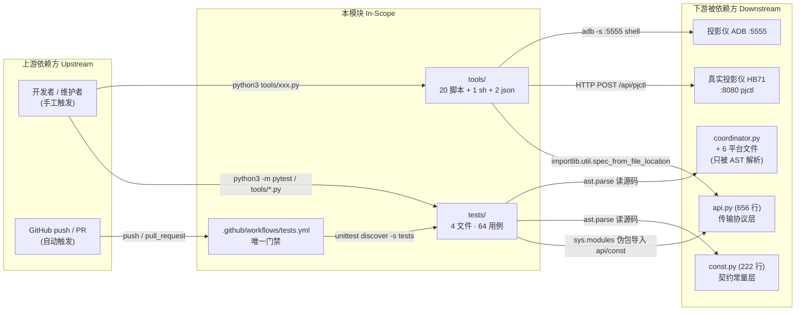

# 模块边界

## 模块范围

| 维度 | 本领域负责 | 本领域不负责（属于其他领域） |
|-|-|-|
| 核心职责 | 离线单元/契约测试（`tests/` 4 文件 1020 行 64 用例）；真机现场分析探测与功能验收（`tools/` 20 个 .py + 1 .sh + 2 .json）；CI 门禁定义与执行（`.github/workflows/tests.yml:1-24`） | 生产运行时行为本身（`api.py`/`coordinator.py`/7 个平台/`__init__` 属其他 4 模块） |
| 数据所有权 | `tools/probe_results.json`（36 条命令探测矩阵存档）、`tools/enum_map.json`（71 CONFIG + 27 NOTIFY 枚举映射）、`tests/` 内的测试替身（`FakeSession`/`FakeResponse`，`tests/test_api.py:40-92`） | `coordinator.data` 共享字典、实体状态、HA 配置项、`const.STANDBY_MODE_OPTIONS` 等生产数据（本模块只读） |
| 业务规则 | 「表宽度 == 解包宽度」契约（`tests/test_const_contract.py:111-125`）；「size=token 数」载荷契约（`tests/test_api.py:235-244`）；「待机不得升级为不可达」语义（`tests/test_regressions.py:186-219`）；CI 只拦 F,E9 | 协议命令语义的正确性（由真机决定，本模块只记录）、实体命名与翻译（`strings.json`/`translations/` 属实体平台域） |
| 变更权限 | 可新增/修改测试与探测脚本、可调整 CI 门禁范围与规则集 | **不得**修改生产代码来让测试变绿；本模块对生产代码只有读权限（`grep -rn "tests\|tools" custom_components/epson_ef/*.py` 无 import 命中，反向依赖为零） |

## 上下游总览

## 上游依赖（Inbound / 谁依赖我）

| 依赖方 (Caller) | 交互方式 | 契约/接口路径 |
|-|-|-|
| 开发者 / 维护者 | 手工命令行 | `python3 -m pytest tests/ -q`（实测 64 passed）；`python3 -m unittest discover -s tests -v`（实测 Ran 64 OK）；`python3 tools/<script>.py <投影仪IP>`（`tools/README.md:8-15`） |
| GitHub Actions | 事件触发（push / pull_request） | `.github/workflows/tests.yml:3-5`；无 tag/release 触发，仓库仅此 1 个 workflow |
| （无其他代码调用方） | — | 生产包不 import 测试或工具：`custom_components/epson_ef/*.py` 中无 `tests`/`tools` 的 import（`grep` 实测 0 命中） |

> 注：本模块的上游只有"人"和"CI 平台"，没有代码级 Caller。这是它与其余 4 个生产模块最本质的结构差异。

## 下游依赖（Outbound / 我依赖谁）

| 被依赖方 (Callee) | 依赖目的 | 协议/驱动类型 | 强/弱 |
|-|-|-|-|
| `custom_components/epson_ef/api.py` | 被测对象（传输层）与工具脚本的执行引擎 | Python import（伪包 `__path__` 注入 / `importlib` 直载） | **强**：api.py 改名/改签名 → 20/20 工具脚本 + 3/4 测试文件同时失效 |
| `custom_components/epson_ef/const.py` | 表结构与取值映射的被测对象 | `ast.parse` 静态读取 + 直接 import（`tests/test_regressions.py:29`） | **强**：表名/位置变动 → 契约测试 `AssertionError: not found in const.py`（`:52`） |
| `custom_components/epson_ef/__init__.py` / `coordinator.py` / `button.py` / `select.py` / `switch.py` | 仅作为 AST 文本被读取（不执行） | 文件读取 + `ast.parse` | 弱（文本级）：内容变化不会让测试崩溃，只会让断言失败 |
| `aiohttp` | 工具脚本与测试的 HTTP 客户端；测试还引用其异常类型 | 库依赖 | 强：`tests/test_api.py:15` `import aiohttp` 无条件执行 |
| `pyflakes` (≥1 个可用实例) | `tests/test_static.py:15` 的静态检查引擎 | 子进程 `python -m pyflakes` | **弱**：缺失即 `skipTest`，保障静默消失（实测 skipped=1、rc=0） |
| `ruff` | CI lint 步骤 | 外部可执行文件 | 强（CI 内）：未安装则 lint step 失败 |
| 真实投影仪（HB71，`192.168.61.7` 曾用作默认） | 真机探测与验收的唯一事实源 | HTTP :8080 pjctl（Digest） | 强（对 tools/）：无设备时 20 个脚本全部无法产生有效结论 |
| 投影仪 ADB（`<IP>:5555`） | 服务器卡死后的解卡；NOTIFY 类命令的截图判定 | `adb` CLI over TCP | 弱：只有 `probe_notify_sweep.py` / `probe_remaining.py` 两个脚本需要（`tools/README.md:50-51`，`tools/probe_notify_sweep.py`，`tools/probe_remaining.py`） |

## 防腐层与协议转换 (Anti-Corruption Layer)

- **外部系统隔离策略**：本模块有两道隔离层，且方向相反。
  1. **对 HA 的隔离（测试侧）**：不安装 HA 也不模拟 HA，而是**绕过包导入**——手工构造 `types.ModuleType("epson_ef")` 并只设 `__path__`，使 `from epson_ef.api import ...` 直接命中 `api.py` 而跳过会执行 `from homeassistant.config_entries import ConfigEntry` 的 `__init__.py`（`__init__.py:6`）。三处实现：`tests/test_api.py:23-26`、`tests/test_const_contract.py:21-24`、`tests/test_regressions.py:24-27`。实测反证：去掉伪包后 `import epson_ef.button` → `ModuleNotFoundError: No module named 'homeassistant'`，rc=1。
  2. **对源码的隔离（契约侧）**：`tests/test_const_contract.py` 与 `tests/test_regressions.py` 的 AST 用例**完全放弃 import**，改为 `ast.parse(path.read_text())`——既躲开 HA，也躲开"导入即产生副作用"（`tests/test_const_contract.py:36`、`tests/test_regressions.py:101`）。
  3. **对设备的隔离（工具侧）**：脚本不复制 `api.py` 的逻辑，而是用 `importlib.util.spec_from_file_location("epson_ef.api", ROOT/"api.py")` 手工 exec 生产模块（20/20 脚本命中，如 `tools/diagnose_state.py:15-18`），确保探测结论与集成实际发出的字节一致。

- **DTO / 领域对象映射**：
  - 测试替身 → aiohttp 会话：`FakeSession.post()` 记录 kwargs 到 `calls` 列表并按序弹出 `FakeResponse`（`tests/test_api.py:73-77`），`FakeResponse.__aenter__` 可抛预设异常以模拟断连/超时（`:49-52`）。映射是"一请求一响应"的队列，不支持并发重排，因此**并发场景天然不可测**。
  - 源码 AST → 结构事实：表定义映射为"首行 elt 个数"（`tests/test_const_contract.py:39-52`）、解包点映射为"(文件名, 行号, target 名字个数)"三元组（`:64-88`）。映射丢掉了类型注解与默认值，只保留宽度——这正是契约需要的唯一不变量。
  - 固件枚举 → HAL 数值：`tools/enum_map.json` 的 `SMFConfigID`(71)/`SMFNotifyID`(27) 两段；生产代码用到的 46 个 `CONFIG_*` 与 20 个 `NOTIFY_*` 全部能在其中找到，反向有 25 个枚举从未被使用（可用作"未探测能力"清单）。

## 边界变更记录

| 日期 | 变更内容 | 根因 / 触发 | 关联工件 |
|-|-|-|-|
| 2026-11-01 | 新增 `tests/test_const_contract.py`（3 用例）把"表宽度==解包宽度"从人工检查升级为 AST 契约 | BLOCKER-1：`WRITABLE_SELECTS` 5→6 元组而 `coordinator.py:97` 漏改，58 实体全部 unavailable | `docs/reports/v3.10.0-release-test.md:16-29`、`tests/test_const_contract.py:1-15` |
| 2026-11-01 | 新增 `tests/test_regressions.py` 的 `EntityRegistryApiTests`，用 AST 校验 `async_get_entity_id` 实参顺序 | MAJOR-2：`(platform, DOMAIN, uid)` 与真实签名 `(domain, platform, unique_id)` 写反，字符串参数不报错、静默失效 | `tests/test_regressions.py:141-170`、`docs/reports/v3.10.0-release-test.md:31-43` |
| 2026-11-01 | 新增 `FocusPositioningTests`，固化"必须 MAX/MIN 连续移动 + OFF 收尾 + 取消时仍发 OFF" | MAJOR-3：按"每步 10"换算的旧算法到不了远距离目标（150 从 89 只到 128） | `tests/test_regressions.py:38-94`、`const.py:105-127` |
| 2026-11-07 | 新增 `FocusAbsoluteTests` + `UnreachableProjectorTests`（5 用例），并把 `unittest.main()` 留在文件中部的历史缺陷暴露出来 | 真机复测对焦语义；不可达语义修正 | `tests/test_api.py:511-567`、`tests/test_regressions.py:186-219` |
| 2026-11-07 | 真机探测脚本第 4–6b 轮全部落地（`probe_round4/5/6/6b`、`probe_focus`、`probe_refresh`、`verify_round4`），`tools/` 达 20 个 .py | 现场分析 pace：每轮确认后立即用脚本回环验证再固化进 `api.py` | `tools/`（24 个受版本控制文件） |
| 2026-11-07 | 边界事实确认：CI 从不安装 `homeassistant`，`tools/` 不在 lint 范围内 | `base_commit` 快照时点现状，非主动变更 | `.github/workflows/tests.yml:18,21` |

## 全局功能树映射（A3 合并回写）

> 依据：`architecture_views/function_tree.yml`（A3 业务去重合并产物，base_commit 52928ed9）。
> 本模块在全局功能树中参与的 `function` 节点如下；合并依据与不合并理由见该文件头部注释。

| 全局 function id | 全局 function 名称 |
|-|-|
| `81` | 隔离依赖执行离线验证 |
| `82` | 锁定协议与配置契约 |
| `83` | 真机探测与验收 |
| `84` | 执行 CI 门禁 |

**回写说明**：本模块的 `function_tree.yml` 描述"本模块内部能力结构"；全局树描述"跨模块的业务能力"，二者通过上表对齐。合并后本模块仍是该能力的实现方之一（`module_refs`），不因合并而失去边界。
