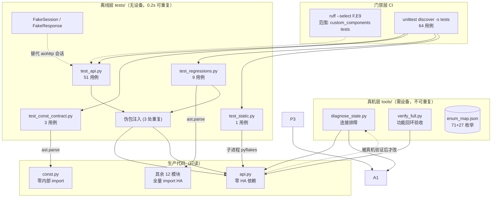
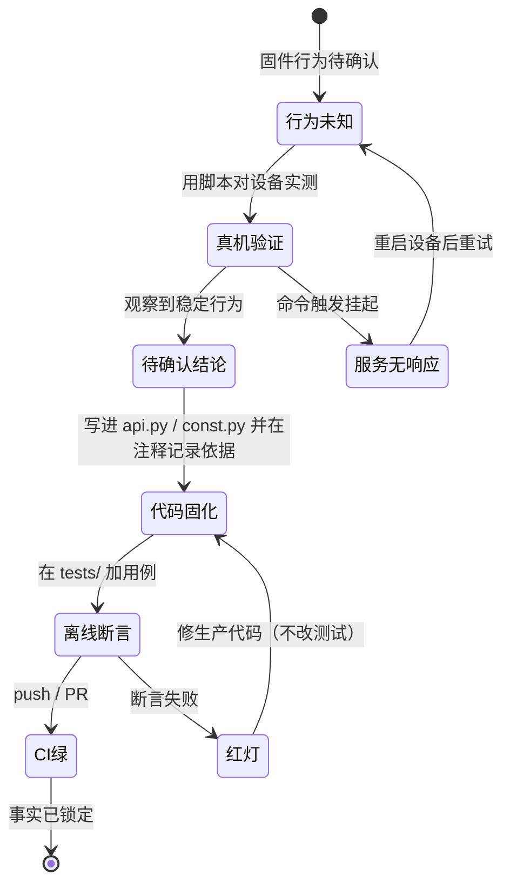
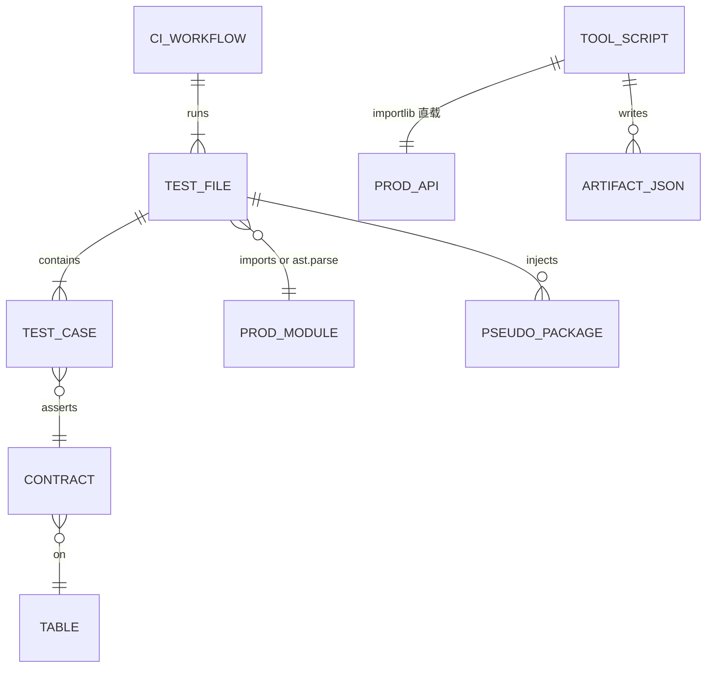
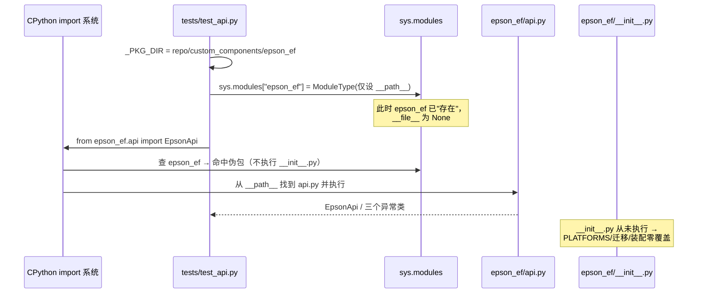
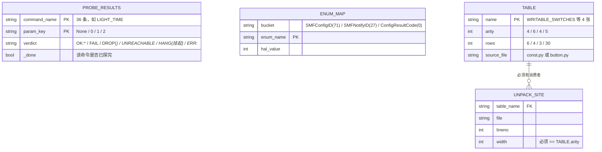
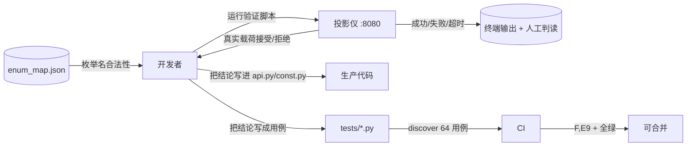

# 模块设计：验证与现场分析设施 (verification-harness)

## 模块定位与核心职责

- **一句话定义**：本模块是"让 3055 行生产代码在没有 Home Assistant、没有投影仪（测试部分）的条件下仍可被断言"的设施集合——它不产出运行时行为，只产出**可信度**。
- **核心业务/技术能力**：
  1. **离线断言**：64 个用例覆盖 Digest 握手、电源态三分判定、32 处命令载荷断言（分布在 20 个用例方法中，实测统计见下）、真机缺陷回归、4 张配置表的宽度契约、pyflakes 名字级检查。
  2. **真机回落**：20 个脚本用 `importlib` 直载生产 `api.py`（20/20），对着真实固件验证"代码写的字节 == 固件接受的字节"。
  3. **门禁执行**：唯一 CI 在 push/PR 上跑 `ruff --select F,E9` 与 `unittest discover`。
- **模块规模实测**：`tests/` 4 文件 / 1020 行；`tools/` 20 个 .py（2005 行）+ 1 个 .sh（56 行）+ 2 个 .json（306 行）+ README.md（55 行），`git ls-files tools` = 24 项；CI 1 文件 24 行。

## 内部架构与分层设计

- **分层模式**：**三层同心结构（按"离真实设备的距离"分层）**，而非传统 Controller/Service/Repository：
  - 外层 = 真机层（`tools/`），唯一接触固件，结论不可重复；
  - 中层 = 离线层（`tests/`），不接触设备、秒级可重复，锁住"已经学到的事实"；
  - 内层 = 门禁层（CI），只跑中层的一个子集，保证事实不倒退。
  这个方向不可颠倒：**真机先发现事实 → 离线测试把事实固化 → CI 阻止事实被改回去**。仓库的 commit 历史与文件时间戳与该顺序一致（脚本早于 `tests/test_api.py` 中对应的断言）。

- **核心组件与分工**：

| 组件/文件 | 职责描述 | 依赖 | 关键文件 |
|-|-|-|-|
| 伪包注入器（3 份复制） | 让 `import epson_ef.api/const` 绕过 `__init__.py` | `types.ModuleType` + `sys.modules` | `tests/test_api.py:23-26`、`tests/test_const_contract.py:21-24`、`tests/test_regressions.py:24-27` |
| 测试替身 `FakeSession`/`FakeResponse` | 记录请求、按序回放响应、注入异常 | 无（纯 Python） | `tests/test_api.py:40-77` |
| 载荷断言组 | 断言完整 payload 字典（`id`/`size`/`params`） | `FakeSession.calls` | `tests/test_api.py:218-504` |
| AST 契约检查器 | 表宽度 ↔ 解包宽度双向比对 | `ast`（不 import 被测模块） | `tests/test_const_contract.py:35-142` |
| AST 装配断言组 | 校验 `legacy` 清理表、`async_get_entity_id` 实参顺序 | `ast` + `ast.literal_eval` | `tests/test_regressions.py:96-180` |
| pyflakes 子进程检查 | 只挑 `undefined name`/`redefinition` | `pyflakes`（可缺失） | `tests/test_static.py:13-38` |
| 排障脚本 `diagnose_state.py` | 定位让设备 HTTP 服务挂起的命令 | `importlib` + aiohttp | `tools/diagnose_state.py` |
| 验收脚本 `verify_full.py` | 功能回环验收（会开关机） | 同上 | `tools/verify_full.py` |
| 枚举清单 `enum_map.json` | 固件命令枚举名 → 内部数值 | 纯 JSON | `tools/enum_map.json` |
| CI 门禁 | 2 条命令 + 3 个 pip 包 | GitHub Actions | `.github/workflows/tests.yml:1-24` |



## 核心领域模型与状态机

本模块没有业务实体，其"数据模型"是三张结构性事实表：

- **关键实体（Value Objects）**：

| 名称 | 形状 | 生产位置 | 验证位置 |
|-|-|-|-|
| `WRITABLE_SWITCHES` | 6 行 × 4 元组 | `const.py:53-66` | 宽度 4；解包点 `coordinator.py:92`、`switch.py:38` |
| `WRITABLE_SELECTS` | 4 行 × **6** 元组 | `const.py:75-92` | 宽度 6；解包点 `coordinator.py:97`、`select.py:40` |
| `AMBIENT_LIGHT_SWITCHES` | 3 行 × 4 元组 | `const.py:138-142` | 宽度 4；解包点 `switch.py:45` |
| `BUTTON_DEFS` | 30 行 × 5 元组 | `button.py:17-83` | 宽度 5；解包点 `button.py:96` |
| `STANDBY_MODE_OPTIONS` | dict 2 项 | `const.py:27-31` | 行为断言 `tests/test_api.py:282-296`（不在 AST 契约内） |
| `enum_map` | `{SMFConfigID: 71, SMFNotifyID: 27, ConfigResultCode: 0}` | `tools/enum_map.json` | 与生产代码 46 CONFIG + 20 NOTIFY 全命中 |

- **状态转换逻辑**：



> 分支冲突裁决规则（实测事实）：**红灯时修生产代码，不修测试**——`tests/test_const_contract.py:120-125` 的失败信息直接指明"this raises ValueError at runtime"，`tests/test_regressions.py:89-93` 的 `test_focus_step_unit_is_one` 明确写"常量若被改回 10 说明又回到了错误假设"（把测试当作事实声明而非实现细节）。

### 实体关系 (ER)



### 状态机

（见上状态机——本模块唯一的真状态机是"结论从设备迁移到 CI 的流转过程"。）

## 关键工作流与算法实现

### 流程 1：测试如何在无 HA 环境导入生产代码（伪包注入）



1. 计算 `_PKG_DIR`（`tests/test_api.py:17-18`）。
2. `sys.path.insert(0, str(_REPO_ROOT))`——这一行在 `test_api.py:19` 存在，但对伪包手法**并非必需**：实测在 `/tmp` 且不插 sys.path 时，仅靠 `__path__` 也能 `from epson_ef.api import EpsonApi` 成功（`epson_ef.__file__` 为 None）。
3. 注入伪包（`:23-26`），`if "epson_ef" not in sys.modules` 做了幂等保护——多文件同进程（discover/pytest）时只有第一个文件生效。
4. 正常 import（`:28-33`），`# noqa: E402` 是因为 import 在代码之后。

### 流程 2：AST 契约如何双向定位（表 ↔ 解包点）

1. **求宽度**（`tests/test_const_contract.py:39-52`）：`ast.walk` 找 `AnnAssign` 且 `target.id == 表名` 且 `value` 是 `List`/`Tuple`，取 `value.elts[0]` 的 `len(elts)`。不读类型注解，不执行代码。
2. **找解包点**（`:64-88`）：遍历包内全部 `*.py`，同时匹配 `ast.For`（语句式）与 `ast.comprehension`（推导式）。后者是必需的——`select.py:40` 与 `switch.py:38` 用的是列表推导式，只认 `ast.For` 会漏掉两个真实消费者（注释明说 `:68`）。
3. **过滤**：`target` 必须是"纯名字元组"（`all(isinstance(e, ast.Name))`），`_table_ref(node.iter)` 取最内层名字/属性名与表名比对（`:55-61`）。
4. **三向断言**：`test_tables_are_non_empty_and_rectangular`（非空 + 每行等宽）、`test_every_consumer_unpacks_full_width`（每个解包点宽度 == 表宽 + 至少存在一个消费者，否则报"table may be dead code"）、`test_known_consumer_locations`（6 个已知 (表,文件) 组合不得缺失）。

### 流程 3：真机探测脚本的启动序列（20/20 同构）

```python
ROOT = pathlib.Path(__file__).resolve().parents[1] / "custom_components" / "epson_ef"
pkg = types.ModuleType("epson_ef"); pkg.__path__ = [str(ROOT)]; sys.modules["epson_ef"] = pkg
spec = importlib.util.spec_from_file_location("epson_ef.api", str(ROOT / "api.py"))
mod = importlib.util.module_from_spec(spec); sys.modules["epson_ef.api"] = mod
spec.loader.exec_module(mod)
```

这段 7 行样板在 20 个脚本中逐字重复（`awk` 实测每文件 7 行、20/20 命中）。它和测试的伪包手法解决同一个问题（`api.py` 的相对 import `from .const import ...` 需要一个已注册的父包），但用的是**双保险**：既注入伪包，又用 `sys.modules["epson_ef.api"] = mod` 预登记，再 `exec_module`。

## 设计模式

| 模式 | 应用位置 | 解决的问题 | 关键文件 | 说明 |
|-|-|-|-|-|
| Test Double（手写 Fake，非 Mock 框架） | `FakeResponse` / `FakeSession` | 不引入 `aioresponses` 等第三方，只依赖 `aiohttp` 已必须安装 | `tests/test_api.py:40-77` | `FakeSession.post` 同时充当"记录器"与"队列"，断言直接读 `session.calls` |
| 结构化静态契约（AST-as-assertion） | `test_const_contract.py`、`test_regressions.py` | 被测模块 import 即拉入 HA，无法用常规断言 | `tests/test_const_contract.py:35-88` | 把"运行时才会炸的错误"提前为"解析文本即可判定" |
| 伪包注入（Import Shim） | 3 处测试 + 20 处工具 | 绕过包 `__init__.py` 的副作用 | `tests/test_api.py:23-26`、`tools/diagnose_state.py:11-18` | 比 `sys.path` 技巧更精确：只屏蔽包入口，不屏蔽模块本体 |
| 探测即固化 | 真机脚本 → `api.py`/`const.py` 注释 → `tests/test_api.py` | 真机结论易失，需在下次改动前固化 | `tests/test_api.py:299-504` | 每条实测结论都有对应用例 |
| Golden Payload（整包字典断言） | `tests/test_api.py` 的 20 个方法 / **32 处** `session.calls[n]["json"]` 断言（实测统计） | 只断单字段会漏掉"多写/少写字段" | `tests/test_api.py:224`、`:232`、`:243` | 代价是加字段要改多处 |
| Regression Fixture from Incident | `tests/test_regressions.py` 的 5 个类 | 真机事故不复现 | 各用例 docstring | 每个类对应一次真机缺陷 |

## 数据设计

### 2.1 核心数据模型



### 2.2 存储与持久化设计

| 存储 | 载体 | 写入方 | 读取方 | 一致性 |
|-|-|-|-|-|
| 枚举映射 | `tools/enum_map.json`（只写一次，手工维护） | 固件静态提取（一次性） | `tools/enum_map.json` | 只读存档 |

> 不适用：无数据库、无缓存层、无迁移脚本。本模块不引入任何持久化依赖。

### 2.3 缓存策略

不适用（验证脚本不缓存中间结果）。

### 数据流图



## 接口契约

### 外部接口

| 名称 | 描述 | 请求方式 | 请求参数 | 返回参数 | 错误码 |
|-|-|-|-|-|-|
| 离线测试入口 | 全量跑 64 用例 | `python3 -m pytest tests/ -q` 或 `python3 -m unittest discover -s tests -v` | 无 | `64 passed` / `Ran 64 tests ... OK` | 失败用例 → rc=1 |
| 单文件直跑 | 只跑该文件的类（**注意会漏跑**） | `python3 tests/<file>.py` | 无 | `Ran 42/3/7/1 tests`（实测） | rc=0（即使漏跑） |
| 真机探测 | 对设备发 pjctl 命令 | `python3 tools/<script>.py <投影仪IP> [port] [短名,...]` | `argv[1]` 或 `EPSON_HOST` | 人读文本 | 无统一码：用法错误 `sys.exit(非0)`（12 处），逻辑失败 rc=0 |
| CI 门禁 | 自动 lint + test | GitHub `push` / `pull_request` | — | Actions 结论 | step 失败 → workflow 失败 |

### 内部接口

| 名称 | 描述 | 调用方 | 提供方 | 请求参数 | 返回参数 |
|-|-|-|-|-|-|
| 伪包注入 | 提供可导入的 `epson_ef` 父包 | 3 个测试文件 | `tests/*` 自身（无共享 helper） | 包目录路径 | 已注册的 ModuleType |
| `FakeSession.post(url, **kw)` | 记录请求并回放下一个响应 | 全部载荷/握手用例 | `tests/test_api.py:73-77` | url + kwargs（含 json/headers/timeout） | `FakeResponse` |
| `_table_arity(name)` | 求表宽度 | 3 个契约用例 | `tests/test_const_contract.py:39-52` | 表名 | int |
| `_unpack_arities(name)` | 找全部解包点 | 契约用例 | `tests/test_const_contract.py:64-88` | 表名 | `[(file, lineno, width)]` |
| `mod.EpsonApi` | 直载的生产客户端 | 20 个工具脚本 | `importlib` 手工 exec | host, port | 实例 |

### 配置接口

| 名称 | 描述 | 类型 | 默认值 | 取值范围 |
|-|-|-|-|-|
| `EPSON_HOST` | 工具脚本的设备地址 | 环境变量 | 两个脚本均从 `argv[1]` 或 `EPSON_HOST` 读取；缺失时打印用法并以非零码退出，无默认值 | 任意可达主机 |
| `argv[1]` | 同上，优先级最高 | 位置参数 | — | 同上 |
| `argv[2]` | 端口 | 位置参数 | 默认 8080 | 整数 |
| `argv[3]` | 命令短名过滤器（逗号分隔） | 位置参数 | 全部 | `ALL` 的子集 |
| CI `python-version` | CI 的 Python 版本 | workflow 字面量 | `"3.13"`（`.github/workflows/tests.yml:15`） | 固定，无矩阵 |

### 错误码与异常定义

| 错误码 | 协议层状态 | 含义 | 触发场景 | 处理建议 |
|-|-|-|-|-|
| `EpsonApiTimeout` | 传输层异常 | 单次请求超时 | 深待机、服务器卡死 | 工具里映射为 `TIMEOUT`/`HANG` |
| `EpsonApiCommandFailed` | 应用层 | `resultCode != 0` | 命令不被固件接受（待机/参数错） | 映射为 `FAIL` |
| `EpsonApiError` | 传输层/协议 | 401 无法解析、HTTP 非 200、坏 JSON | 挑战格式异常、5xx | 映射为 `ERR:*` |
| `unittest.skipTest` | 测试框架 | `pyflakes` 缺失 | 精简环境 | **静默降级**：rc 仍为 0 |

## 实测验证（本模块最重要的证据）

> 环境：macOS + Python 3.13.13 + pytest 9.1.1 + aiohttp 3.14.5 + pyflakes 4.1.0 + ruff 0.15.15。全部命令在 `/Users/li/Projects/ha-epson-ef-projector` 下执行，`base_commit = 2ac3d73`。

### 命令 × 真实输出 × 退出码

| # | 命令 | 真实输出（摘要） | 退出码 | 结论 |
|-|-|-|-|-|
| 1 | `python3 -m pytest tests/ -q` | `................................................................ [100%]`<br/>`64 passed in 0.20s` | 0 | 全绿；但 **pytest 未声明为依赖**（无 requirements/pyproject，CI 不装） |
| 2 | `python3 -m unittest discover -s tests -v` | `Ran 64 tests in 0.177s`<br/>`OK` | 0 | 与 CI 完全同款；唯一能跑满 64 的方式 |
| 3 | `python3 tests/test_api.py` | `..........................................`<br/>`Ran 42 tests in 0.024s` → `OK` | 0 | **只跑 42/51**：`unittest.main()` 在 `:507-508`，其后的 `FocusAbsoluteTests`(3)、`ReadHelperTests`(4)、`PowerStateTests`(2) 共 **9 个用例被跳过** |
| 4 | `python3 tests/test_const_contract.py` | `Ran 3 tests in 0.085s` → `OK` | 0 | 3/3 全跑（`unittest.main()` 在文件末尾 `:145-146`） |
| 5 | `python3 tests/test_regressions.py` | `Ran 7 tests in 0.006s` → `OK` | 0 | **只跑 7/9**：`unittest.main()` 在 `:183-184`，其后的 `UnreachableProjectorTests`(2) 被跳过 |
| 6 | `python3 tests/test_static.py` | `Ran 1 test in 0.042s` → `OK` | 0 | 1/1；本机装了 pyflakes 才真正执行 |
| 7 | `ruff check custom_components tests --select F,E9` | `All checks passed!` | 0 | CI 同款；范围**不含 tools/** |
| 9 | `python3 -c "import homeassistant"` | `ModuleNotFoundError: No module named 'homeassistant'` | **1** | 本机与 CI 同构：HA 层不可测 |

### 用例分布（AST 精确统计，非估算）

| 文件 | 行数 | 用例数 | 类 → 用例数 | 直跑是否跑满 |
|-|-|-|-|-|
| `tests/test_api.py` | 613 | **51** | `DigestTests`(100)→3、`RequestTests`(120)→6、`ProbeTests`(165)→6、`PayloadTests`(218)→7、`StandbyModeMappingTests`(282)→2、`Round4Tests`(299)→7、`Round5Tests`(354)→6、`Round6Tests`(425)→5、`FocusAbsoluteTests`(511)→3、`ReadHelperTests`(569)→4、`PowerStateTests`(595)→2 | ❌ 42/51（漏 9） |
| `tests/test_const_contract.py` | 146 | **3** | `ConstContractTests`(91)→3 | ✅ 3/3 |
| `tests/test_regressions.py` | 219 | **9** | `FocusPositioningTests`(38)→3、`LegacyEntityCleanupTests`(96)→2、`EntityRegistryApiTests`(141)→1、`CoordinatorContractTests`(173)→1、`UnreachableProjectorTests`(186)→2 | ❌ 7/9（漏 2） |
| `tests/test_static.py` | 42 | **1** | `StaticAnalysisTests`(12)→1 | ✅ 1/1 |
| **合计** | **1020** | **64** | **18 个测试类**（AST 实测：test_api 11 + test_const_contract 1 + test_regressions 5 + test_static 1；另有 2 个非测试类 `FakeResponse`/`FakeSession`） | 直跑合计 **53/64** |

> 注意 `unittest.main()` 缺陷的**双向后果**：
> - 直跑 4 个文件总和 = 42+3+7+1 = **53**，比 discover 的 64 少 **11**（9 + 2），但 4 条命令**全部 rc=0**——开发者看到 4 个 OK 会以为全绿。
> - `python3 -m unittest tests.test_api`（模块式调用）**不做 `__main__` 判定**，实测 `Ran 51 tests`，因此"用 discover 还是用模块路径"才是关键，`python3 tests/x.py` 才是危险路径。
> - pytest 单文件收集同样是 51 个（`pytest tests/test_api.py --collect-only -q` → `51 tests collected`），因为 pytest 不执行 `unittest.main()`。

### 伪包手法的副作用（实测）

| 观测项 | 命令 | 结果 |
|-|-|-|
| 无伪包时能否导入 | `python3 -c "import sys; sys.path.insert(0,'custom_components'); import epson_ef.button"` | `ModuleNotFoundError: No module named 'homeassistant'`（栈顶 `__init__.py:6`），rc=1 |
| 有伪包时能否导入 | 同上 + 手工注入 | `OK <class 'epson_ef.api.EpsonApi'>` |
| 伪包是否必要 | 在 `/tmp` 下不插 `sys.path`、只设 `__path__` | 成功；`epson_ef.__file__` 为 `None`（说明 `__init__.py` 从未执行） |
| 测试实际 import 了哪些生产模块 | 用 `sys.modules` 过滤 discover 结束后的状态 | 仅 `['epson_ef', 'epson_ef.api', 'epson_ef.const']`——**14 个生产模块中只执行了 2 个** |
| 12 个 HA 依赖模块的可导入性 | 逐个 `import custom_components.epson_ef.<mod>` | 12/12 全部 rc=1 |

### pyflakes 缺失时的行为（实测）

| 场景 | 命令/手法 | 结果 |
|-|-|-|
| 正常（装了 pyflakes 4.1.0） | `python3 -m unittest tests.test_static -v` | `Ran 1 test ... OK`，rc=0 |
| 屏蔽 pyflakes 后 | 注入 `MetaPathFinder` 对 `pyflakes` 抛 ImportError | `skipped 'pyflakes not installed'`，`Ran 1 test ... OK (skipped=1)`，**rc=0**，`skipped=1 failures=0 errors=0` |

### tools/ 的现状

| 事实 | 证据 |
|-|-|
| 只保留两个脚本 | `tools/diagnose_state.py`（连接排障）、`tools/verify_full.py`（真机验收），另有 `enum_map.json` |
| 设备地址无默认值 | 均从 `argv[1]` 或 `EPSON_HOST` 读取，缺失时打印用法并以非零码退出 |
| 逻辑失败不进入退出码 | 两个脚本只在用法错误时 `sys.exit(...)`；验收失败仅打印结果，不适合作为自动化门禁 |
| 不在 CI lint 范围内 | `.github/workflows/tests.yml:21` 只查 `custom_components tests` |

### CI 门禁的覆盖边界

| 维度 | 事实 | 证据 |
|-|-|-|
| 触发 | `push`（所有分支）+ `pull_request` | `.github/workflows/tests.yml:3-5` |
| 运行环境 | `ubuntu-latest` + Python `3.13` | `:9`, `:15` |
| 安装的包 | `aiohttp ruff pyflakes`（**不装 homeassistant**，全部不锁版本） | `:18` |
| lint 范围 | `custom_components tests`（**不含 tools/**），规则 `F,E9`（仅 pyflakes 类 + 语法错误） | `:21` |
| 测试命令 | `python -m unittest discover -s tests -v`（64 用例） | `:24` |
| 是否跑 pytest | 否（本地能跑纯属环境自带） | — |
| 是否跑 hassfest / HACS 校验 | **否**（无 `hassfest.yml`，`.github/workflows/` 仅此 1 文件） | `ls .github/workflows/` |
| 是否跑真机脚本 | 否 | — |
| 是否检查版本号/manifest | 否 | — |

## 开发指南

### 洞察

- **本模块的正确性由"它能否在坏代码上变红"定义，而不是"它是否全绿"。** `tests/test_const_contract.py:1-9` 记录了它存在的唯一理由：静态检查与既有单测都没抓到 5→6 元组扩宽，真机部署后全实体 unavailable。测试有效性通过"注入 bug → 测试必须失败"的方式验证过——这是本项目唯一有记录的"测试有效性验证"。
- **隔离手法决定了覆盖形状。** 因为绕过了 `__init__.py`，所以覆盖恰好是"零 HA 依赖的那两个模块"（`api.py`、`const.py`）加上"能被 AST 静态读出的装配约束"。这不是偶然：`api.py` 开头就写明了 `Pure aiohttp + stdlib; no Home Assistant imports so it can be tested standalone.`（`api.py:1-4`）——**可测性是设计出来的，不是测试补出来的**。
- **真机结论的固化有固定节拍**：真机实测 → 记录到 `api.py`/`const.py` 注释 → 在 `tests/test_api.py` 加用例。断言中保留设备型号与实测数值（`tests/test_api.py:300`, `:355-356`, `:426-427`）。
- **本模块是唯一能"证伪"其他模块的地方**：`tests/test_regressions.py:89-93` 用断言锁死一个数值常量（`FOCUS_STEP_UNIT == 1`），把"曾经错过的假设"变成编译期不可回退的事实。

### 扩展指南

**新增一条命令的验证（最常见的改动）**：
1. 真机确认：基于 `tools/diagnose_state.py` 的 importlib 样板写最小验证脚本，记录设备实际接受的 `size`/`params`。
2. 在 `api.py` 加高层方法（若需要）。
3. 在 `tests/test_api.py` 加载荷断言：构造 `make_api([challenge(), ok(...)])`，`await` 方法，断言 `session.calls[1]["json"]` 整包相等（参照 `:218-244`）。
4. 若有"失败也合法"的路径（如待机返回 None），补一个 `fail()` 分支断言（参照 `:273-275`）。
5. 跑 `python3 -m unittest discover -s tests -v`（**不要**用 `python3 tests/test_api.py`）。

**新增一张配置表**：
1. 在 `const.py` 定义 `AnnAssign` 形态的 `NAME: list[tuple] = [...]`（契约检查器只认这个形态，`tests/test_const_contract.py:41-47`）。
2. 把表名加进 `TABLE_SOURCES`（`:27-32`），值填 `"const.py"` 或 `"button.py"`。
3. 至少有一个 `for ... in NAME` 或推导式消费者，否则 `test_every_consumer_unpacks_full_width` 会报 "has no consumer — table may be dead code"。
4. 把 (表名, 消费者文件名) 加进 `test_known_consumer_locations` 的 `expected`（`:129-136`），否则位置漂移不会被拦。

**新增一个 CI 门禁项**：
1. 只在 `.github/workflows/tests.yml` 加 step；仓库没有 ruff/pytest 配置文件，所有规则必须写在命令行。
2. 若要覆盖 `tools/`，把 `:21` 改为 `ruff check .` 即可——当前全仓 `ruff check .` 已通过。

### 风格与约定

| 约定 | 现状 | 证据 |
|-|-|-|
| 测试框架 | 只用 stdlib `unittest`（含 `IsolatedAsyncioTestCase`），不引 pytest 特性 | `tests/test_api.py:120`、`:165`、`:218` |
| 断言风格 | 载荷类用整包 `assertEqual(dict, dict)`；语义类用 `assertRaises` + 后置状态断言 | `:224`、`:141-150` |
| 测试替身 | 手写 Fake，不用 `unittest.mock` 替代 HTTP（`mock` 只用于 patch `asyncio.sleep` 与方法） | `:13`、`:546-548` |
| 时间控制 | 一律 `patch("asyncio.sleep", new=AsyncMock())`，不真的等 | `:178`、`:548`、`:602-603` |
| 地址 | 测试用 TEST-NET 段 `192.0.2.10` / `203.0.113.1` / `203.0.113.9`（RFC 5737），**但 docstring 里仍留真实内网 `192.168.61.250`**（`tests/test_regressions.py:192`） | 同上 |
| 中文注释 | 测试脚本使用中文说明命令语义与实测数据 | `:300`、`:355` |
| 工具脚本样板 | 7 行 importlib 引导逐字重复，**无共用 helper** | 20/20 文件 |
| 工具输出 | 人读文本 + emoji（`✅`/`❌`），无机器可读输出 | `verify_full.py` |

### 设计哲学

- **「无 HA 优先」而非「模拟 HA」**：整个仓库没有 `conftest.py`、没有 fixture、没有 `pytest-homeassistant-custom-component`。面对"测试需要 HA 但环境没有 HA"，选择的是**删掉被测对象的 HA 依赖**（`api.py` 零 import HA）而不是**伪造 HA**。这在 3055 行 / 58 实体的规模下是理性的，但代价明确：装配层零覆盖（`__init__.py` 221 行、7 个平台文件全部不可测）。
- **「静态契约优于运行时断言」**：凡是"导入即爆炸"的耦合，就用 AST 而不是 import 去检查（`test_const_contract.py`、`test_regressions.py` 的三个 AST 类）。这让 CI 在没有 HA 的情况下仍能覆盖 12 个 HA 依赖模块里的**结构性约束**（表宽度、清理表内容、实参顺序、调用存在性）。
- **「一个 workflow、两条命令」**：不做矩阵、不做版本交叉、不做 hassfest。门禁的野心被刻意压到"只要能拦住语法错误与解包宽度错误"。实测效果：`ruff check .` 有 3 个错误、`tools/` 一跑即 NameError、11 个用例可被漏跑，CI 依然全绿。
- **「真机是唯一事实源，脚本是它的临时探针」**：`tools/` 的 20 个脚本从不被 CI 执行、从不被生产 import、彼此不共享代码，允许腐化。这是主动取舍：脚本的生命周期只有"一轮现场分析"，用完即弃，不值得工程化。

### 修改检查清单

- [ ] 改 `const.py` 任何元组表后：`python3 -m unittest discover -s tests -v` 是否 64 全绿？（**不要**只跑 `python3 tests/test_const_contract.py` 就放心）
- [ ] 改 `api.py` 任一高层方法后：对应载荷断言是否仍断言**整包字典**？失败信息是否仍指向"应该改生产代码"而不是改断言？
- [ ] 新增测试文件/类后：`unittest.main()` 是否在**文件最末尾**？直跑数与 discover 数是否一致？
- [ ] 新增/改测试后：`python3 -m pytest tests/ -q` 与 `python3 -m unittest discover -s tests -v` 的用例数是否都是 64（pytest 收集 64、unittest 运行 64）？
- [ ] 修改 `tools/` 任何脚本后：`ruff check tools` 是否干净？（CI 不会替你检查）
- [ ] 新增工具脚本后：是否使用了 `sys.argv[1]` 或 `EPSON_HOST`？**是否引入了默认 IP**？是否 `await api.close()`？
- [ ] 修改 CI workflow 后：`tools/` 是否仍被排除？是否会因为 `ruff check .` 的既存 3 个错误而变红？
- [ ] 任何"真机验证通过"的结论：是否附了设备型号 + 日期 + 具体命令（如 `tests/test_api.py:300` 的写法）？
